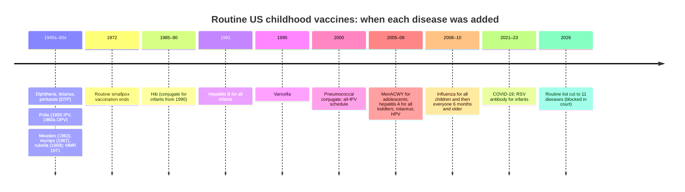

# Schedules over time

**Prerequisites:** [The US schedule](02-the-us-schedule.md); [Hib and the conjugate revolution](../04-history/11-hib-and-the-conjugate-revolution.md)

## From three diseases to seventeen

In the early 1980s a US child was routinely vaccinated against seven diseases: diphtheria, tetanus, pertussis, polio, measles, mumps and rubella, with DTP shots, oral polio drops and MMR. Smallpox vaccination had ended in 1972. Over the next 40 years, vaccines were added as they were invented and recommended, as shown above. By 2024 the routine schedule covered about 17 diseases, with around 30 injections by age two depending on products, plus annual flu vaccines.

Other countries followed a similar arc at different speeds. The WHO's Expanded Programme on Immunization, launched in 1974, began with six diseases (diphtheria, tetanus, pertussis, polio, measles, tuberculosis) and now recommends vaccines against about a dozen for all children, with more for specific regions ([WHO, "WHO recommendations for routine immunization: summary tables"](https://www.who.int/teams/immunization-vaccines-and-biologicals/policies/who-recommendations-for-routine-immunization---summary-tables)).

## Fewer antigens, more vaccines

The number of injections rose, but the number of antigens (the distinct proteins and polysaccharides the immune system must respond to) fell. The whole-cell pertussis vaccine alone contained about 3,000 antigens, and smallpox vaccine about 200. A 2002 analysis estimated that the 1980 schedule exposed children to more than 3,000 antigens, while the much longer 2000 schedule contained about 123–126, because acellular pertussis and purified subunit vaccines contain only a handful each ([Offit et al., *Pediatrics* 2002](https://doi.org/10.1542/peds.109.1.124)). The same paper's estimate that an infant could in theory respond to about 10,000 vaccines at once is often quoted; it is a theoretical calculation, not an experimental finding. The lead author, Paul Offit, co-invented the RotaTeq rotavirus vaccine, a conflict of interest critics often raise (see [conflicts of interest and funding](../07-controversies/14-conflicts-of-interest-and-funding.md)).

## Removals and switches

Schedules also lose vaccines:

- **Smallpox** (1972 in the US) as the disease receded.
- **RotaShield** (1999) after intussusception was linked to it, only a year after it was recommended ([Murphy et al., *NEJM* 2001](https://doi.org/10.1056/NEJM200102223440804)).
- **Oral polio vaccine** (2000 in the US) because, once wild polio was gone, the rare vaccine-associated paralytic polio it caused outweighed its advantages.
- **Whole-cell pertussis** replaced by acellular vaccine in the 1990s in rich countries, trading some effectiveness for fewer side effects.
- **Live attenuated influenza vaccine** was not recommended in the US for two seasons (2016–18) after poor effectiveness.
- **Thimerosal** removed from childhood vaccines as a precaution from 1999 ([CDC, "Notice to readers: thimerosal in vaccines: a joint statement of the American Academy of Pediatrics and the Public Health Service", *MMWR* 1999;48(26):563–565](https://www.cdc.gov/mmwr/preview/mmwrhtml/mm4826a3.htm)); see [thimerosal and autism](../07-controversies/02-thimerosal-and-autism.md).

## Why the schedule grew

The growth reflects new technology (conjugate, recombinant and mRNA vaccines), new knowledge of disease burden (rotavirus, HPV-related cancers), and changing judgement about which diseases are worth preventing in all children rather than risk groups. The US often adopted vaccines universally where other countries targeted them (hepatitis A and B, influenza), partly because targeted programmes failed to reach many high-risk people.

## Why some think it grew too much

Critics argue that the cumulative schedule has never been tested as a whole against an unvaccinated group, that each addition was judged on its own, and that liability protection for manufacturers after 1986 removed a brake on growth (see [[the-national-childhood-vaccine-injury-act-1986|the 1986 Act]]). Defenders note that each vaccine was tested with existing ones, that the IOM in 2013 found no evidence of harm from the schedule as a whole, and that diseases prevented by the additions (Hib meningitis, rotavirus hospitalisations, invasive pneumococcal disease) fell sharply after each was introduced ([Institute of Medicine, *The Childhood Immunization Schedule and Safety* (2013)](https://doi.org/10.17226/13563)). The 2026 US cuts were the first large-scale reversal of this trend.

## Key ideas

- The US childhood schedule grew from seven diseases in the early 1980s to about 17 by 2024.
- Antigen counts fell, because new vaccines are more purified.
- Vaccines are removed when risks outweigh benefits or diseases disappear.
- Whether the growth was well judged is the core of the "too many, too soon" debate.

## Where this leads

- Next: [Pregnancy, adult and travel vaccination](08-pregnancy-adult-and-travel-vaccination.md); see [too many, too soon](../07-controversies/07-too-many-too-soon.md).
