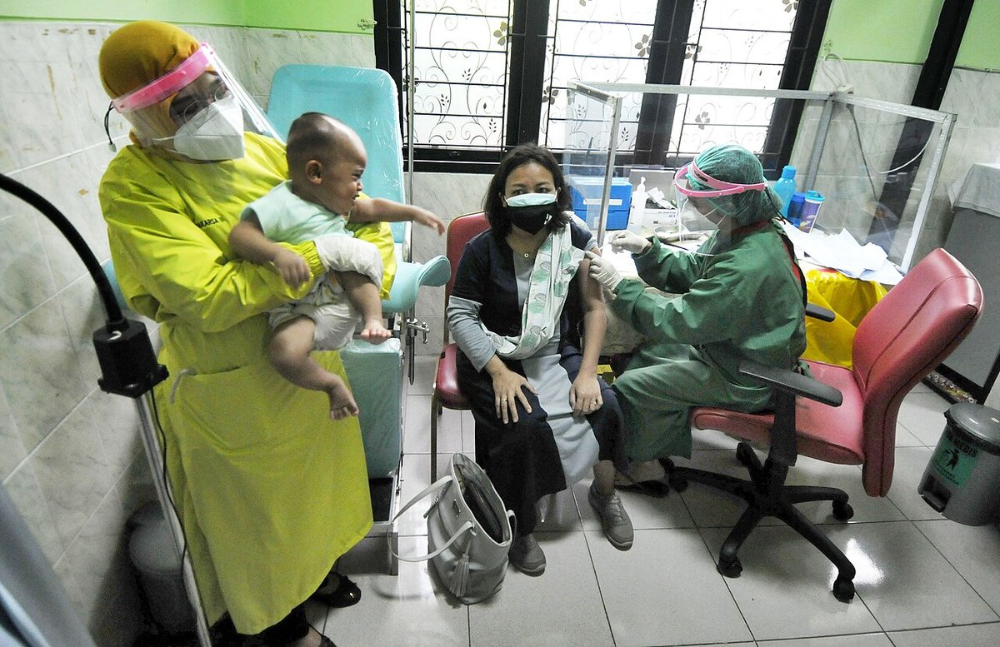

# Pregnancy, adult and travel vaccination

**Prerequisites:** [How schedules are built](01-how-schedules-are-built.md); [Passive and active immunity](../../08-passive-and-active-immunity.md)

*Paramedics vaccinate pregnant women against COVID-19 at a health centre in South Jakarta, Indonesia. Credit: Arie Basuki. License: [CC BY-SA 4.0](https://creativecommons.org/licenses/by-sa/4.0). Source: [File:Pregnant women vaccination.jpg](https://commons.wikimedia.org/wiki/File:Pregnant_women_vaccination.jpg).*

## Vaccinating in pregnancy

Pregnancy vaccination has two aims: protecting the mother, who is at higher risk from some infections (influenza, COVID-19), and protecting the newborn through antibodies that cross the placenta in the last trimester ([passive immunity](../../08-passive-and-active-immunity.md)). This "cocooning from within" covers the months before a baby can be vaccinated.

- **Pertussis (Tdap)** in every pregnancy, ideally in the late second or early third trimester (27–36 weeks in the US; from 16 weeks in the UK). After England began maternal pertussis vaccination in 2012, effectiveness against infant pertussis in the first two months was estimated at about 91% ([Amirthalingam et al., *Lancet* 2014](https://doi.org/10.1016/S0140-6736(14)60686-3)), and a Kaiser Permanente study of about 149,000 US newborns estimated 91% effectiveness in the first two months, though with a very wide confidence interval (19.5–99.1%) because cases were few ([Baxter et al., *Pediatrics* 2017](https://doi.org/10.1542/peds.2016-4091)). The English study was by the government's public health agency; two Kaiser authors disclosed conflicts of interest relating to the vaccines' manufacturers (GlaxoSmithKline and Sanofi Pasteur). The two studies, with different funders and designs, agree.
- **Influenza** in any trimester during flu season.
- **RSV**: a maternal RSV vaccine (Abrysvo) given at 32–36 weeks in the US (from 28 weeks in the UK) protects infants; the alternative is giving the baby the long-acting antibody nirsevimab. A small imbalance in preterm births in some trials led US regulators to restrict the vaccination window ([Kampmann et al., *NEJM* 2023](https://doi.org/10.1056/NEJMoa2216480)).
- **COVID-19**: recommended in pregnancy by most agencies through 2024. In May 2025 the US HHS Secretary removed the CDC's routine recommendation for healthy pregnant women; medical societies such as the American College of Obstetricians and Gynecologists continued to recommend it.
- **Live vaccines** (MMR, varicella, yellow fever except in high-risk situations) are avoided in pregnancy because of a theoretical risk to the fetus, though inadvertent vaccination has not been shown to cause harm and is not a reason to end a pregnancy ([CDC, *General Best Practice Guidelines for Immunization*: contraindications and precautions](https://www.cdc.gov/vaccines/hcp/imz-best-practices/contraindications-precautions.html)). Rubella immunity is checked before or during pregnancy and MMR given after birth if needed.

## Adults

Adult schedules get less attention, and coverage is generally lower. Typical recommendations in North America and the UK include:

- **Tetanus and diphtheria** boosters every 10 years (US, Canada), with one adult dose of Tdap; the UK stops after five lifetime doses.
- **Influenza** every year (all adults in the US and Canada; over 65s and risk groups in the UK); **COVID-19** for older and high-risk adults.
- **Shingles** (recombinant Shingrix, two doses): from 50 in the US, 65–70 in the UK and Ontario.
- **Pneumococcal**: from 50 in the US (since 2024), 65 in Canada and the UK.
- **RSV**: from 75 and for at-risk people aged 50–74 or 60–74.
- **HPV** catch-up to age 26 in the US and Canada.
- **Hepatitis B** for all adults up to 59 in the US since 2022; risk-based elsewhere.
- **Catch-up** of any missed childhood vaccines, particularly MMR for adults born after 1970 (1957 in the US) without immunity.

## Catching up

Missed doses do not mean starting again. A key rule in every guide is that **interrupted series are resumed, not restarted**, because immune memory persists. Catch-up schedules use minimum ages and intervals to complete protection quickly, and some vaccines (Hib, pneumococcal) need fewer doses in older children because the risk falls with age ([Public Health Agency of Canada, *Canadian Immunization Guide*: recommended immunization schedules](https://www.canada.ca/en/public-health/services/publications/healthy-living/canadian-immunization-guide-part-1-key-immunization-information/page-13-recommended-immunization-schedules.html)).

## Travel vaccines

Travel medicine adds vaccines for diseases rare at home:

- **Yellow fever** is the only vaccine that countries may require under the International Health Regulations; a single dose gives lifelong protection and is recorded on an international certificate ([WHO yellow fever fact sheet](https://www.who.int/news-room/fact-sheets/detail/yellow-fever)).
- **Meningococcal ACWY** is required by Saudi Arabia for Hajj and Umrah pilgrims.
- **Hepatitis A**, **typhoid**, **Japanese encephalitis**, **rabies** (pre-exposure), **cholera**, **dengue** (in some cases), **polio** boosters for some countries, and **measles** catch-up are recommended depending on destination and activities. See [the disease pages](../03-diseases/README.md).

## Key ideas

- Pregnancy vaccines protect newborns through placental antibodies; pertussis, flu and RSV are the main ones.
- Live vaccines are avoided in pregnancy.
- Adult vaccines include tetanus boosters, flu, shingles, pneumococcal and RSV; coverage is lower than in children.
- Interrupted series are resumed, not restarted.

## Where this leads

- Next: [Contraindications and precautions](09-contraindications-and-precautions.md).
