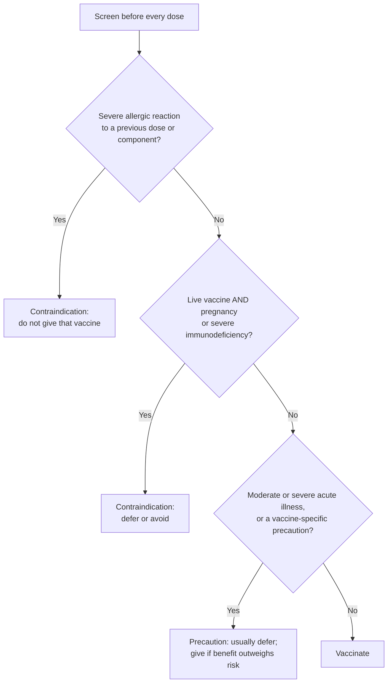

# Contraindications and precautions

**Prerequisites:** [How schedules are built](01-how-schedules-are-built.md); [Live attenuated vaccines](../01-how-vaccines-work/03-live-attenuated-vaccines.md)

## Two categories

Every vaccine guide distinguishes ([CDC, *General Best Practice Guidelines for Immunization*: contraindications and precautions](https://www.cdc.gov/vaccines/hcp/imz-best-practices/contraindications-precautions.html); [Public Health Agency of Canada, *Canadian Immunization Guide*: contraindications and precautions](https://www.canada.ca/en/public-health/services/publications/healthy-living/canadian-immunization-guide-part-2-vaccine-safety/page-3-contraindications-precautions-concerns.html)):

- A **contraindication** is a condition that greatly increases the risk of a serious adverse reaction. The vaccine should not be given.
- A **precaution** is a condition that might increase the risk of a reaction, confuse diagnosis, or reduce the vaccine's effect. Vaccination is usually deferred but may go ahead if the benefit outweighs the risk, for example during an outbreak.

Most contraindications are temporary or specific to one vaccine, so true reasons never to vaccinate at all are rare.

## Contraindications

- **Severe allergic reaction (anaphylaxis)** to a previous dose or to a vaccine component. This applies to every vaccine. See [anaphylaxis](../06-adverse-events/03-anaphylaxis.md).
- **Live vaccines in severe immunodeficiency**: people with conditions such as severe combined immunodeficiency (SCID), leukaemia under treatment, or high-dose immunosuppressive drugs should not receive live vaccines (MMR, varicella, BCG, yellow fever, oral typhoid, live flu), because the weakened vaccine microbes can cause disease.
- **Live vaccines in pregnancy** (see [pregnancy vaccination](08-pregnancy-adult-and-travel-vaccination.md)).
- **Encephalopathy within seven days** of a pertussis-containing vaccine, not explained by another cause, contraindicates further pertussis vaccine.
- **Rotavirus vaccine**: SCID, or a history of intussusception ([intussusception](../06-adverse-events/05-intussusception-and-rotavirus-vaccines.md)).
- **Dengue (Dengvaxia)**: no laboratory evidence of previous dengue infection, because the vaccine increases the risk of severe dengue in people never infected ([[dengvaxia-in-the-philippines|Dengvaxia]]).

## Precautions

- **Moderate or severe acute illness**, with or without fever, for all vaccines.
- **Guillain-Barré syndrome within six weeks** of a previous influenza or tetanus-containing vaccine ([GBS](../06-adverse-events/06-guillain-barre-syndrome.md)).
- **Recent blood products or immunoglobulin** for MMR and varicella, which antibodies can neutralise.
- **Personal or family history of seizures** for the first MMRV dose, because MMRV doubles the risk of febrile seizures compared with separate vaccines ([Klein et al., *Pediatrics* 2010](https://doi.org/10.1542/peds.2010-0665)).
- **Progressive or unstable neurological disorders** for pertussis vaccine until the condition is clarified.
- **History of myocarditis** after an mRNA COVID-19 vaccine ([myocarditis](../06-adverse-events/08-myocarditis-and-mrna-vaccines.md)).

## Things that are not contraindications

Guides list common misconceptions that lead to missed vaccinations: mild illness (such as a cold) with or without fever; current antibiotics; prematurity (preterm babies are vaccinated by age, not due date, with some hepatitis B exceptions); a family history of seizures, SIDS or adverse events (except as noted for MMRV); breastfeeding; recent exposure to an infection; non-vaccine allergies; and stable neurological conditions such as cerebral palsy ([CDC, *General Best Practice Guidelines for Immunization*: contraindications and precautions](https://www.cdc.gov/vaccines/hcp/imz-best-practices/contraindications-precautions.html)).

**Egg allergy** was once a reason to avoid flu and MMR vaccines. Current guidance in the US, Canada and the UK is that people with egg allergy, even severe, can receive flu vaccine in any setting appropriate for their age, and MMR (grown in chick embryo cells, not eggs) contains negligible egg protein. Yellow fever vaccine still contains egg protein and needs specialist assessment.

## Medical exemptions

In places with school requirements, a documented contraindication is grounds for a medical exemption. Some doctors have issued exemptions for reasons outside these guidelines; in California, after the 2015 removal of personal belief exemptions, medical exemptions rose sharply and some physicians were disciplined, including Bob Sears in 2018 ([Los Angeles Times, "California doctor critical of vaccines is punished for exempting 2-year-old boy from all childhood immunizations" (29 June 2018)](https://www.latimes.com/local/california/la-me-ln-sears-license-20180629-story.html)). See [[religious-and-philosophical-exemptions|exemptions]].

## Key ideas

- Contraindications mean "do not give"; precautions mean "usually defer, weigh the balance".
- The main contraindications are prior anaphylaxis, live vaccines in immunodeficiency or pregnancy, and a few vaccine-specific conditions.
- Many common reasons for delay, including mild illness and egg allergy, are not contraindications.

## Where this leads

- Next: [Alternative and delayed schedules](10-alternative-and-delayed-schedules.md).
