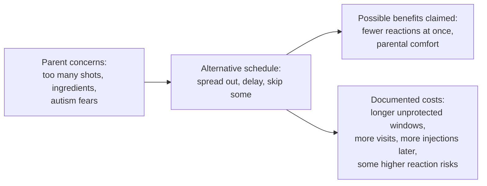

# Alternative and delayed schedules

**Prerequisites:** [How schedules are built](01-how-schedules-are-built.md); [Comparing schedules](06-comparing-schedules.md)

## What alternative schedules are

Some parents want to vaccinate but not on the official schedule. They may spread vaccines over more visits, delay the start, skip particular vaccines (often hepatitis B at birth, rotavirus, flu or HPV), or request separate measles, mumps and rubella vaccines (unavailable in the US and UK). Surveys in the US have found that a substantial minority of parents delay or refuse at least one vaccine, and that undervaccination by parental choice has grown ([Glanz et al., *JAMA Pediatrics* 2013](https://doi.org/10.1001/jamapediatrics.2013.502)).

## Robert Sears's schedule

The best-known alternative schedule is in *The Vaccine Book* (2007) by California paediatrician Robert ("Bob") Sears. He proposed giving no more than two vaccines at a time, starting later, and spreading the schedule over more visits, while presenting it as a middle path for hesitant parents. The book was widely read. It was criticised by paediatricians and vaccine scientists, notably Paul Offit and Charlotte Moser in *Pediatrics* (2009), on the grounds that the schedule was not tested, prolonged the period of vulnerability, and gave credence to unfounded fears ([Offit & Moser, *Pediatrics* 2009](https://doi.org/10.1542/peds.2008-2189)). Offit, a co-inventor of RotaTeq, is a frequent critic of Sears; Sears earned income from the book and from patients seeking flexible care. In 2018 the Medical Board of California placed Sears on 35 months' probation for gross negligence in writing a letter excusing a two-year-old from all future vaccinations without obtaining basic medical information ([Los Angeles Times, "California doctor critical of vaccines is punished for exempting 2-year-old boy from all childhood immunizations" (29 June 2018)](https://www.latimes.com/local/california/la-me-ln-sears-license-20180629-story.html)).

## What the evidence says

No randomised trial has compared an alternative schedule with the official one. Observational evidence gives a mixed but mostly cautionary picture:

- **Disease risk.** Children of parents who refused pertussis vaccination were at much higher risk of pertussis (in a Kaiser Permanente Colorado case-control study, 12% of cases versus 0.5% of controls were refusers; 11% of all pertussis cases were attributable to refusal) ([Glanz et al., *Pediatrics* 2009](https://doi.org/10.1542/peds.2008-2150)). Delays leave infants unprotected when pertussis and Hib are most dangerous.
- **Seizures.** In 323,247 children in the Vaccine Safety Datalink, infant vaccine timing made no difference to seizure risk, but delaying the first MMR past 15 months roughly doubled the relative risk of febrile seizures after it (incidence rate ratio 6.5 versus 2.7 for on-time) ([Hambidge et al., *Pediatrics* 2014](https://doi.org/10.1542/peds.2013-3429)).
- **Health care use.** In the same cohort, undervaccinated children had fewer outpatient visits than on-time children (IRR 0.89), but more inpatient admissions (IRR 1.21); children undervaccinated by parental choice also had fewer emergency department visits ([Glanz et al., *JAMA Pediatrics* 2013](https://doi.org/10.1001/jamapediatrics.2013.502)). Vaccine sceptics cite the lower outpatient use as a sign of better health; the authors note it may reflect parents who use less health care generally, and hospital admissions were higher. This is a textbook case of [healthy-user and care-seeking bias](../../../../science/research-methods/reading-research/04-causation/06-healthy-user-bias.md).
- **Neurodevelopment.** Studies comparing on-time and delayed vaccination have not found better neuropsychological outcomes with delay; in a reanalysis of a Vaccine Safety Datalink cohort tested at 7–10 years, timely vaccination was associated with better scores on 2 of 42 neuropsychological outcomes after adjustment, and no outcome favoured delay ([Smith & Woods, *Pediatrics* 2010](https://doi.org/10.1542/peds.2009-2489)).
- **Practicalities.** Spreading vaccines means more visits and more total injections (single vaccines instead of combinations), and dropout before completion is common.

The Institute of Medicine in 2013 concluded there was no evidence that alternative schedules are safer, and recommended research using existing data systems rather than new trials ([Institute of Medicine, *The Childhood Immunization Schedule and Safety* (2013)](https://doi.org/10.17226/13563)).

## The other side

Supporters argue that parental comfort matters, that a flexible paediatrician may keep hesitant families vaccinating rather than refusing entirely, and that the official schedule as a whole has not been tested against alternatives. The 2026 US move to "shared clinical decision-making" for several vaccines can be seen as officially sanctioning some flexibility; critics see it as legitimising delay without evidence ([CDC newsroom, "CDC Acts on Presidential Memorandum to Update Childhood Immunization Schedule" (5 January 2026)](https://www.cdc.gov/media/releases/2026/2026-cdc-acts-on-presidential-memorandum-to-update-childhood-immunization-schedule.html)).

## Key ideas

- Alternative schedules spread out, delay or skip vaccines; Bob Sears's 2007 book popularised them.
- No trial shows they are safer; observational data show more disease risk and, for late MMR, more febrile seizures.
- Some outcomes (fewer outpatient visits) are cited by both sides and are confounded by health-care-seeking behaviour.

## Where this leads

- Back to [the schedules section](README.md); see [[too-many-too-soon|too many, too soon]] and [[conflicts-of-interest-and-funding|conflicts of interest and funding]].
