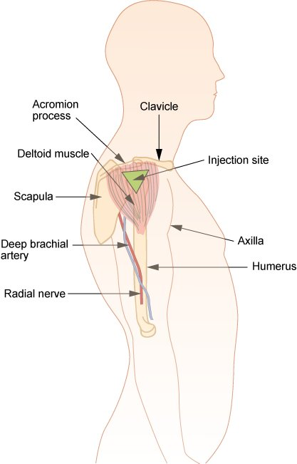

# Common reactions

**Prerequisites:** [Inflammation and fever](../../03-inflammation-and-fever.md); [How vaccines work](../01-how-vaccines-work/01-how-vaccines-work.md)

*The deltoid site for intramuscular injection, used for most vaccines in older children and adults. Credit: British Columbia Institute of Technology (BCIT). Download this book for free at http://open.bccampus.ca. License: [CC BY 4.0](https://creativecommons.org/licenses/by/4.0). Source: [File:Im-deltoid.png](https://commons.wikimedia.org/wiki/File:Im-deltoid.png).*

## What "side effect" usually means

Most reactions to vaccines are the expected result of the immune system responding: local inflammation where the vaccine was injected, and a short-lived systemic response as innate immune signals (cytokines such as interleukin-1 and interleukin-6) circulate. These are called **reactogenicity** and are measured in every clinical trial using diaries in which participants record symptoms for about a week after each dose ([clinical trial phases](../02-development-and-regulation/02-clinical-trial-phases.md)).

## Local reactions

- Pain, redness and swelling at the injection site, usually starting within a day and lasting one to three days.
- Larger swellings, sometimes of the whole limb, after the fourth and fifth doses of acellular pertussis vaccines in young children; they look alarming but resolve without harm.
- A small lump that persists for weeks, more common with aluminium-adjuvanted vaccines.
- **Arthus reactions**: painful local swelling several hours after a tetanus or diphtheria booster given too soon after the previous one, caused by immune complexes. This is why tetanus boosters are not given more often than recommended ([CDC, *General Best Practice Guidelines for Immunization*: contraindications and precautions](https://www.cdc.gov/vaccines/hcp/imz-best-practices/contraindications-precautions.html)).

## Systemic reactions

- **Fever**, typically within 24–48 hours of inactivated vaccines, or 7–12 days after measles-containing vaccines, when the attenuated virus replicates.
- **Fatigue, headache, muscle aches and chills**, especially with adjuvanted vaccines (Shingrix, some RSV vaccines) and with mRNA vaccines after the second dose. In the Pfizer–BioNTech trial, fatigue and headache were reported by more than half of younger participants after dose two ([Polack et al., *NEJM* 2020 (BNT162b2 trial)](https://doi.org/10.1056/NEJMoa2034577)).
- **Irritability, crying and sleepiness** in infants.
- A mild **rash** after MMR or varicella vaccines, and sometimes swollen glands after rubella vaccine or joint pain in adult women.

These effects are usually more frequent with whole-cell or more reactogenic vaccines. The switch from whole-cell to acellular pertussis vaccines in the 1990s greatly reduced fever, crying and local reactions ([[dtp-and-whole-cell-pertussis|DTP and whole-cell pertussis]]).

## How common?

Placebo-controlled trials show that some of what is reported after vaccination would have happened anyway. In many trials, headache and fatigue occur in a sizeable minority of placebo recipients, a reminder of the **nocebo** effect: expecting side effects can produce them. A meta-analysis of COVID-19 vaccine trials estimated that about three quarters of systemic adverse events after a first dose were also reported by placebo recipients ([Haas et al., *JAMA Network Open* 2022 (adverse events in placebo arms)](https://doi.org/10.1001/jamanetworkopen.2021.43955)). At the same time, real local and systemic reactions are clearly more common in vaccinated groups.

## Does a stronger reaction mean better protection?

Not reliably. Studies have found weak or inconsistent links between reactogenicity and antibody levels, and people with no side effects are still protected. Taking paracetamol (acetaminophen) or ibuprofen to treat discomfort is reasonable, though giving it routinely before vaccination was found in one infant trial to reduce antibody responses to some antigens ([Prymula et al., *Lancet* 2009](https://doi.org/10.1016/S0140-6736(09)61208-3)).

## Syncope and anxiety-related reactions

Fainting is common in adolescents, often minutes after an injection, and the main risk is injury from falling. See [syncope and shoulder injuries](04-syncope-and-shoulder-injuries.md).

## Key ideas

- Most side effects are short-lived signs of the immune response: sore arm, fever, fatigue, headache.
- Trials measure them systematically, and placebo groups show that some are not caused by the vaccine.
- Reaction strength is not a good guide to protection.

## Where this leads

- Next: [Febrile seizures](02-febrile-seizures.md).
