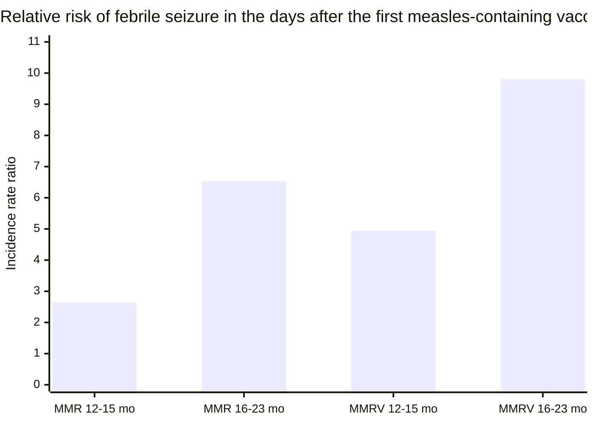

# Febrile seizures

**Prerequisites:** [Common reactions](01-common-reactions.md); [Self-controlled designs](../../../epidemiology/09-self-controlled-designs.md)

*Data: [Hambidge et al., *Pediatrics* 2014](https://doi.org/10.1542/peds.2013-3429). Rate ratios compare the risk window after vaccination with other times in the same children.*

## What febrile seizures are

A febrile seizure is a convulsion triggered by fever in a child aged about six months to five years. They are common, affecting roughly 2–5% of children in Europe and North America, and usually occur with ordinary infections such as colds or ear infections. They are frightening to witness but almost always harmless: most last under five minutes, and children with simple febrile seizures have normal development and only a slightly higher risk of later epilepsy.

## The link with vaccines

Because vaccines can cause fever, they can trigger febrile seizures in susceptible children. Large studies have quantified this:

- **Whole-cell DTP** increased the risk of febrile seizures on the day of vaccination (relative risk about 5.7) ([Barlow et al., *NEJM* 2001](https://doi.org/10.1056/NEJMoa003077)). Acellular pertussis vaccines cause much less fever.
- **MMR** increases the risk 8–14 days after vaccination, when the measles vaccine virus is replicating (relative risk about 2.8), with no increase in non-febrile seizures and no long-term neurological harm ([Barlow et al., *NEJM* 2001](https://doi.org/10.1056/NEJMoa003077)). A Danish study of over 537,000 children found a similar relative risk (2.75) in the two weeks after MMR, an absolute excess of about 1.6 febrile seizures per 1,000 children vaccinated at 15–17 months, and no increase in later epilepsy among children whose seizures followed vaccination ([Vestergaard et al., *JAMA* 2004](https://doi.org/10.1001/jama.292.3.351)).
- **MMRV** (combined with varicella) as a first dose doubles the risk compared with separate MMR and varicella shots given the same day: about one extra febrile seizure per 2,300 doses ([Klein et al., *Pediatrics* 2010](https://doi.org/10.1542/peds.2010-0665)). For this reason the US recommends separate vaccines for the first dose by default, and in 2025 the reconstituted ACIP voted against MMRV under age four.
- **Delaying** the first MMR past 15 months makes the relative risk larger, not smaller ([Hambidge et al., *Pediatrics* 2014](https://doi.org/10.1542/peds.2013-3429)), because febrile seizure susceptibility peaks in the second year of life.
- Influenza vaccine given with pneumococcal conjugate vaccine produced a small seizure signal in young children in some seasons, and an Australian influenza vaccine (Fluvax) caused a high rate of febrile seizures in 2010 and was withdrawn for children (see [surveillance outside the US](../02-development-and-regulation/10-surveillance-outside-the-us.md)).

## Putting the risk in context

The measles virus itself causes fever in nearly everyone infected and febrile seizures more often than the vaccine, as well as pneumonia and encephalitis. Families who have experienced a seizure after vaccination often understandably fear further doses. Guidance is that a febrile seizure after vaccination is not a contraindication to future doses (except that MMRV is avoided in children with a personal or family history of seizures) ([CDC, *General Best Practice Guidelines for Immunization*: contraindications and precautions](https://www.cdc.gov/vaccines/hcp/imz-best-practices/contraindications-precautions.html)).

## Febrile seizures and claims of brain injury

Seizures after vaccination were central to the whole-cell pertussis controversy in the 1970s and 1980s and to compensation claims. Later evidence suggests that some children who had seizures after DTP actually had **Dravet syndrome**, a genetic epilepsy caused by SCN1A mutations whose first seizure is often triggered by fever, including vaccine fever. A 2006 study found SCN1A mutations in 11 of 14 patients diagnosed with "vaccine encephalopathy" ([Berkovic et al., *Lancet Neurology* 2006](https://doi.org/10.1016/S1474-4422(06)70446-X)). Vaccination may bring forward the first seizure in such children, but does not appear to change the course of the disease ([McIntosh et al., *Lancet Neurology* 2010](https://doi.org/10.1016/S1474-4422(10)70107-1)). See [DTP and whole-cell pertussis](../07-controversies/08-dtp-and-whole-cell-pertussis.md) and [the vaccine injury table](../08-litigation-and-compensation/04-the-vaccine-injury-table.md).

## Key ideas

- Vaccines that cause fever can trigger febrile seizures; MMR roughly triples the short-term risk, MMRV raises it further.
- Absolute risks are about 1 in 3,000 to 1 in 600 doses depending on vaccine and age; long-term outcomes are normal.
- Some "vaccine encephalopathy" cases were genetic epilepsies (Dravet syndrome) unmasked by fever.

## Where this leads

- Next: [Anaphylaxis](03-anaphylaxis.md).
