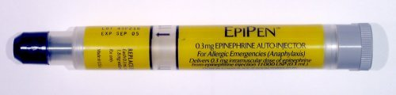

# Anaphylaxis

**Prerequisites:** [When immunity goes wrong](../../09-when-immunity-goes-wrong.md); [Common reactions](01-common-reactions.md)

*An adrenaline (epinephrine) auto-injector; adrenaline is the first treatment for anaphylaxis, and vaccination sites keep it on hand. Credit: Credit as given on Wikimedia Commons. License: [CC BY-SA 3.0](http://creativecommons.org/licenses/by-sa/3.0/). Source: [File:Epipen.jpg](https://commons.wikimedia.org/wiki/File:Epipen.jpg).*

## What it is

Anaphylaxis is a severe, rapid, potentially fatal allergic reaction affecting several body systems: hives and swelling, difficulty breathing, wheeze, a drop in blood pressure, vomiting or collapse. Most cases after vaccination begin within minutes to an hour. It is treated with intramuscular adrenaline (epinephrine), which is why vaccination sites keep it available and why recipients are observed for 15 minutes (30 minutes for people with a history of severe allergy).

## How rare is it?

Anaphylaxis is the clearest example of a real but very rare vaccine harm. In the Vaccine Safety Datalink, 33 confirmed cases occurred after more than 25 million vaccine doses given from 2009 to 2011, a rate of about **1.3 per million doses**, with no significant difference by age ([McNeil et al., *J Allergy Clin Immunol* 2016](https://doi.org/10.1016/j.jaci.2015.07.048)). Rates vary somewhat by vaccine.

When mRNA COVID-19 vaccines were introduced, early US monitoring found higher rates: about 4.7 cases per million doses for Pfizer–BioNTech and 2.5 per million for Moderna in the first weeks, mostly in women and people with a history of allergies; none of the reported cases in that early analysis was fatal ([Shimabukuro & Nair, *JAMA* 2021](https://doi.org/10.1001/jama.2021.0600)). Later rates were lower, possibly because people at risk were screened more carefully.

## What triggers it

Vaccine anaphylaxis can be caused by:

- **Gelatin**, used as a stabiliser in some MMR, varicella and other vaccines. Japan reduced gelatin-related reactions by removing or changing gelatin in its vaccines in the late 1990s.
- **Polyethylene glycol (PEG)**, a component of the lipid nanoparticles in mRNA vaccines, suspected in some mRNA vaccine reactions.
- **Egg proteins** in yellow fever vaccine. Influenza vaccines contain so little egg protein that egg allergy is no longer a contraindication ([contraindications and precautions](../05-schedules/09-contraindications-and-precautions.md)).
- **Latex** in some vial stoppers and syringe plungers (now rare).
- Occasionally **neomycin** or other antibiotic traces, and yeast proteins in hepatitis B and HPV vaccines (very rare).

Many reactions labelled as anaphylaxis turn out on review to be anxiety reactions, fainting or non-allergic flushing. Case definitions such as the Brighton Collaboration's are used to distinguish confirmed cases ([Bonhoeffer et al., *Vaccine* 2002 (Brighton Collaboration)](https://doi.org/10.1016/s0264-410x(02)00449-8)).

## What follows an anaphylactic reaction

A confirmed anaphylactic reaction to a vaccine or one of its components is a contraindication to further doses of that vaccine. Allergists can sometimes identify the component responsible and allow vaccination with a different product, or give a vaccine in divided doses under observation. Anaphylaxis after vaccination is listed on the US Vaccine Injury Table for compensation when it begins within four hours ([[the-vaccine-injury-table|the vaccine injury table]]).

## How critics and defenders use these numbers

Anaphylaxis illustrates how the same facts are framed differently. Vaccine sceptics point out that the risk is real and that package inserts list it. Defenders note that one per million is lower than many everyday risks and that the reaction is treatable when vaccination is done in properly equipped settings. Both are true; what matters for individual decisions is weighing that rare risk against the benefit of the vaccine (see [weighing risks against benefits](14-weighing-risks-against-benefits.md)).

## Key ideas

- Anaphylaxis after vaccination occurs at roughly one per million doses, higher for early mRNA COVID-19 vaccination.
- Triggers include gelatin, PEG, egg protein (yellow fever) and latex.
- Observation after vaccination and on-site adrenaline make it treatable; a prior reaction contraindicates that vaccine.

## Where this leads

- Next: [Syncope and shoulder injuries](04-syncope-and-shoulder-injuries.md).
