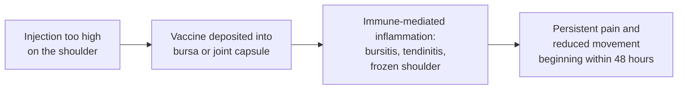

# Syncope and shoulder injuries

**Prerequisites:** [Common reactions](01-common-reactions.md); [Routes, doses and combination vaccines](../01-how-vaccines-work/14-routes-doses-and-combination-vaccines.md)

## Harms from the injection, not the vaccine

Some adverse events after vaccination are caused not by the vaccine's contents but by the act of injection. They matter because they are relatively common, preventable, and among the most frequently compensated injuries.

## Fainting (syncope)

Fainting after an injection is a reflex response (vasovagal syncope) to pain, anxiety or the sight of a needle. It is most common in adolescents and young adults, and typically happens within 15 minutes. Its main danger is injury from falling, including head injuries. Reports of syncope rose in the US after vaccines for adolescents (HPV, Tdap and MenACWY) were introduced in 2005–06, which led to recommendations that adolescents be vaccinated seated or lying down and observed for 15 minutes.

Clusters of fainting and other symptoms in schools have sometimes been reported as mass reactions to vaccines. The WHO describes these as **immunisation stress-related responses**: real symptoms, triggered by anxiety, that can spread through a group. A widely publicised cluster of schoolgirls with fainting and other symptoms after HPV vaccination in Colombia in 2014 was judged by investigators to be a psychogenic reaction, but it affected HPV vaccine uptake there ([[hpv-vaccine-safety-claims|HPV vaccine safety claims]]).

## Shoulder injury related to vaccine administration (SIRVA)

When a vaccine meant for the deltoid muscle is injected too high, it can reach the shoulder's bursa or joint space, provoking inflammation. The result can be bursitis, tendinitis, adhesive capsulitis ("frozen shoulder") or rotator cuff damage, with pain beginning within 48 hours and lasting months. The condition was described in 2010 by physicians at the US Vaccine Injury Compensation Program in a series of 13 cases ([Atanasoff et al., *Vaccine* 2010 (SIRVA)](https://doi.org/10.1016/j.vaccine.2010.10.005)). It is believed to be an immune-mediated inflammatory reaction to antigen in the wrong place, more than a mechanical injury.

SIRVA was added to the US Vaccine Injury Table in 2017 and quickly became the most common type of claim filed under the programme, mostly after flu vaccines given to adults. This reflects both the huge number of adult flu shots and the ease of compensation once a condition is on the table ([HRSA, "Vaccine Injury Compensation Data" (monthly VICP data report)](https://www.hrsa.gov/vaccine-compensation/data); [[vaccine-injury-compensation-program|VICP]]). In 2020 the US government proposed removing SIRVA and syncope from the table, arguing that they are injection injuries rather than vaccine injuries; a rule doing so was published in January 2021 but withdrawn in April 2021 before taking effect. In 2025 HHS Secretary Robert F. Kennedy Jr. said he intended to overhaul the compensation programme; see [[the-vaccine-injury-table|the vaccine injury table]].

Prevention depends on technique: identify the deltoid correctly, inject at its thickest part (about two to three finger-breadths below the bony tip of the shoulder), and use an appropriate needle length.

## Other injection-related problems

- Injection-site abscesses, which are rare with single-use needles but were common historically with re-used syringes.
- Nerve injury from injections into the buttock (sciatic nerve), which is why infants are vaccinated in the thigh and older children and adults in the deltoid.
- Transmission of blood-borne infections through re-used needles, a serious historical problem in some low-income countries, now largely prevented by auto-disable syringes.

## Key ideas

- Some harms come from the injection, not the vaccine: fainting and shoulder injuries are the most common.
- Adolescents should be vaccinated seated and observed for 15 minutes.
- SIRVA, caused by injecting too high on the shoulder, is now the most common US compensation claim.

## Where this leads

- Next: [Intussusception and rotavirus vaccines](05-intussusception-and-rotavirus-vaccines.md).
