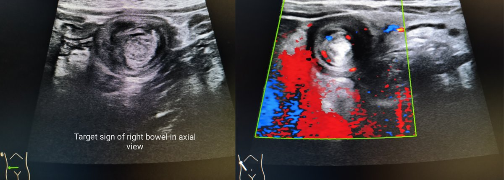

# Intussusception and rotavirus vaccines

**Prerequisites:** [Rotavirus](../03-diseases/rotavirus.md); [Post-market surveillance](../02-development-and-regulation/07-post-market-surveillance.md)

*Ultrasound image of intussusception, showing the characteristic "target" appearance of bowel telescoped into itself. Credit: Cerevisae. License: [CC BY-SA 4.0](https://creativecommons.org/licenses/by-sa/4.0). Source: [File:Ultrasound of target sign in intussusception of the right bowel.png](https://commons.wikimedia.org/wiki/File:Ultrasound_of_target_sign_in_intussusception_of_the_right_bowel.png).*

## The condition

Intussusception is a blockage in which part of the intestine telescopes into the next section. It occurs naturally in roughly 1 in 2,000 to 1 in 3,000 infants in the first year in rich countries, peaking around 5–9 months, and causes episodes of severe abdominal pain, vomiting and sometimes bloody stools. It is usually treated with an air or contrast enema, sometimes surgery; untreated, it can be fatal.

## RotaShield: a withdrawn vaccine

The first rotavirus vaccine, RotaShield (Wyeth), was licensed in the US in August 1998 and recommended for all infants. Within months, VAERS received reports of intussusception. A case-control investigation found that the risk was greatly increased in the one to two weeks after the first dose ([Murphy et al., *NEJM* 2001](https://doi.org/10.1056/NEJM200102223440804)), with an estimated excess of roughly one case per 5,000–10,000 vaccinated infants. ACIP withdrew its recommendation in October 1999, and the manufacturer withdrew the vaccine. The episode is often cited as evidence that the US safety system works: a rare harm missed in trials was detected and acted on within a year.

## The second generation

Because of RotaShield, the next vaccines, RotaTeq (Merck, 2006) and Rotarix (GSK, 2008 in the US), were tested in exceptionally large trials of about 60,000–70,000 infants each, designed to detect an intussusception risk of RotaShield's size. Neither trial found one ([Vesikari et al., *NEJM* 2006 (RotaTeq trial)](https://doi.org/10.1056/NEJMoa052664); [Ruiz-Palacios et al., *NEJM* 2006 (Rotarix trial)](https://doi.org/10.1056/NEJMoa052434)). Paul Offit, a co-inventor of RotaTeq, was among the authors of the RotaTeq trial report; he and his institution later received royalties from the sale of rights to the vaccine, a conflict critics frequently raise ([conflicts of interest and funding](../07-controversies/14-conflicts-of-interest-and-funding.md)).

Post-licensure studies, however, detected a smaller risk. Studies in Mexico, Brazil and Australia found an increased risk after the first dose of both vaccines, and a US study in the FDA's Mini-Sentinel system found about 1.1–1.5 excess cases per 100,000 first doses of RotaTeq ([Yih et al., *NEJM* 2014 (intussusception after rotavirus vaccine)](https://doi.org/10.1056/NEJMoa1303164)). Current estimates range from about 1 to 6 excess cases per 100,000 vaccinated infants, depending on country and vaccine, concentrated in the week after dose one.

## Why the vaccines are still used

The WHO and national regulators judged that the benefits far outweigh this risk. Before vaccination, rotavirus caused an estimated 55,000–70,000 hospitalisations and 20–60 deaths a year in the US, and roughly half a million deaths a year worldwide in the early 2000s; global deaths fell to about 128,500 by 2016, partly because of vaccination ([Troeger et al., *JAMA Pediatrics* 2018](https://doi.org/10.1001/jamapediatrics.2018.1960)). In Mexico and Brazil, the studies that detected intussusception risk also estimated that vaccination prevented many more hospitalisations and deaths than it caused.

To minimise risk, the first dose must be given by 15 weeks of age and the series completed by 8 months, because natural intussusception becomes more common later in infancy. A history of intussusception is a contraindication ([CDC, *General Best Practice Guidelines for Immunization*: contraindications and precautions](https://www.cdc.gov/vaccines/hcp/imz-best-practices/contraindications-precautions.html)). Parents are advised to watch for symptoms in the week after the first dose.

## Why countries still disagree

Denmark does not include rotavirus vaccine in its schedule, while the UK, Canada, Finland and most other countries do. The 2026 US schedule moved rotavirus vaccine to shared clinical decision-making ([CDC newsroom, "CDC Acts on Presidential Memorandum to Update Childhood Immunization Schedule" (5 January 2026)](https://www.cdc.gov/media/releases/2026/2026-cdc-acts-on-presidential-memorandum-to-update-childhood-immunization-schedule.html)). Differences reflect judgements about a disease that is common but rarely fatal in rich countries, the cost of hospital care, and how much weight to give a rare vaccine-caused complication.

## Key ideas

- RotaShield was withdrawn in 1999 after an intussusception risk of about 1 in 10,000.
- Current vaccines carry a smaller risk of roughly 1–6 per 100,000, mostly after the first dose.
- Age limits on dosing reduce the risk; benefits in hospitalisations and deaths prevented far exceed it.

## Where this leads

- Next: [Guillain-Barré syndrome](06-guillain-barre-syndrome.md).
