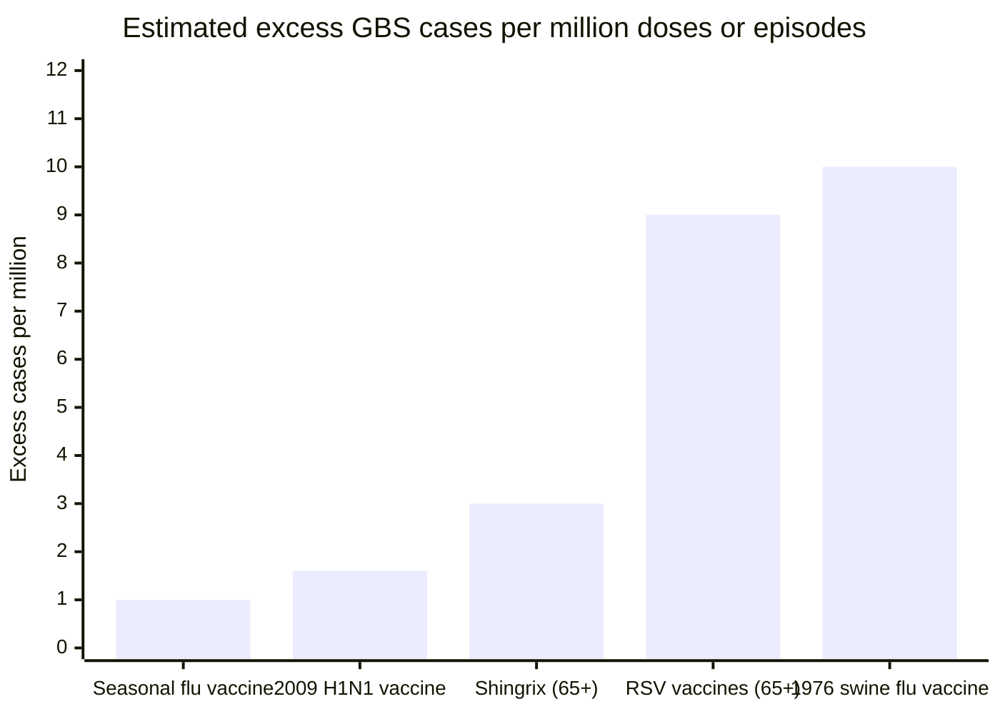

# Guillain-Barré syndrome

**Prerequisites:** [When immunity goes wrong](../../09-when-immunity-goes-wrong.md); [Self-controlled designs](../../../epidemiology/09-self-controlled-designs.md)

*Approximate attributable risks from [Kwong et al., *Lancet Infectious Diseases* 2013](https://doi.org/10.1016/S1473-3099(13)70104-X), [Salmon et al., *Lancet* 2013](https://doi.org/10.1016/S0140-6736(12)62189-8), [Goud et al., *JAMA Internal Medicine* 2021](https://doi.org/10.1001/jamainternmed.2021.6227), [FDA, "FDA requires Guillain-Barré syndrome (GBS) warning in the prescribing information for RSV vaccines Abrysvo and Arexvy" (January 2025)](https://www.fda.gov/vaccines-blood-biologics/safety-availability-biologics/fda-requires-guillain-barre-syndrome-gbs-warning-prescribing-information-rsv-vaccines-abrysvo-and) (Abrysvo; 7 per million for Arexvy) and [Schonberger et al., *American Journal of Epidemiology* 1979](https://doi.org/10.1093/oxfordjournals.aje.a112795) (about 1 per 100,000).*

## The condition

Guillain-Barré syndrome (GBS) is an autoimmune disorder in which the immune system attacks peripheral nerves, causing weakness that typically starts in the legs and ascends over days to weeks. About a quarter of patients need mechanical ventilation, about 3–7% die, and some are left with lasting weakness, though most recover over months. It affects roughly 1–2 people per 100,000 each year. About two thirds of cases follow an infection, often *Campylobacter jejuni* gastroenteritis or a respiratory infection; the leading theory is **molecular mimicry**, in which antibodies against a microbe cross-react with nerve components.

## The 1976 swine flu vaccine

GBS became linked to vaccines in 1976, when the US vaccinated about 45 million people against a feared swine flu pandemic that never materialised. Surveillance found an excess of GBS in the six weeks after vaccination, about one additional case per 100,000 vaccinated people ([Schonberger et al., *American Journal of Epidemiology* 1979](https://doi.org/10.1093/oxfordjournals.aje.a112795)). The programme was halted. The episode shaped public memory of vaccine safety and vaccine policy ever since ([the 1976 swine flu affair](../04-history/09-the-1976-swine-flu-affair.md)).

## Later influenza vaccines

Seasonal influenza vaccines have been studied repeatedly. Most studies find either no increased risk or a small one, about one extra case per million doses. A meta-analysis of six US monitoring systems covering 23 million people vaccinated against 2009 H1N1 pandemic flu found 1.6 excess cases per million ([Salmon et al., *Lancet* 2013](https://doi.org/10.1016/S0140-6736(12)62189-8)).

Influenza itself also triggers GBS, and much more strongly. In an Ontario study using health records from 1993 to 2011, the relative incidence of GBS in the six weeks after vaccination was 1.52, but after a health-care visit for influenza it was 15.8 ([Kwong et al., *Lancet Infectious Diseases* 2013](https://doi.org/10.1016/S1473-3099(13)70104-X)). For most people, preventing influenza may prevent more GBS than vaccination causes, though this depends on how likely the person is to catch flu.

## Other vaccines

- **Shingrix** (recombinant zoster vaccine): a Medicare study found about 3 excess cases per million doses in people 65 and older, and the FDA added a warning in 2021 ([Goud et al., *JAMA Internal Medicine* 2021](https://doi.org/10.1001/jamainternmed.2021.6227)).
- **RSV vaccines for older adults** (Abrysvo and Arexvy): in January 2025 the FDA required a GBS warning after a Medicare study estimated 9 and 7 excess cases per million doses respectively; the FDA said the evidence suggested but did not establish causation and that benefits outweighed risks ([FDA, "FDA requires Guillain-Barré syndrome (GBS) warning in the prescribing information for RSV vaccines Abrysvo and Arexvy" (January 2025)](https://www.fda.gov/vaccines-blood-biologics/safety-availability-biologics/fda-requires-guillain-barre-syndrome-gbs-warning-prescribing-information-rsv-vaccines-abrysvo-and)).
- **Johnson & Johnson's COVID-19 vaccine** (Ad26.COV2.S) carried a GBS warning from July 2021, and a National Academies review concluded the evidence favoured a causal relationship ([NASEM, *Evidence Review of the Adverse Effects of COVID-19 Vaccination* (2024)](https://doi.org/10.17226/27746)). mRNA COVID-19 vaccines have not shown a consistent GBS signal.
- Earlier concerns about meningococcal conjugate vaccine (Menactra) and GBS were not confirmed by later studies.

## What it means in practice

GBS within six weeks of a previous dose of influenza or tetanus-containing vaccine is a **precaution** for those vaccines; people with GBS unrelated to vaccination can generally be vaccinated ([CDC, *General Best Practice Guidelines for Immunization*: contraindications and precautions](https://www.cdc.gov/vaccines/hcp/imz-best-practices/contraindications-precautions.html)). GBS after the 1976 vaccine and after some seasonal flu vaccines is on the US Vaccine Injury Table, and GBS claims are among the most frequently compensated ([[the-vaccine-injury-table|the vaccine injury table]]).

## How GBS illustrates causality assessment

Because GBS is rare, has background causes, and follows infections that are themselves seasonal, it is hard to study. Self-controlled designs, which compare each person with themselves at different times, help avoid confounding ([self-controlled designs](../../../epidemiology/09-self-controlled-designs.md)). Even so, the small risks reported for flu vaccines vary between seasons and studies, showing the limits of detecting effects of about one in a million ([causality assessment](13-causality-assessment.md)).

## Key ideas

- GBS is an autoimmune nerve disorder usually triggered by infections.
- The 1976 swine flu vaccine caused about 1 extra case per 100,000; modern flu vaccines about 1 per million, if any.
- Small risks have been found for Shingrix and the older-adult RSV vaccines; influenza infection itself carries a much higher GBS risk.

## Where this leads

- Next: [Narcolepsy and Pandemrix](07-narcolepsy-and-pandemrix.md).
