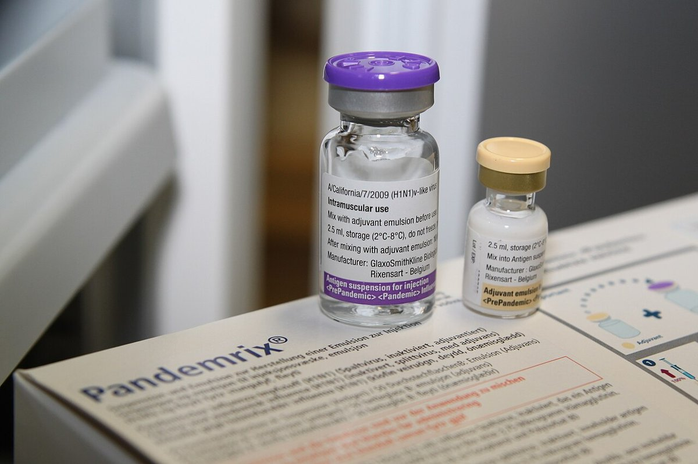

# Narcolepsy and Pandemrix

**Prerequisites:** [Adjuvants](../01-how-vaccines-work/10-adjuvants.md); [Influenza](../03-diseases/influenza.md)

*Pandemrix, GlaxoSmithKline's AS03-adjuvanted 2009 pandemic influenza vaccine. Credit: Alcibiades. License: Public domain. Source: [File:Pandemrix1.jpg](https://commons.wikimedia.org/wiki/File:Pandemrix1.jpg).*

## The vaccine

During the 2009 H1N1 influenza pandemic, European countries used **Pandemrix**, a GSK vaccine containing the AS03 adjuvant (an oil-in-water emulsion with squalene and vitamin E). More than 30 million doses were given in Europe. The vaccine was licensed quickly under pandemic procedures, and most countries offered it to the whole population, including children.

## The signal

In August 2010 sleep specialists in Finland and Sweden reported a sharp rise in narcolepsy in children and adolescents. Narcolepsy is a chronic disorder causing overwhelming daytime sleepiness and, often, cataplexy (sudden muscle weakness triggered by emotions). It is caused by loss of the brain cells that produce hypocretin (orexin), almost always in people carrying the HLA-DQB1\*06:02 gene variant, and is thought to be autoimmune.

A Finnish national cohort study found that narcolepsy incidence in 4- to 19-year-olds was 9.0 per 100,000 person-years among vaccinated children versus 0.7 among unvaccinated, a rate ratio of 12.7, and estimated a vaccine-attributable risk of about **1 in 16,000** vaccinated children ([Nohynek et al., *PLoS One* 2012](https://doi.org/10.1371/journal.pone.0033536)). Similar increases were found in Sweden, Norway, Ireland, England and France, with smaller increases in adults. Some of the Finnish authors disclosed consultancy or research funding from GSK, the manufacturer, which did not prevent them from reporting a harm of its vaccine.

## Why Pandemrix?

Other H1N1 vaccines, including an AS03-adjuvanted vaccine made by GSK in Canada (Arepanrix) and unadjuvanted vaccines in the US, were not clearly associated with narcolepsy. Researchers have proposed that Pandemrix contained more of a particular viral nucleoprotein fragment that resembles part of the hypocretin receptor, so that in genetically susceptible people the immune response cross-reacted with the brain ([Ahmed et al., *Science Translational Medicine* 2015](https://doi.org/10.1126/scitranslmed.aab2354)). That explanation remains debated. H1N1 infection itself may also trigger narcolepsy: China saw a rise after the 2009 pandemic without Pandemrix.

## Detecting it was not straightforward

The narcolepsy signal was found by clinicians noticing unusual numbers of young patients, not by automated surveillance, and it took months to confirm. Narcolepsy develops gradually and is often diagnosed years after symptoms start, so studies had to reconstruct when symptoms began. Once the possible link was publicised, more parents sought diagnosis, which can inflate apparent associations (an ascertainment bias). The Finnish study addressed this by limiting its main analysis to cases with symptoms before the media attention began in August 2010 ([Nohynek et al., *PLoS One* 2012](https://doi.org/10.1371/journal.pone.0033536)). A European study coordinated through the ECDC network found the association in countries where the signal was first detected but initially struggled to confirm it elsewhere, partly because of these biases.

## Consequences

- Several countries compensated affected people. In the UK, which had indemnified GSK, the government paid; Sweden's pharmaceutical insurance and Finland's programmes paid hundreds of claims.
- The episode is a frequent example for both sides of vaccine debates. Critics cite it as proof that rushed vaccines with novel adjuvants can cause serious, permanent harm, and that official reassurances can be wrong. Defenders cite it as proof that the surveillance system detects and acknowledges rare harms, even when they are inconvenient for public health authorities and manufacturers.
- It contributed to European caution about mass vaccination and adjuvants, and to the recognition that safety in one population cannot always be extrapolated to another with different genetics or exposures.

## Key ideas

- Pandemrix, an AS03-adjuvanted 2009 pandemic flu vaccine, increased narcolepsy risk in children and adolescents by about 1 in 16,000 in Finland.
- The mechanism probably involves autoimmunity in people with HLA-DQB1\*06:02, possibly via cross-reaction with a viral protein.
- Other H1N1 vaccines showed no clear link; the case shows both that rare harms happen and that surveillance can find them.

## Where this leads

- Next: [Myocarditis and mRNA vaccines](08-myocarditis-and-mrna-vaccines.md).
