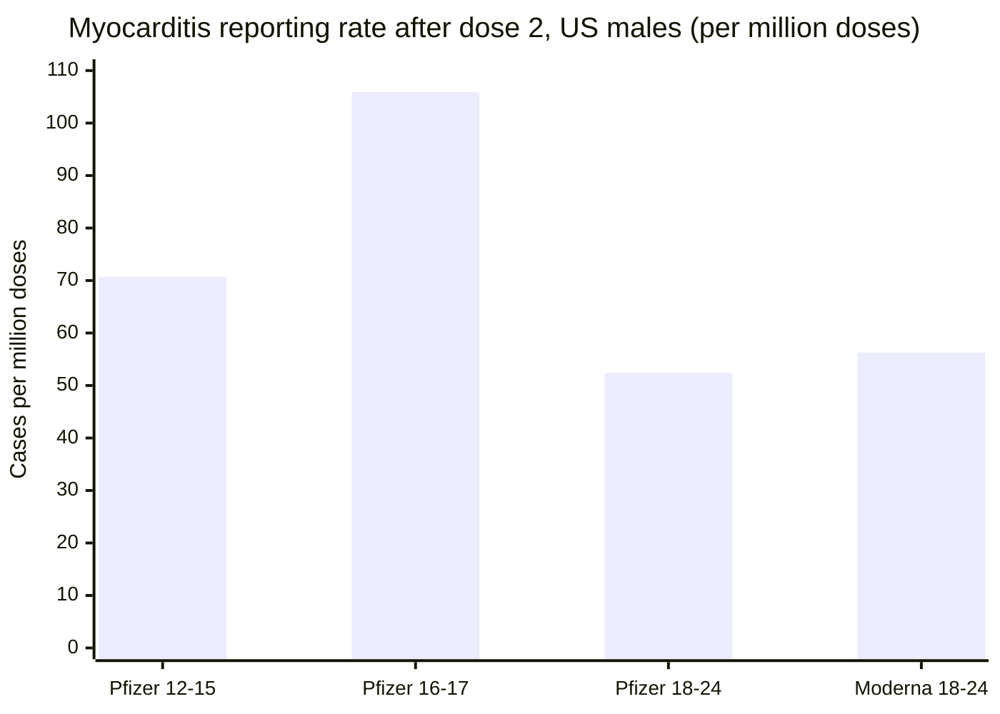

# Myocarditis and mRNA vaccines

**Prerequisites:** [mRNA vaccines](../01-how-vaccines-work/09-mrna-vaccines.md); [COVID-19](../03-diseases/covid-19.md)

*Source: VAERS cases meeting the case definition, December 2020 to August 2021 ([Oster et al., *JAMA* 2022](https://doi.org/10.1001/jama.2021.24110)). Rates were much lower in older age groups and in females.*

## What was found

Myocarditis (inflammation of the heart muscle) and pericarditis (inflammation of the sac around the heart) emerged in spring 2021 as a rare side effect of the mRNA COVID-19 vaccines from Pfizer–BioNTech and Moderna. The trials, with about 15,000–20,000 vaccinated participants each, were too small to detect it ([Polack et al., *NEJM* 2020 (BNT162b2 trial)](https://doi.org/10.1056/NEJMoa2034577); [Baden et al., *NEJM* 2021 (mRNA-1273 trial)](https://doi.org/10.1056/NEJMoa2035389)).

The pattern was consistent across countries:

- Mostly **young males**, aged roughly 12 to 30.
- Usually after the **second dose**, with symptoms (chest pain, breathlessness, palpitations) within a few days.
- Higher after **Moderna** than Pfizer–BioNTech, probably because of Moderna's higher dose, and higher when doses were given closer together.

In Israel's national surveillance, the risk was highest in males aged 16–19 after the second dose, about 1 in 6,600 ([Mevorach et al., *NEJM* 2021](https://doi.org/10.1056/NEJMoa2109730)). In the US, among 192 million vaccinated people, 1,626 reports met the case definition; reporting rates after dose two peaked at about 106 per million doses (about 1 in 9,400) in males aged 16–17 ([Oster et al., *JAMA* 2022](https://doi.org/10.1001/jama.2021.24110)). An English study of 42 million people found risks increased after mRNA vaccines and, to a smaller extent, after the AstraZeneca vaccine, with the largest excess after a second dose of Moderna in men under 40 ([Patone et al., *Circulation* 2022](https://doi.org/10.1161/CIRCULATIONAHA.122.059970)).

## How serious?

Most cases were mild: in the US analysis, about 96% of young patients were hospitalised, mostly for observation, and 87% had resolution of symptoms by discharge ([Oster et al., *JAMA* 2022](https://doi.org/10.1001/jama.2021.24110)). In Israel, 95% of cases were mild and one fulminant case was fatal ([Mevorach et al., *NEJM* 2021](https://doi.org/10.1056/NEJMoa2109730)). A few deaths have been attributed to vaccine myocarditis after autopsy. A key uncertainty is long-term outcome: cardiac MRI scans showed scarring (late gadolinium enhancement) in many patients months later, though its significance is unclear. Follow-up studies so far have found most patients recovered with few long-term problems.

## Infection versus vaccination

SARS-CoV-2 infection also causes myocarditis. The English study found that, overall, the risk after infection exceeded the risk after vaccination, but that in young men after a second Moderna dose the vaccine-associated excess was higher than the infection-associated excess ([Patone et al., *Circulation* 2022](https://doi.org/10.1161/CIRCULATIONAHA.122.059970)). How these compare depends on age, sex, prior infection, the vaccine and dose, and the variant in circulation; for young males who have already had COVID-19, the benefit of additional doses is small.

## Policy responses

Countries responded differently, which itself is instructive:

- **Nordic countries** paused or stopped Moderna for young people in late 2021.
- Many countries **lengthened the interval** between doses (8 weeks rather than 3–4), which appears to reduce risk.
- The UK and others offered **one dose only** to healthy adolescents at first.
- In 2025 the US FDA required updated myocarditis warnings on mRNA vaccine labels and set a framework limiting approval of updated COVID-19 vaccines to people 65 and over or with risk factors ([Prasad & Makary, *NEJM* 2025, "An Evidence-Based Approach to Covid-19 Vaccination"](https://doi.org/10.1056/NEJMsb2506929)).

Critics argued that authorities were slow to acknowledge the risk and too insistent on vaccinating healthy young people with little risk from COVID-19. Defenders noted that the signal was detected, confirmed and acted on within months, and that decisions were made with incomplete information during a pandemic. Both views are discussed in [COVID-19 vaccines, mandates and mortality](../07-controversies/10-covid-19-vaccines-mandates-and-mortality.md).

## Key ideas

- mRNA COVID-19 vaccines cause myocarditis, mainly in young males after the second dose, up to roughly 1 in 6,000–10,000 in the highest-risk groups.
- Most cases are mild and resolve; long-term effects are still being studied.
- Risk depends on vaccine, dose interval and age; policies were adjusted accordingly.

## Where this leads

- Next: [VITT and adenovirus vector vaccines](09-vitt-and-adenovirus-vector-vaccines.md).
