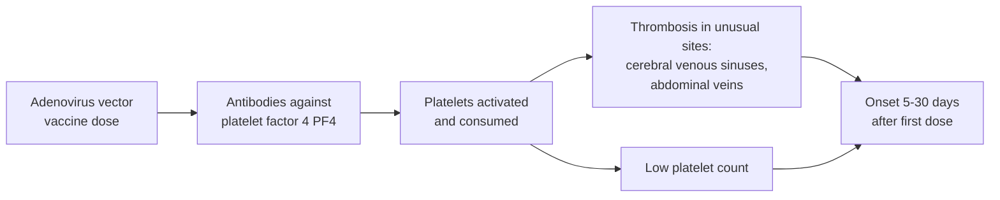

# VITT and adenovirus vector vaccines

**Prerequisites:** [Viral vector vaccines](../01-how-vaccines-work/08-viral-vector-vaccines.md); [COVID-19](../03-diseases/covid-19.md)

## A new syndrome

In March 2021, weeks after mass vaccination with the Oxford–AstraZeneca COVID-19 vaccine (ChAdOx1 nCoV-19) began in Europe, doctors in Germany, Austria, Norway and the UK reported young and middle-aged adults with an unusual combination: blood clots in rare locations, particularly the veins draining the brain (cerebral venous sinus thrombosis) and the abdomen, together with low platelet counts. Several died.

Three papers in the *New England Journal of Medicine* in April 2021 described the syndrome and its mechanism. Patients had high levels of antibodies against **platelet factor 4 (PF4)**, resembling the rare reaction to the blood thinner heparin, but without exposure to heparin ([Greinacher et al., *NEJM* 2021](https://doi.org/10.1056/NEJMoa2104840); [Schultz et al., *NEJM* 2021](https://doi.org/10.1056/NEJMoa2104882); [Scully et al., *NEJM* 2021](https://doi.org/10.1056/NEJMoa2105385)). In Norway, five cases among more than 130,000 vaccinated health-care workers prompted the authors to propose the name **vaccine-induced immune thrombotic thrombocytopenia (VITT)** ([Schultz et al., *NEJM* 2021](https://doi.org/10.1056/NEJMoa2104882)). The US uses the broader term thrombosis with thrombocytopenia syndrome (TTS).

## How common and how serious

A UK prospective study identified 170 definite and 50 probable cases. All followed a first dose, presenting 5 to 48 days after vaccination (median 14). The median age was 48, there was no sex preponderance, and overall mortality was **22%**, higher with cerebral venous sinus thrombosis and very low platelet counts ([Pavord et al., *NEJM* 2021 (VITT clinical features, UK)](https://doi.org/10.1056/NEJMoa2109908)). Rates were highest in younger adults.

Johnson & Johnson's single-dose vaccine (Ad26.COV2.S), also an adenovirus vector, caused the same syndrome. US reporting rates were 3.83 cases per million doses for Ad26.COV2.S compared with 0.0086 per million for mRNA vaccines, with the highest rates in women aged 30–49 ([See et al., *Annals of Internal Medicine* 2022 (TTS after Ad26.COV2.S, US)](https://doi.org/10.7326/m21-4502)).

## Regulatory responses

Countries responded in very different ways:

- **Denmark** stopped using the AstraZeneca vaccine entirely in April 2021, and Norway followed.
- The **UK** and many others restricted it to older adults, first offering under-30s, then under-40s, an alternative, because the benefit–risk balance was least favourable in younger people at low risk from COVID-19.
- The **US** paused J&J vaccination for ten days in April 2021, then resumed it with a warning; in December 2021 the CDC preferred mRNA vaccines, and in May 2022 the FDA restricted J&J use.
- In May 2024 AstraZeneca withdrew its vaccine's European marketing authorisation, citing falling demand.

## Treatment and lessons

Clinicians learned within weeks to recognise VITT, avoid heparin and platelet transfusions, and treat with non-heparin anticoagulants and intravenous immunoglobulin, which lowered mortality. Families of people who died or were injured have sought compensation; in the UK, a group legal action against AstraZeneca began in 2023, and the UK's Vaccine Damage Payment Scheme received many VITT claims ([[covid-19-litigation|COVID-19 litigation]]).

VITT illustrates several general points. It was too rare to appear in trials of about 20,000 people. Benefit–risk depended strongly on age and on how much COVID-19 was circulating: in older adults during a wave, the vaccine prevented far more deaths than it caused; in young adults with mRNA alternatives available, it did not. And how the harm was communicated affected trust in vaccines generally, especially in Europe ([weighing risks against benefits](14-weighing-risks-against-benefits.md)).

## Key ideas

- Adenovirus vector COVID-19 vaccines caused VITT, a rare clotting disorder driven by anti-PF4 antibodies, with about 22% mortality in the UK series.
- Rates were highest in younger adults; J&J's US rate was about 4 per million doses.
- Countries restricted or stopped these vaccines depending on age and alternatives.

## Where this leads

- Next: [Vaccine-derived polio](10-vaccine-derived-polio.md).
