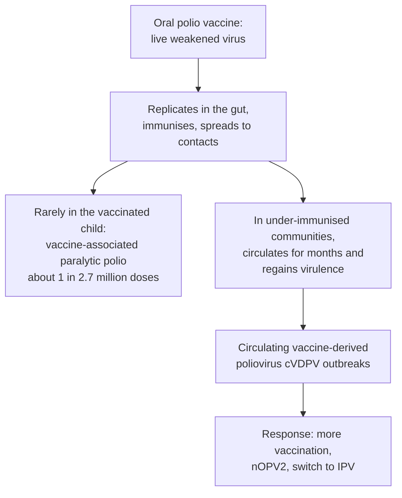

# Vaccine-derived polio

**Prerequisites:** [Polio](../03-diseases/polio.md); [Live attenuated vaccines](../01-how-vaccines-work/03-live-attenuated-vaccines.md)

## The trade-off of the oral vaccine

Albert Sabin's oral polio vaccine (OPV) contains live, weakened polioviruses. It is cheap (about US$0.15–0.20 a dose), easy to give as drops, produces strong intestinal immunity that stops transmission, and spreads to unvaccinated contacts, indirectly immunising them ([GPEI, "Oral polio vaccine (OPV)"](https://polioeradication.org/about-polio/the-vaccines/opv/)). These features made it the main tool of the global eradication campaign ([polio eradication](../04-history/08-polio-eradication.md)).

The same live virus carries two risks.

## Vaccine-associated paralytic polio (VAPP)

In rare cases the weakened virus mutates in the vaccinated child or a close contact and causes paralysis. The GPEI estimates about **1 case per 2.7 million doses**, with the risk highest after the first dose and in people with immune deficiencies ([GPEI, "Oral polio vaccine (OPV)"](https://polioeradication.org/about-polio/the-vaccines/opv/)). In the US, once wild polio was eliminated (the last wild cases were in 1979), VAPP was the only cause of polio, about 8–10 cases a year. That led the US to move to inactivated polio vaccine (IPV) in stages, using IPV exclusively from 2000. Most rich countries made the same switch.

## Circulating vaccine-derived poliovirus (cVDPV)

Where vaccination coverage is low, vaccine virus excreted in stool can pass from person to person for a year or more, accumulating mutations until it regains the ability to paralyse like wild virus. Outbreaks of cVDPV have occurred across Africa and Asia and occasionally in rich countries. Most are type 2. Wild type 2 poliovirus was declared eradicated in 2015, so in April 2016 all OPV-using countries switched in a coordinated move from trivalent to bivalent OPV (types 1 and 3). But low immunity to type 2 after the switch, plus outbreak responses with the old type 2 vaccine, allowed cVDPV2 outbreaks to expand, peaking at more than 1,000 paralytic cases in 2020 ([Bigouette et al., *MMWR* 2023 (vaccine-derived poliovirus outbreaks 2021–2022)](https://doi.org/10.15585/mmwr.mm7214a3)). Paralysis from vaccine-derived virus has outnumbered paralysis from wild virus in most recent years.

Detections have included a paralysed unvaccinated young man in Rockland County, New York, in 2022, with related virus found in sewage; type 2 virus in London sewage the same year; and the first polio case in Gaza in 25 years in 2024. These were all linked to low vaccination coverage in the affected communities.

## The response: nOPV2

To break the cycle, scientists engineered a **novel oral polio vaccine type 2 (nOPV2)** that is genetically more stable and less likely to revert. It was the first vaccine to receive WHO Emergency Use Listing (November 2020), was rolled out from March 2021, and received full WHO prequalification in December 2023 ([GPEI press release on nOPV2 prequalification (December 2023)](https://polioeradication.org/news/gpei-press-release-on-nopv2-prequalification/)). Hundreds of millions of doses have been used. Novel type 1 and 3 vaccines are in development. The long-term plan is to stop all OPV use after wild polio is eradicated and rely on IPV.

## Interpreting vaccine-derived polio

Critics of vaccination sometimes cite cVDPV as evidence that "the vaccine causes polio". It does, rarely, and public health bodies say so openly. But cVDPV outbreaks occur where too few children are vaccinated, and are stopped by more vaccination, not less. The trade-off reflects choices: OPV's cheapness and ability to stop transmission made it the only feasible tool for eradication in many countries, at the price of rare paralysis.

## Key ideas

- OPV rarely causes paralysis directly (about 1 per 2.7 million doses) and, in under-immunised communities, can evolve into circulating vaccine-derived poliovirus.
- cVDPV2 outbreaks expanded after the 2016 switch and peaked in 2020.
- The genetically stabilised nOPV2 and eventual switch to IPV aim to end vaccine-derived polio.

## Where this leads

- Next: [ITP and other blood disorders](11-itp-and-other-blood-disorders.md).
