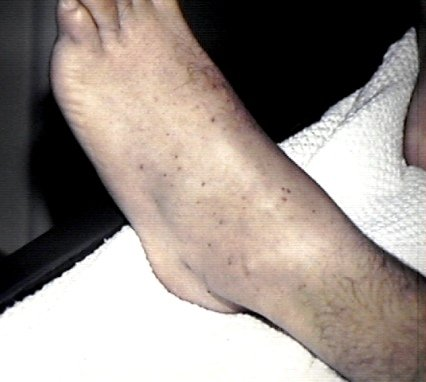

# ITP and other blood disorders

**Prerequisites:** [When immunity goes wrong](../../09-when-immunity-goes-wrong.md); [Measles](../03-diseases/measles.md)

*Petechiae, tiny pinpoint bleeds under the skin, a typical sign of a low platelet count. Credit: The original uploader was Seasurfer at Chinese Wikipedia. License: Public domain. Source: [File:Petechiaesmall.jpg](https://commons.wikimedia.org/wiki/File:Petechiaesmall.jpg).*

## Immune thrombocytopenia

Immune thrombocytopenia (ITP, also called immune thrombocytopenic purpura) occurs when antibodies destroy platelets, the blood cells that help clotting. Children typically develop bruising, petechiae (pinpoint red spots) and sometimes nosebleeds, usually a few weeks after a viral infection. In most children it resolves within weeks to months, with or without treatment; serious bleeding, such as bleeding into the brain, is rare.

## MMR and ITP

MMR vaccine causes ITP in about **1 in 30,000–40,000** vaccinated children, typically within six weeks of the first dose. A Vaccine Safety Datalink study of over a million vaccinated children found the relative risk highest at 12–15 months of age (about seven times the background risk), and estimated that most ITP cases in 12- to 23-month-olds in the six weeks after vaccination were attributable to the vaccine ([France et al., *Pediatrics* 2008](https://doi.org/10.1542/peds.2007-1578)). The cases were similar in severity and duration to ITP from other causes.

The natural infections cause ITP more often: rubella causes it in about 1 in 3,000 cases and measles more often still. So the vaccine trades a rare ITP risk for protection against diseases with higher ITP risks plus their other complications.

ITP has also been reported after other vaccines (hepatitis A, varicella and Tdap in adolescents, influenza), but associations other than MMR are weak or inconsistent. Children who had ITP after the first MMR dose can usually receive the second dose after checking immunity, because recurrence appears uncommon.

## Thrombosis with thrombocytopenia

The adenovirus vector COVID-19 vaccines caused a different and more dangerous condition combining low platelets with blood clots, discussed in [VITT](09-vitt-and-adenovirus-vector-vaccines.md). ITP without clots was also reported more often than expected after the AstraZeneca vaccine in a Scottish study, at an estimated 1.1 cases per 100,000 doses ([Simpson et al., *Nature Medicine* 2021 (ChAdOx1 and ITP, Scotland)](https://doi.org/10.1038/s41591-021-01408-4)); the same study found no such increase after the Pfizer–BioNTech vaccine.

## Other blood and vascular events

- **Capillary leak syndrome**: a few cases of this rare, life-threatening condition were reported after adenovirus vector COVID-19 vaccines, and regulators listed it as a possible side effect in people with a prior history of it.
- **Bleeding disorders and injections**: people with haemophilia or on anticoagulants can usually be vaccinated intramuscularly with a fine needle and pressure afterwards.
- **Anaemia, leukaemia and other claims**: claims on social media that vaccines cause leukaemia or other cancers have not been supported by epidemiological studies.

## How blood disorders are studied

ITP shows how rare events are confirmed: a signal from passive reports, case definitions (a platelet count below a set threshold, with bleeding), large linked databases, and self-controlled comparisons of the risk window with other times ([self-controlled designs](../../../epidemiology/09-self-controlled-designs.md)). Laboratory confirmation helps, because a platelet count is objective, which makes ITP easier to study than conditions with vague symptoms or gradual onset.

## Key ideas

- MMR causes ITP in about 1 in 30,000–40,000 children, usually mild and self-limiting.
- Natural measles and rubella cause ITP more often than the vaccine.
- Clotting with low platelets after adenovirus vector vaccines (VITT) is a separate, more serious condition.

## Where this leads

- Next: [Other rare serious reactions](12-other-rare-serious-reactions.md).
