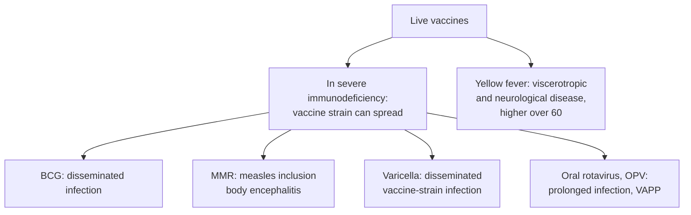

# Other rare serious reactions

**Prerequisites:** [Live attenuated vaccines](../01-how-vaccines-work/03-live-attenuated-vaccines.md); [Contraindications and precautions](../05-schedules/09-contraindications-and-precautions.md)

## Live vaccines in the wrong person

Live attenuated vaccines contain weakened microbes that replicate. In healthy people the immune system controls them; in people with severe immunodeficiency they can cause serious, sometimes fatal, infections. This is the main reason live vaccines are contraindicated in severe immunodeficiency ([CDC, *General Best Practice Guidelines for Immunization*: contraindications and precautions](https://www.cdc.gov/vaccines/hcp/imz-best-practices/contraindications-precautions.html)). Some immunodeficiencies, such as severe combined immunodeficiency (SCID), are not yet diagnosed when infants receive their first vaccines, which is one reason some countries now screen newborns for SCID.

The Institute of Medicine's 2011 review found convincing evidence that the varicella vaccine strain can cause disseminated infection and that MMR can cause measles inclusion body encephalitis in people with immune deficiencies ([Institute of Medicine, *Adverse Effects of Vaccines*, report brief (2011)](https://nap.nationalacademies.org/resource/13164/Adverseeffectsofvaccinesreportbrief.pdf)).

- **BCG** can cause disseminated infection in infants with SCID, HIV or other immune defects, as well as local abscesses and lymph node inflammation in healthy infants.
- **Varicella vaccine** virus can establish latency and later cause shingles, though less often than wild virus.
- **Rotavirus vaccine** can cause prolonged diarrhoea in infants with SCID.

## Yellow fever vaccine

Yellow fever vaccine is highly effective but has two rare, serious reactions:

- **Yellow fever vaccine-associated viscerotropic disease (YEL-AVD)**, an illness resembling yellow fever itself with multi-organ failure and a high fatality rate, at about 0.3 cases per 100,000 doses in the US, rising to 1.2 per 100,000 in people aged 60 and over.
- **Yellow fever vaccine-associated neurologic disease (YEL-AND)**, including encephalitis and GBS, at about 0.8 per 100,000, and 2.2 per 100,000 in those 60 and over ([CDC Yellow Book 2026, "Yellow fever" (NCBI Bookshelf)](https://www.ncbi.nlm.nih.gov/books/NBK620866/)).

People with thymus disorders are at particular risk, and age 60 or over is a precaution. Travellers are advised to weigh these risks against the actual risk of yellow fever at their destination.

## Historical examples

- **Smallpox vaccine** (vaccinia) caused encephalitis, progressive vaccinia in immunodeficient people, eczema vaccinatum, and myopericarditis. Its relatively high rate of serious reactions is one reason routine smallpox vaccination ended once the disease receded ([smallpox](../03-diseases/smallpox.md)).
- **Whole-cell pertussis vaccine** caused hypotonic-hyporesponsive episodes (sudden floppiness and pallor) and high fever more often than acellular vaccines, though without lasting harm ([DTP and whole-cell pertussis](../07-controversies/08-dtp-and-whole-cell-pertussis.md)).
- **Urabe-strain mumps vaccine** caused aseptic meningitis more often than other strains and was withdrawn in several countries around 1992 ([mumps](../03-diseases/mumps.md)).
- **Semple-type rabies vaccines** made from animal brain tissue caused neurological reactions and have been replaced by cell-culture vaccines ([rabies](../03-diseases/rabies.md)).

## The long tail of claims

Beyond these established reactions, many conditions have been proposed as vaccine-caused: autism, type 1 diabetes, multiple sclerosis, sudden infant death syndrome, asthma, chronic fatigue, autoimmune diseases, infertility. The IOM's 2011 review of 158 vaccine–event pairs found the evidence inadequate to accept or reject a causal relationship for most, and concluded the evidence favoured rejecting a link for MMR and autism, MMR and type 1 diabetes, DTaP and type 1 diabetes, and inactivated influenza vaccine with asthma attacks and Bell's palsy ([Institute of Medicine, *Adverse Effects of Vaccines*, report brief (2011)](https://nap.nationalacademies.org/resource/13164/Adverseeffectsofvaccinesreportbrief.pdf)). "Inadequate evidence" is not the same as evidence of harm; it often means no good studies exist. These claims are examined in [[d:immunology/vaccines/07-controversies|the controversies section]].

## Key ideas

- Live vaccines can cause serious infections in people with severe immunodeficiency.
- Yellow fever vaccine carries rare viscerotropic and neurological reactions, more common over 60.
- Several older vaccines were replaced partly because of their reactions.

## Where this leads

- Next: [Causality assessment](13-causality-assessment.md).
