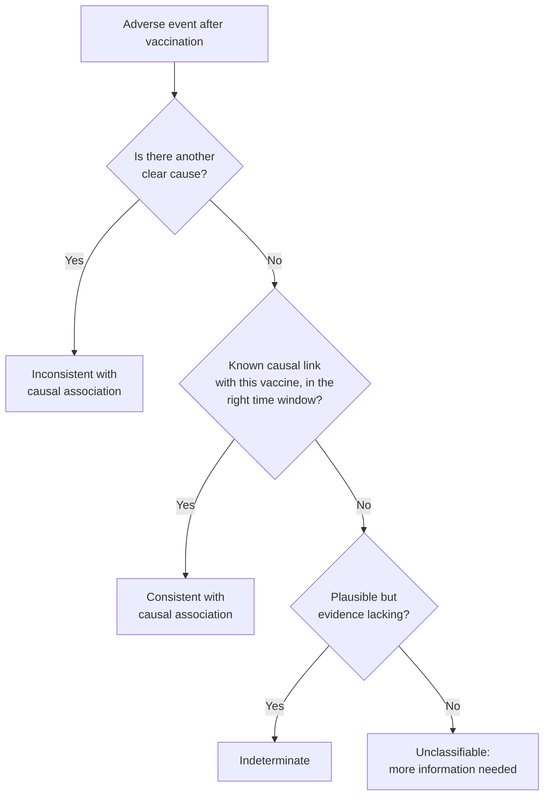

# Causality assessment

**Prerequisites:** [Causation and association](../../../epidemiology/06-causation-and-association.md); [Reading VAERS correctly](../02-development-and-regulation/08-reading-vaers-correctly.md)

*Simplified from the WHO causality assessment algorithm for individual cases ([Tozzi et al., *Vaccine* 2013 (WHO causality tool)](https://doi.org/10.1016/j.vaccine.2013.08.087)).*

## Two different questions

"Did this vaccine cause this person's illness?" and "Does this vaccine cause this illness?" are different questions. The second, **population-level** question is answered by epidemiological studies: does the illness occur more often in vaccinated people, or in the period after vaccination, than expected? The first, **individual-level** question is harder, and often cannot be answered with certainty. A vaccine that does cause, say, GBS in one per million recipients does not mean a particular GBS case after vaccination was caused by it; most such cases would have occurred anyway.

## Population-level evidence

The questions epidemiologists ask echo the **Bradford Hill considerations** ([Hill, *Proceedings of the Royal Society of Medicine* 1965](https://doi.org/10.1177/003591576505800503)):

- **Strength**: how much higher is the risk? Large relative risks (RotaShield and intussusception; Pandemrix and narcolepsy) are harder to explain by bias.
- **Consistency**: is the association found in different populations and study designs?
- **Temporality**: does the event follow vaccination in a biologically plausible window?
- **Dose–response**: is the risk higher after more doses or higher doses (myocarditis after Moderna's higher dose)?
- **Plausibility and mechanism**: is there a biological explanation (anti-PF4 antibodies in VITT)?
- **Specificity and coherence**: does the pattern fit what is known?

Study designs matter. Self-controlled designs avoid differences between vaccinated and unvaccinated people ([self-controlled designs](../../../epidemiology/09-self-controlled-designs.md)); large linked databases such as the Vaccine Safety Datalink allow rare events to be studied ([active surveillance](../02-development-and-regulation/09-active-surveillance-systems.md)); and expert committees like the IOM/NASEM weigh the whole body of evidence ([Institute of Medicine, *Adverse Effects of Vaccines: Evidence and Causality* (2011)](https://doi.org/10.17226/13164); [NASEM, *Evidence Review of the Adverse Effects of COVID-19 Vaccination* (2024)](https://doi.org/10.17226/27746)).

## Individual case assessment

For individual reports, the WHO uses a structured algorithm: check eligibility (a confirmed diagnosis and a known vaccine), then a checklist of questions about other causes, known associations, timing and strength of evidence, leading to a classification as consistent, inconsistent, indeterminate or unclassifiable ([Tozzi et al., *Vaccine* 2013 (WHO causality tool)](https://doi.org/10.1016/j.vaccine.2013.08.087)). Standard **case definitions**, such as those developed by the Brighton Collaboration, ensure that "myocarditis" or "anaphylaxis" means the same thing in different reports ([Bonhoeffer et al., *Vaccine* 2002 (Brighton Collaboration)](https://doi.org/10.1016/s0264-410x(02)00449-8)).

The approach has critics. Jacob Puliyel and a colleague argued that the 2018 revision of the WHO algorithm discounts new signals: if an event is not already known to be caused by a vaccine, cases tend to be classified as "indeterminate" or "inconsistent", making it hard for new harms to be recognised ([Puliyel & Naik, *F1000Research* 2018](https://doi.org/10.12688/f1000research.13694.2)). Defenders reply that individual case assessment is not meant to discover new harms, which is the job of population studies.

## Coincidence and base rates

Many illnesses happen by chance after vaccination simply because vaccines are given to millions of people at ages when other things happen: sudden infant death in infancy, the first signs of autism in the second year, autoimmune diseases in adolescence. Estimating how many cases would be expected by coincidence is essential before concluding that a vaccine caused them ([base rates and coincidence](../../../epidemiology/11-base-rates-and-coincidence.md)). When the COVID-19 vaccines were rolled out to older people, for example, thousands of deaths were expected within weeks of vaccination simply because of the population's age.

## Legal causation is different

Compensation programmes and courts use their own standards. The US Vaccine Injury Table presumes causation for listed injuries in set time windows, and off-table claims need a "preponderance of evidence", which can be met with a plausible theory and a logical sequence of cause and effect even where science is uncertain. Legal findings of causation therefore do not necessarily mean scientific consensus, and vice versa ([[the-vaccine-injury-table|the vaccine injury table]]).

## Key ideas

- Population-level causation is established by epidemiology; individual cases are assessed with algorithms and often remain uncertain.
- Bradford Hill considerations, case definitions and self-controlled designs are the main tools.
- Coincidental events are expected when millions are vaccinated; legal causation uses different standards.

## Where this leads

- Next: [Weighing risks against benefits](14-weighing-risks-against-benefits.md). For general principles, see [the Bradford Hill criteria](../../../../science/research-methods/reading-research/04-causation/09-bradford-hill-criteria.md) in the reading-research course.
