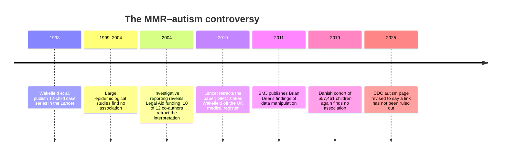

# MMR and autism

**Prerequisites:** [The MMR era](../04-history/10-the-mmr-era.md); [Cohort and case-control studies](../../../epidemiology/08-cohort-and-case-control-studies.md)

## The 1998 paper

In February 1998 Andrew Wakefield and 12 co-authors at the Royal Free Hospital in London published a case series in *The Lancet* describing 12 children with developmental regression and bowel symptoms. Parents of eight of the children associated the onset of symptoms with MMR vaccination. The paper itself stated that it did not prove a link ([Wakefield et al., *Lancet* 1998 (retracted)](https://doi.org/10.1016/S0140-6736(97)11096-0)), but at a press conference Wakefield recommended that single vaccines be used instead of MMR until more was known. Media coverage was intense, and MMR coverage in England fell from about 92% to around 80% by 2003, lower in parts of London ([the MMR era](../04-history/10-the-mmr-era.md)).

## What the epidemiology found

A case series cannot establish causation: autism is typically recognised in the second year of life, the same age at which MMR is given, so coincidence is expected ([base rates and coincidence](../../../epidemiology/11-base-rates-and-coincidence.md)). Researchers therefore compared vaccinated and unvaccinated children:

- **UK**, 1999: no change in autism trends after MMR was introduced in 1988, and no clustering of onset after vaccination ([Taylor et al., *Lancet* 1999](https://doi.org/10.1016/S0140-6736(99)01239-8)). A UK general practice database study found no association ([Smeeth et al., *Lancet* 2004](https://doi.org/10.1016/S0140-6736(04)17020-7)).
- **Denmark**, 2002: in 537,303 children, the risk of autism was the same in vaccinated and unvaccinated children ([Madsen et al., *NEJM* 2002](https://doi.org/10.1056/NEJMoa021134)). In 2019, a cohort of 657,461 children, including those with autistic siblings and other risk factors, again found no increased risk (hazard ratio 0.93) ([Hviid et al., *Annals of Internal Medicine* 2019](https://doi.org/10.7326/M18-2101)).
- **US**, 2015: among 95,727 children with older siblings, including siblings with autism (a group whose parents might be most concerned), MMR was not associated with autism ([Jain et al., *JAMA* 2015](https://doi.org/10.1001/jama.2015.3077)).
- **Meta-analysis**, 2014: of studies including about 1.2 million children found no association ([Taylor, Swerdfeger & Eslick, *Vaccine* 2014 (meta-analysis)](https://doi.org/10.1016/j.vaccine.2014.04.085)); a Cochrane review in 2020 reached the same conclusion while criticising the quality of reporting of some safety studies ([Di Pietrantonj et al., Cochrane review of MMR/MMRV vaccines, 2020](https://doi.org/10.1002/14651858.CD004407.pub4)).
- The **Institute of Medicine** in 2004 and 2011 concluded that the evidence favoured rejection of a causal relationship ([Institute of Medicine, *Immunization Safety Review: Vaccines and Autism* (2004)](https://doi.org/10.17226/10997); [Institute of Medicine, *Adverse Effects of Vaccines: Evidence and Causality* (2011)](https://doi.org/10.17226/13164)).

Laboratory claims also failed: measles virus reported in children's intestines by a laboratory linked to the litigation could not be replicated by independent laboratories ([Hornig et al., *PLoS One* 2008](https://doi.org/10.1371/journal.pone.0003140)).

## What the investigations found

Journalist Brian Deer reported in 2004 that Wakefield had been paid by a lawyer, Richard Barr, preparing a lawsuit against MMR manufacturers, funded by the UK Legal Aid Board, and that some of the 12 children were litigants. Wakefield had received more than £400,000 for this work, undisclosed to the *Lancet*, and had filed a 1997 patent application for a measles vaccine product that would have competed with MMR ([Deer, *BMJ* 2011, "How the vaccine crisis was meant to make money"](https://doi.org/10.1136/bmj.c5258)). Ten of the 12 co-authors published a retraction of the paper's interpretation in 2004 ([Murch et al., "Retraction of an interpretation", *Lancet* 2004](https://doi.org/10.1016/S0140-6736(04)15715-2)).

In 2010 the UK General Medical Council found Wakefield guilty of serious professional misconduct, including dishonesty and subjecting children to invasive procedures without ethical approval, and struck him off the medical register ([Kmietowicz, *BMJ* 2010, "Wakefield is struck off"](https://doi.org/10.1136/bmj.c2803)). The *Lancet* fully retracted the paper ([*Lancet* retraction notice, 2010](https://doi.org/10.1016/S0140-6736(10)60175-4); [Dyer, *BMJ* 2010, "Lancet retracts Wakefield's MMR paper"](https://doi.org/10.1136/bmj.c696)). In 2011 the *BMJ* published Deer's analysis comparing the paper with the children's medical records, concluding that details had been altered to fit the hypothesis, and editorialised that the paper was fraudulent ([Deer, *BMJ* 2011, "How the case against the MMR vaccine was fixed"](https://doi.org/10.1136/bmj.c5347); [Godlee, Smith & Marcovitch, *BMJ* 2011 editorial](https://doi.org/10.1136/bmj.c7452)). The senior clinician, John Walker-Smith, won a High Court appeal against his own striking-off in 2012 on the grounds that the GMC panel had not properly reasoned its decision; that ruling did not revisit Wakefield's case, which he did not appeal.

Wakefield has always denied wrongdoing, describing himself as the victim of a campaign. He moved to the US, continued to campaign on vaccine safety, and directed the 2016 film *Vaxxed* ([CDC whistleblower claims](04-cdc-whistleblower-claims.md)).

## Why the idea persists

Several factors keep the hypothesis alive: the timing coincidence; the real rise in autism diagnoses ([autism diagnosis](03-autism-the-epidemiology-of-diagnosis.md)); parents' sincere observations of regression after vaccination; distrust of institutions and of studies funded or conducted by governments or near vaccine makers; and the argument that population studies could miss a vulnerable subgroup. The subgroup argument is hard to refute entirely, but sibling studies and studies of children with genetic risk factors have looked for such groups without finding them ([Jain et al., *JAMA* 2015](https://doi.org/10.1001/jama.2015.3077); [Hviid et al., *Annals of Internal Medicine* 2019](https://doi.org/10.7326/M18-2101)).

Since November 2025, the US CDC's website has stated that the claim "vaccines do not cause autism" is not evidence-based, that the major MMR studies have methodological flaws, and that Danish findings may not apply to the US ([CDC, "Autism and Vaccines" page as revised 19 November 2025 (updated July 2026)](https://www.cdc.gov/vaccine-safety/about/autism.html)). Most scientists and medical organisations disputed the change, noting that the same reviews it cites rated the evidence against an MMR link as strong ([the 2025 HHS autism claims](05-hhs-autism-claims-2025.md)).

## Conflicts of interest on both sides

Wakefield's undisclosed Legal Aid funding and patent are a textbook case of financial conflict. Critics of the epidemiology point to conflicts on the other side: Statens Serum Institut, where some Danish authors worked, also made vaccines until 2016; some US researchers have received industry funding. Whether these conflicts biased the results is assessed by looking at consistency across independent groups and countries, the transparency of data and methods, and whether conclusions follow from the data ([[conflicts-of-interest-and-funding|conflicts of interest and funding]]). For a case study of the paper itself, see [Wakefield 1998](../../../../science/research-methods/reading-research/10-case-studies/07-wakefield-1998.md) in the reading-research course, and [a worked appraisal of Hviid 2019](../../../../science/research-methods/reading-research/11-practice/04-worked-example-a-cohort-study.md).

## Key ideas

- The 1998 case series of 12 children could not show causation and was later retracted after evidence of undisclosed conflicts and misreported data.
- Studies of millions of children in several countries found no association between MMR and autism.
- The hypothesis persists because of timing, distrust and the hard-to-exclude subgroup argument; in 2025 the US CDC revised its position.

## Where this leads

- Next: [Thimerosal and autism](02-thimerosal-and-autism.md).
