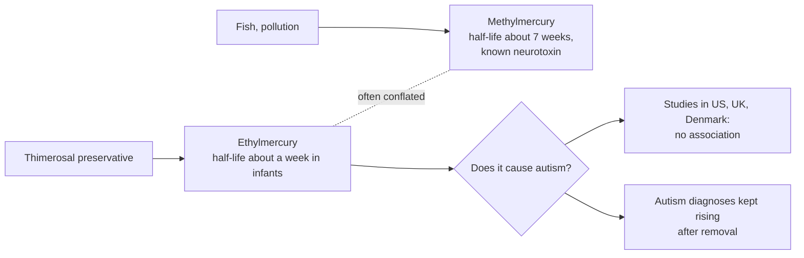

# Thimerosal and autism

**Prerequisites:** [MMR and autism](01-mmr-and-autism.md); [[vaccine-ingredients|Vaccine ingredients]]

## The preservative

Thimerosal (thiomersal) is a mercury-containing preservative used since the 1930s to prevent bacterial contamination of vaccines, especially in multi-dose vials. In the body it breaks down to **ethylmercury**, which is cleared much faster than **methylmercury**, the form in fish that is a known developmental neurotoxin. A study of infants receiving thimerosal-containing vaccines found low blood mercury levels and an estimated half-life of about a week ([Pichichero et al., *Lancet* 2002 (ethylmercury in infants)](https://doi.org/10.1016/S0140-6736(02)11682-5)).

## The 1999 decision

In 1999 a US Food and Drug Administration review found that infants following the full schedule could receive up to 187.5 micrograms of ethylmercury in the first six months, exceeding one federal guideline for methylmercury. The American Academy of Pediatrics and the Public Health Service jointly asked manufacturers to remove thimerosal "as soon as possible" as a precaution, while stating that there was no evidence of harm ([CDC, "Notice to readers: thimerosal in vaccines: a joint statement of the American Academy of Pediatrics and the Public Health Service", *MMWR* 1999;48(26):563–565](https://www.cdc.gov/mmwr/preview/mmwrhtml/mm4826a3.htm)). By 2001 routine childhood vaccines in the US were thimerosal-free or contained only trace amounts; multi-dose influenza vials still contained it.

The precautionary removal was criticised from both sides. Some scientists argued it implied a danger that did not exist and fuelled fears. Critics argued that it confirmed a danger that officials had ignored.

## The autism hypothesis

From around 2000, parent groups and some researchers proposed that thimerosal caused autism, pointing to supposed similarities between autism and mercury poisoning and to the rise in autism diagnoses in the 1990s. Robert F. Kennedy Jr.'s 2005 article "Deadly Immunity", published by *Salon* and *Rolling Stone*, alleged a cover-up; *Salon* later removed the article after corrections and criticism. Papers by Mark and David Geier, father and son, reported associations using VAERS and the Vaccine Safety Datalink; their methods were widely criticised, and Mark Geier's medical licence was suspended in Maryland in 2011. In 2025 HHS hired David Geier to analyse vaccine safety data ([NBC News, "The little-known database at the heart of Kennedy's vaccine conspiracy theory" (2025)](https://www.nbcnews.com/health/health-news/kennedy-vaccine-safety-datalink-conspiracy-theory-rcna203411)).

## The evidence

- **Vaccine Safety Datalink**, 2003: a two-phase study found inconsistent associations in one health plan that were not replicated in others ([Verstraeten et al., *Pediatrics* 2003](https://doi.org/10.1542/peds.112.5.1039)). An earlier internal analysis discussed at a 2000 meeting in Simpsonwood, Georgia, which showed preliminary signals, is cited by critics as evidence of a cover-up; CDC researchers said the signals weakened with more data and better methods.
- **Denmark**, 2003: autism rates did not differ by thimerosal exposure, and rose after thimerosal was removed from Danish vaccines in 1992 ([Hviid et al., *JAMA* 2003 (thimerosal)](https://doi.org/10.1001/jama.290.13.1763)).
- **Neuropsychological outcomes**, 2007: in 1,047 children aged 7–10, a few small associations were found in both directions among 42 outcomes, with no consistent pattern; autism was not assessed in that study ([Thompson et al., *NEJM* 2007](https://doi.org/10.1056/NEJMoa071434)).
- **Case-control**, 2010: prenatal and infant thimerosal exposure was not associated with autism ([Price et al., *Pediatrics* 2010](https://doi.org/10.1542/peds.2010-0309)).
- **California**, 2008: autism caseloads kept rising after 2004, when thimerosal exposure had fallen sharply ([Schechter & Grether, *Archives of General Psychiatry* 2008](https://doi.org/10.1001/archgenpsychiatry.2007.1)).
- The **Institute of Medicine** in 2004 concluded that the evidence favoured rejecting a causal link ([Institute of Medicine, *Immunization Safety Review: Vaccines and Autism* (2004)](https://doi.org/10.17226/10997)).

## The 2025 decision

In June 2025, at its first meeting after all members were replaced, ACIP voted to recommend only thimerosal-free influenza vaccines, and Secretary Kennedy adopted the recommendation in July ([CDC newsroom, ACIP June 2025 meeting votes](https://www.cdc.gov/media/releases/2025/2025-cdcs-advisory-committee-on-immunization-concludes-meeting-with-joint-statement.html); [HHS press release on removing thimerosal from US influenza vaccines (23 July 2025)](https://www.hhs.gov/press-room/thimerosal-mercury-removed-from-us-flu-vaccines-acip.html)). By then most US flu vaccine doses were already thimerosal-free, so the practical effect was small. Supporters described it as removing a needless neurotoxin; critics noted that a presentation to the committee cited a study that did not exist and that the decision gave official weight to a hypothesis rejected by the evidence. Globally, thimerosal remains important in multi-dose vials used in low-income countries, and the WHO continues to consider it safe.

## Lessons

The thimerosal story shows how precautionary actions can be read as admissions, how ecological arguments (rising diagnoses at the same time as rising exposure) can mislead, and how a natural experiment, removal of the exposure followed by continued rise in the outcome, can test a hypothesis.

## Key ideas

- Thimerosal contains ethylmercury, cleared much faster than methylmercury.
- It was removed from US childhood vaccines from 1999 as a precaution; autism diagnoses kept rising.
- Studies in several countries found no link; in 2025 the US moved to thimerosal-free flu vaccines.

## Where this leads

- Next: [Autism: the epidemiology of diagnosis](03-autism-the-epidemiology-of-diagnosis.md).
