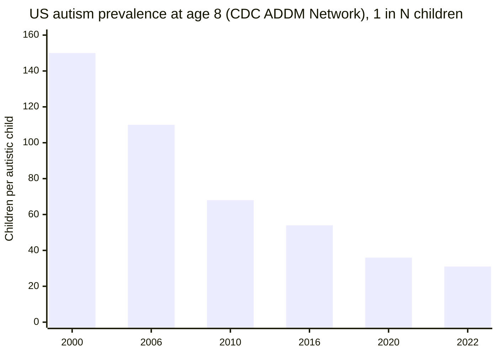

# Autism: the epidemiology of diagnosis

**Prerequisites:** [Measuring disease](../../../epidemiology/02-measuring-disease.md); [Bias and confounding](../../../epidemiology/10-bias-and-confounding.md)

*Lower bars mean higher prevalence. Source: CDC ADDM Network reports; 2022 figure from [Shaw et al., *MMWR Surveillance Summaries* 2025](https://doi.org/10.15585/mmwr.ss7402a1).*

## A real rise in diagnoses

The proportion of children diagnosed with autism has risen dramatically. The CDC's Autism and Developmental Disabilities Monitoring (ADDM) Network estimated about 1 in 150 eight-year-olds in 2000 and 1 in 31 in 2022 ([Shaw et al., *MMWR Surveillance Summaries* 2025](https://doi.org/10.15585/mmwr.ss7402a1)). Similar increases have occurred in the UK, Scandinavia, Canada and elsewhere. Because the rise coincided with expansion of the vaccine schedule, it is central to claims that vaccines cause autism. Correlation over time, however, links autism with many things that increased over the same period, from organic food sales to mobile phones; it cannot by itself identify a cause ([ecological studies](../../../../science/research-methods/reading-research/03-study-designs/03-ecological-studies.md)).

## How much is diagnosis?

Several changes in how autism is defined and found explain much of the rise:

- **Broader definitions.** The 1980 *DSM-III* described "infantile autism" narrowly. *DSM-IV* (1994) added Asperger's disorder and pervasive developmental disorder not otherwise specified; *DSM-5* (2013) merged them into a single autism spectrum.
- **Diagnostic substitution.** Children who once would have been labelled with intellectual disability or language disorder are now diagnosed with autism. In California, an estimated 26% of the increased autism caseload from 1992 to 2005 was attributable to diagnostic change alone ([King & Bearman, *International Journal of Epidemiology* 2009](https://doi.org/10.1093/ije/dyp261)).
- **Services and awareness.** US special education law added autism as a category in 1991, and insurance mandates and services now depend on the diagnosis, increasing incentives to diagnose. Public and professional awareness has grown enormously.
- **Screening and adult diagnosis.** Routine screening at 18 and 24 months, and diagnosis of girls, minority groups and adults previously overlooked, add cases. ADDM data show the gap between white children and Black, Hispanic and Asian children closing or reversing as access improved.
- **Real risk factors.** Older parental age and increased survival of very premature babies are associated with autism and may account for some genuine increase.

Whether any true increase remains after accounting for these changes is debated. Many epidemiologists believe most of the rise reflects ascertainment; others, including the current HHS leadership, believe a substantial environmental cause remains unidentified.

## What causes autism?

Twin and family studies show autism is strongly heritable. A study of over two million people in five countries estimated heritability at about 80% ([Bai et al., *JAMA Psychiatry* 2019 (autism heritability, five countries)](https://doi.org/10.1001/jamapsychiatry.2019.1411)). Hundreds of genes have been implicated, many involved in brain development. Brain tissue studies have found patches of disorganised cortex in autistic children that must have formed before birth ([Stoner et al., *NEJM* 2014](https://doi.org/10.1056/NEJMoa1307491)), and studies of prenatal factors (maternal infection, certain medications such as valproate) also point to development before birth.

Many parents first notice signs around 12–24 months, and about a quarter to a third describe regression, a loss of words or social skills. Prospective studies of infants with autistic siblings show subtle differences in eye contact and social engagement developing during the first year in many children later diagnosed, before MMR. The timing of noticing is therefore not the same as the timing of onset.

## Environmental hypotheses

Studies have examined many environmental factors, including air pollution, maternal infection, maternal diabetes and obesity, folate, pesticides and medications. Vaccines are among the most studied exposures, with large studies of MMR, thimerosal and aluminium finding no association ([MMR and autism](01-mmr-and-autism.md); [thimerosal](02-thimerosal-and-autism.md); [[aluminium-adjuvants|aluminium adjuvants]]). In 2025 HHS highlighted acetaminophen use in pregnancy; a large Swedish sibling study had found no association once family factors were accounted for ([Ahlqvist et al., *JAMA* 2024 (acetaminophen in pregnancy, Swedish siblings)](https://doi.org/10.1001/jama.2024.3172)); see [the 2025 HHS autism claims](05-hhs-autism-claims-2025.md).

## Key ideas

- Diagnosed autism prevalence in US eight-year-olds rose from about 1 in 150 (2000) to 1 in 31 (2022).
- Broader definitions, substitution, services and awareness explain much of the rise; how much true increase remains is debated.
- Autism is about 80% heritable and begins developing before birth in many cases.

## Where this leads

- Next: [CDC whistleblower claims](04-cdc-whistleblower-claims.md).
