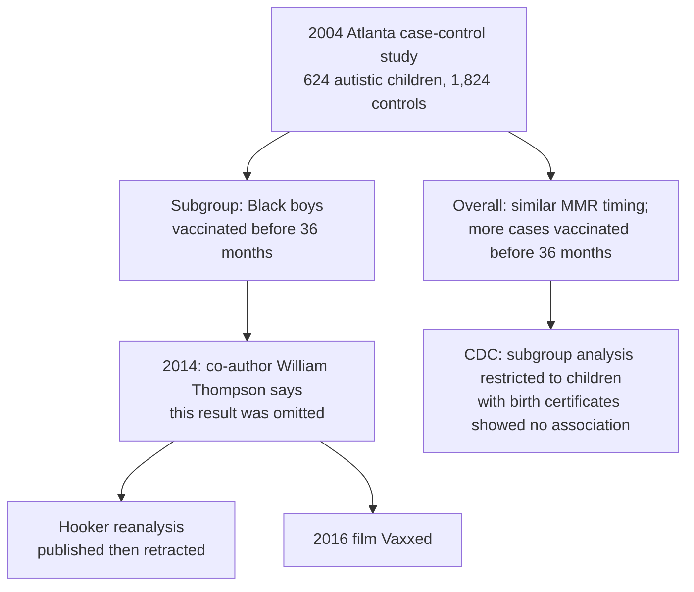

# CDC whistleblower claims

**Prerequisites:** [MMR and autism](01-mmr-and-autism.md); [Cohort and case-control studies](../../../epidemiology/08-cohort-and-case-control-studies.md)

## The study

In 2004 CDC researchers led by Frank DeStefano published a case-control study of 624 autistic children and 1,824 matched controls in metropolitan Atlanta. Most children in both groups received MMR at 12–17 months, and there was no difference in vaccination before 18 or 24 months, the ages before autism is usually recognised. More autistic children than controls had been vaccinated before 36 months (93.4% versus 90.6%), which the authors attributed to preschool special education programmes requiring vaccination ([DeStefano et al., *Pediatrics* 2004](https://doi.org/10.1542/peds.113.2.259)). In a subsample with Georgia birth certificate data, which allowed adjustment for factors such as birth weight and maternal education, the association was weaker and not statistically significant.

## The whistleblower

In August 2014, William Thompson, a CDC scientist and co-author, issued a statement through his lawyers saying he regretted that the authors had "omitted statistically significant information" from the paper: an association in African American boys vaccinated before 36 months. He said decisions to change the analysis had been made after seeing data, deviating from the study protocol. He added that he believed vaccines had saved countless lives and did not want parents to avoid them ([William W. Thompson, statement regarding the 2004 MMR–autism article (27 August 2014; archived)](https://web.archive.org/web/20150221101545/http:/www.morganverkamp.com/august-27-2014-press-release-statement-of-william-w-thompson-ph-d-regarding-the-2004-article-examining-the-possibility-of-a-relationship-between-mmr-vaccine-and-autism)). Thompson had been recorded in phone calls by Brian Hooker, a biochemist whose son was a petitioner in the vaccine court's autism proceedings. Thompson later gave documents to US Representative Bill Posey.

## The reanalysis and retraction

Hooker published a reanalysis of the CDC data in *Translational Neurodegeneration* in 2014, reporting a raised risk in African American boys. The journal retracted it within two months, citing undeclared competing interests and concerns about the validity of the statistical analysis: Hooker used a cohort-style analysis on case-control data and did not adjust for confounders ([Hooker, *Translational Neurodegeneration* 2014 (retracted)](https://doi.org/10.1186/2047-9158-3-16)). Hooker's competing interests (his son's claim, and his role with an advocacy organisation) were not disclosed.

## CDC's response

The CDC said the race-specific analysis was restricted to children with Georgia birth certificates, because race and other confounders were best measured there, and that in that sample the association was not significant. It said the original analysis plan had been modified for valid methodological reasons, and that subsequent studies, including much larger ones in other countries, found no association between MMR and autism in any subgroup examined ([Jain et al., *JAMA* 2015](https://doi.org/10.1001/jama.2015.3077); [Hviid et al., *Annals of Internal Medicine* 2019](https://doi.org/10.7326/M18-2101)). No other co-author supported Thompson's characterisation.

## Vaxxed and politics

The episode became the basis of the 2016 film *Vaxxed: From Cover-Up to Catastrophe*, directed by Andrew Wakefield and produced by Del Bigtree; it was withdrawn from the Tribeca Film Festival after criticism and then released independently. The claims of a CDC cover-up have since featured in congressional speeches, in Robert F. Kennedy Jr.'s campaigns, and in HHS's 2025 statements about vaccine safety research ([the 2025 HHS autism claims](05-hhs-autism-claims-2025.md)).

## How to assess the claim

The dispute is a useful exercise in research methods:

- **Subgroup analyses** multiply the chance of false positives; a single significant subgroup among many is weak evidence unless planned and replicated ([statistics](../../../../science/research-methods/reading-research/02-statistics/README.md) in the reading-research course).
- **Protocol deviations** matter; changing analyses after seeing data is a real problem ("researcher degrees of freedom"). Thompson's account raises legitimate questions about the conduct of the analysis.
- **Confounding**: early vaccination was associated with entry to special education services, which require up-to-date vaccination; this is a classic form of reverse causation.
- **Replication**: the claim predicts a higher autism risk in Black boys in other datasets. Later studies have not reported one, though few have looked specifically.

## Key ideas

- A CDC co-author said in 2014 that a subgroup result for Black boys was omitted from a 2004 MMR–autism study.
- A reanalysis claiming a raised risk was retracted for undisclosed conflicts and flawed methods.
- The episode raises real questions about analysis decisions but does not overturn the wider evidence.

## Where this leads

- Next: [The 2025 HHS autism claims](05-hhs-autism-claims-2025.md).
