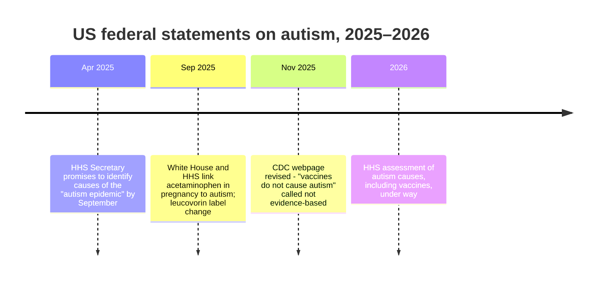

# The 2025 HHS autism claims

**Prerequisites:** [MMR and autism](01-mmr-and-autism.md); [Autism: the epidemiology of diagnosis](03-autism-the-epidemiology-of-diagnosis.md)

## A change in official position

For decades the CDC, like health agencies worldwide, stated that vaccines do not cause autism. After Robert F. Kennedy Jr., a long-time proponent of the vaccine–autism hypothesis, became HHS Secretary in 2025, that changed.

## Acetaminophen and leucovorin

On 22 September 2025 President Trump and Secretary Kennedy announced that the FDA would add information about a possible association between acetaminophen (paracetamol, Tylenol) use in pregnancy and autism and ADHD to the drug's label, and would update the label of leucovorin (folinic acid) for cerebral folate deficiency, a condition associated with some autistic symptoms ([HHS, "President Trump, Secretary Kennedy announce bold actions to tackle autism epidemic" (22 September 2025)](https://www.hhs.gov/press-room/hhs-trump-kennedy-autism-initiatives-leucovorin-tylenol-research-2025.html)). The FDA's own notice said a causal relationship had not been established and that some studies found no association ([FDA, "FDA responds to evidence of possible association between autism and acetaminophen use during pregnancy" (September 2025)](https://www.fda.gov/news-events/press-announcements/fda-responds-evidence-possible-association-between-autism-and-acetaminophen-use-during-pregnancy)). The largest sibling-controlled study, of 2.5 million Swedish children, found small associations in standard analyses that disappeared when siblings were compared, suggesting family factors rather than the drug explained them ([Ahlqvist et al., *JAMA* 2024 (acetaminophen in pregnancy, Swedish siblings)](https://doi.org/10.1001/jama.2024.3172)). Obstetric societies continued to recommend acetaminophen for fever and pain in pregnancy, since untreated fever carries its own risks.

## The CDC webpage

On 19 November 2025 the CDC revised its "Autism and Vaccines" page. It now says ([CDC, "Autism and Vaccines" page as revised 19 November 2025 (updated July 2026)](https://www.cdc.gov/vaccine-safety/about/autism.html)):

- the claim "vaccines do not cause autism" is not evidence-based, because studies have not ruled out the possibility that infant vaccines cause autism;
- studies supporting a link have been ignored by health authorities;
- the statement had been used historically "to prevent vaccine hesitancy";
- the IOM and AHRQ found the evidence inadequate to accept or reject a link between autism and DTaP and other infant vaccines;
- MMR studies have methodological flaws and Danish results may not apply to the US;
- HHS will investigate mechanisms including aluminium adjuvants and mitochondrial disorders.

The page cited the Danish aluminium study as reassuring overall but highlighted a supplementary finding for Asperger's syndrome in one birth cohort ([Andersson & Hviid, *Annals of Internal Medicine* 2025 (aluminium adjuvants, Denmark)](https://doi.org/10.7326/ANNALS-25-00997)).

## The responses

**Support.** Supporters, including some parents' groups and the Secretary, argued that proving a universal negative requires studying each vaccine, that few studies compare fully unvaccinated with vaccinated children, that the schedule as a whole has been studied little (as the IOM acknowledged in 2013, [Institute of Medicine, *The Childhood Immunization Schedule and Safety* (2013)](https://doi.org/10.17226/13563)), and that institutional statements had gone beyond the evidence.

**Criticism.** Most medical and scientific organisations, including the American Academy of Pediatrics, said the change misrepresented the evidence. They argued that:

- "Inadequate evidence to accept or reject" in IOM language reflects a lack of studies of specific pairs, not evidence of harm; the same reviews rated the evidence against an MMR–autism link as strong.
- No study can ever "rule out" every possible effect; science instead estimates how large any effect could plausibly be, and large studies make a meaningful effect very unlikely.
- Studies of total vaccine exposure, aluminium and schedule timing have found no association ([Andersson & Hviid, *Annals of Internal Medicine* 2025 (aluminium adjuvants, Denmark)](https://doi.org/10.7326/ANNALS-25-00997); [Smith & Woods, *Pediatrics* 2010](https://doi.org/10.1542/peds.2009-2489)).
- Citing a single supplementary subgroup result from a study whose main findings were null is selective reporting.
- Autism's high heritability and prenatal origins make a large vaccine effect implausible ([Bai et al., *JAMA Psychiatry* 2019 (autism heritability, five countries)](https://doi.org/10.1001/jamapsychiatry.2019.1411)).

The Andersson and Hviid paper's authors and journal rejected a request from the Secretary in 2025 to retract it. Another unpublished analysis promoted at a September 2025 Senate hearing, comparing vaccinated and unvaccinated children in the Henry Ford Health system, was criticised by independent epidemiologists for differences in follow-up and health-care use between groups ([Munblit et al., *Clinical Infectious Diseases* 2026 (critique of the Henry Ford analysis)](https://doi.org/10.1093/cid/ciag403)); see [too many, too soon](07-too-many-too-soon.md).

## The Hannah Poling case

Supporters of the hypothesis often cite *Poling*, in which the US government in 2007–08 conceded a vaccine injury claim for a girl with an underlying mitochondrial disorder whose condition worsened after vaccines, including features of autism. The government did not concede that vaccines cause autism; it agreed that the vaccines significantly aggravated her mitochondrial disorder, which presented with autistic features ([Offit, *NEJM* 2008, "Vaccines and autism revisited: the Hannah Poling case"](https://doi.org/10.1056/NEJMp0802904)). The case is discussed in [[the-omnibus-autism-proceeding|the omnibus autism proceeding]].

## Key ideas

- In 2025–26 US federal agencies moved from saying vaccines do not cause autism to saying a link has not been ruled out.
- Critics say this confuses "no studies of a specific pair" with evidence of harm; supporters say past statements overreached.
- Acetaminophen in pregnancy was also linked by HHS to autism despite sibling studies showing no association.

## Where this leads

- Next: [Aluminium adjuvants](06-aluminium-adjuvants.md).
