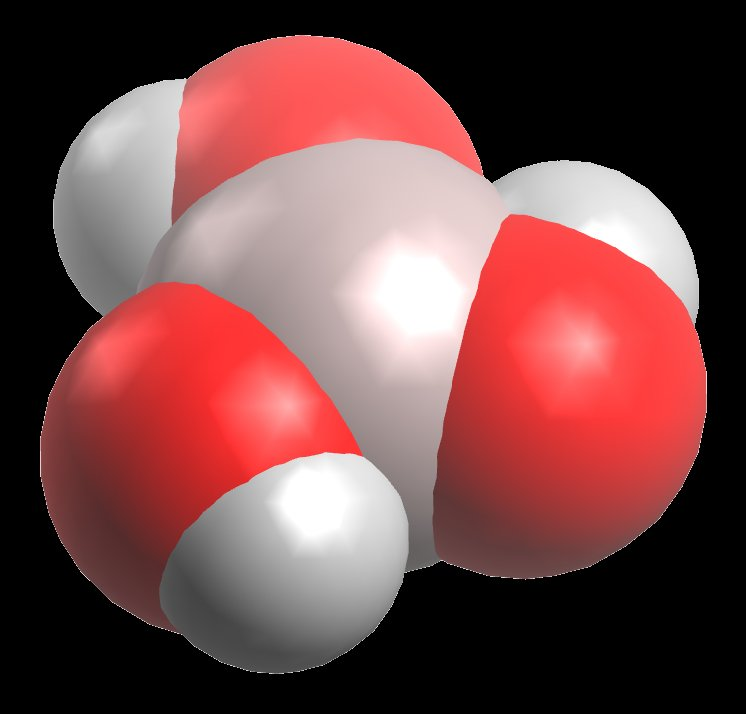

# Aluminium adjuvants

**Prerequisites:** [Adjuvants](../01-how-vaccines-work/10-adjuvants.md); [[vaccine-ingredients|Vaccine ingredients]]

*Aluminium hydroxide, one of the aluminium salts used as vaccine adjuvants since the 1930s. Credit: Hoa112008. License: Public domain. Source: [File:Aluminium hydroxide 3D spacefill.png](https://commons.wikimedia.org/wiki/File:Aluminium_hydroxide_3D_spacefill.png).*

## What they are and why they are used

Aluminium salts (aluminium hydroxide, aluminium phosphate and amorphous aluminium hydroxyphosphate sulfate) have been used as adjuvants since the 1930s to strengthen immune responses to inactivated and subunit vaccines such as DTaP, hepatitis A and B, Hib, pneumococcal conjugate and HPV vaccines ([adjuvants](../01-how-vaccines-work/10-adjuvants.md)). Live vaccines (MMR, varicella, rotavirus) do not contain them. A dose typically contains between about 0.125 and 0.85 mg of aluminium. Children vaccinated on the US schedule receive about 4 mg of aluminium from vaccines by age two ([Daley et al., *Academic Pediatrics* 2023](https://doi.org/10.1016/j.acap.2022.08.006)). Aluminium is also the most abundant metal in the earth's crust and is present in food, water, breast milk and infant formula.

## The concerns

- **Neurotoxicity.** High aluminium exposure is toxic, for example in people with kidney failure on dialysis. Critics argue that injected aluminium behaves differently from ingested aluminium (most of which is not absorbed) and may be carried to the brain by immune cells.
- **Autism.** An ecological study by Lucija Tomljenovic and Christopher Shaw correlated aluminium exposure from vaccines with autism prevalence across countries ([Tomljenovic & Shaw, *Journal of Inorganic Biochemistry* 2011](https://doi.org/10.1016/j.jinorgbio.2011.08.008)); Christopher Exley's group reported high aluminium levels in brain tissue from five people with autism ([Mold et al., *Journal of Trace Elements in Medicine and Biology* 2018](https://doi.org/10.1016/j.jtemb.2017.11.012)). The CDC's 2025 autism page cites the former as grounds for further study ([CDC, "Autism and Vaccines" page as revised 19 November 2025 (updated July 2026)](https://www.cdc.gov/vaccine-safety/about/autism.html)).
- **Autoimmunity.** Yehuda Shoenfeld proposed an "autoimmune/inflammatory syndrome induced by adjuvants" (ASIA) ([Shoenfeld & Agmon-Levin, *Journal of Autoimmunity* 2011 (ASIA)](https://doi.org/10.1016/j.jaut.2010.07.003)). French researchers described macrophagic myofasciitis, a lesion at the injection site containing aluminium, and associated it with chronic fatigue.
- **Allergy.** Aluminium adjuvants promote type 2 immune responses, raising the question of whether they increase asthma or allergy.

## The evidence

- **Pharmacokinetics.** An FDA modelling study estimated that infant body burden of aluminium from vaccines and diet stays below the minimal risk level derived from animal studies ([Mitkus et al., *Vaccine* 2011](https://doi.org/10.1016/j.vaccine.2011.09.124)). Critics question the model's assumptions about absorption of adjuvant particles.
- **Danish cohort, 2025.** In 1.2 million children, cumulative aluminium from vaccines in the first two years was not associated with any of 50 chronic disorders, including autoimmune, allergic and neurodevelopmental conditions (hazard ratio per mg for any neurodevelopmental disorder 0.93) ([Andersson & Hviid, *Annals of Internal Medicine* 2025 (aluminium adjuvants, Denmark)](https://doi.org/10.7326/ANNALS-25-00997)). The study used natural variation in aluminium content as vaccines changed over time. The 2025 CDC page highlighted a supplementary subgroup result for Asperger's syndrome; the authors noted many outcomes were tested and the main analyses were null. HHS Secretary Kennedy asked the journal to retract the paper; it declined.
- **Asthma, 2023.** A CDC-funded Vaccine Safety Datalink study of 326,991 children found a modest association between vaccine aluminium and persistent asthma (hazard ratio 1.19–1.26 per mg) ([Daley et al., *Academic Pediatrics* 2023](https://doi.org/10.1016/j.acap.2022.08.006)). The authors called for further study and noted possible residual confounding; differences in health-care use between more- and less-vaccinated children can bias such comparisons.
- **ASIA and myofasciitis** rest mainly on case series without control groups; population studies have not confirmed increased autoimmune disease after aluminium-adjuvanted vaccines.
- **Brain tissue** studies like Exley's had very few samples and no matched controls. Exley's research was funded in part by the Children's Medical Safety Research Institute, a foundation that supports research critical of vaccine safety.

## Placebo controls

Many trials, including those of HPV vaccines, used aluminium-containing placebos. Critics argue that this hides aluminium's harms by giving it to both groups; trialists reply that it isolates the effect of the antigen and preserves blinding ([the placebo controls debate](../02-development-and-regulation/03-placebo-controls-debate.md)).

## Where the debate stands

Aluminium adjuvants have a long safety record and large studies have found no link with autism or autoimmune disease. Uncertainty remains about some outcomes (asthma) and about how injected particles are distributed, and a few research groups continue to argue for harm. Funding on both sides deserves scrutiny: much safety research is done by public agencies and some by manufacturers, while much of the research alleging harm has been funded by foundations opposed to current vaccination policy ([[conflicts-of-interest-and-funding|conflicts of interest and funding]]).

## Key ideas

- Aluminium salts have been used as adjuvants since the 1930s; US children receive about 4 mg from vaccines by age two.
- A Danish study of 1.2 million children found no link with 50 chronic disorders; a US study found a modest association with asthma.
- Claims of autism and autoimmunity rest mainly on ecological studies and small case series.

## Where this leads

- Next: [Too many, too soon](07-too-many-too-soon.md).
