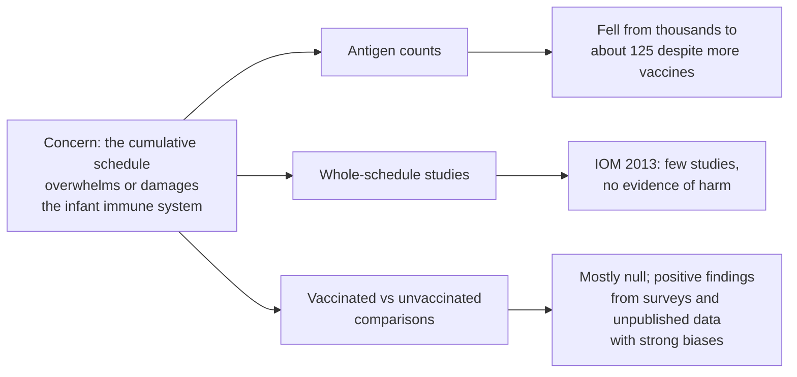

# Too many, too soon

**Prerequisites:** [Schedules over time](../05-schedules/07-schedules-over-time.md); [Alternative and delayed schedules](../05-schedules/10-alternative-and-delayed-schedules.md)

## The concern

"Too many, too soon" is the worry that the number of vaccines given in the first two years, many at the same visit, overwhelms or harms the developing immune system, causing autism, allergies, autoimmune disease or other chronic conditions. Polls have found it among the most common concerns of hesitant parents. It does not depend on any single vaccine being harmful, which makes it harder to test.

## Immunological arguments

Defenders of the schedule argue that infants encounter enormous numbers of antigens from birth, from the bacteria colonising their gut and skin, food and everyday infections. Modern vaccines are also far more purified than older ones: one analysis estimated that the full US schedule in 2000 contained about 125 antigens, compared with more than 3,000 in the 1980 schedule, mostly because whole-cell pertussis vaccine was replaced ([Offit et al., *Pediatrics* 2002](https://doi.org/10.1542/peds.109.1.124)). The same authors estimated that infants could theoretically respond to about 10,000 vaccines at once; critics point out that this is a theoretical calculation and that one of the authors, Paul Offit, co-invented a vaccine. Critics also argue that antigen number is the wrong metric, since adjuvants and injection route differ from natural exposure ([aluminium adjuvants](06-aluminium-adjuvants.md)).

## Whole-schedule evidence

The Institute of Medicine reviewed the childhood schedule in 2013 and found no evidence that it was unsafe, but noted that few studies examined the schedule as a whole, or compared alternative schedules. It concluded that a randomised trial withholding vaccines would be unethical and recommended using existing data systems such as the Vaccine Safety Datalink to study alternatives ([Institute of Medicine, *The Childhood Immunization Schedule and Safety* (2013)](https://doi.org/10.17226/13563)).

Studies of cumulative exposure have generally been reassuring:

- Children's total antigen exposure in the first two years was not associated with autism in a case-control study of 256 autistic children and 752 controls ([DeStefano, Price & Weintraub, *J Pediatrics* 2013](https://doi.org/10.1016/j.jpeds.2013.02.001)).
- Timely vaccination was not associated with worse neuropsychological outcomes at 7–10 years ([Smith & Woods, *Pediatrics* 2010](https://doi.org/10.1542/peds.2009-2489)).
- Cumulative aluminium was not associated with 50 chronic disorders in 1.2 million Danish children, though a US study found a modest association with asthma ([Andersson & Hviid, *Annals of Internal Medicine* 2025 (aluminium adjuvants, Denmark)](https://doi.org/10.7326/ANNALS-25-00997); [Daley et al., *Academic Pediatrics* 2023](https://doi.org/10.1016/j.acap.2022.08.006)).

## Vaccinated versus unvaccinated

Critics often ask for a comparison of fully vaccinated and fully unvaccinated children. Such comparisons are possible observationally, though unvaccinated children are few and their families differ in many ways, including how often they see doctors.

- In Germany's national child health survey, unvaccinated children did not have more allergic diseases than vaccinated children, and had more vaccine-preventable infections ([Schmitz et al., *Deutsches Ärzteblatt International* 2011 (KiGGS)](https://doi.org/10.3238/arztebl.2011.0099)).
- The Danish MMR cohort included unvaccinated children and found no difference in autism ([Hviid et al., *Annals of Internal Medicine* 2019](https://doi.org/10.7326/M18-2101)).
- A 2017 online survey of homeschooling mothers, led by Anthony Mawson, reported more chronic illness and neurodevelopmental disorders in vaccinated children ([Mawson et al., *Journal of Translational Science* 2017](https://doi.org/10.15761/JTS.1000186)). It relied on parental report, a self-selected sample recruited through organisations sympathetic to the hypothesis, and could not verify diagnoses; an earlier acceptance of the paper by another journal was withdrawn.
- An unpublished 2020 analysis of about 18,000 children in the Henry Ford Health system, promoted at a Senate hearing in September 2025 and in the film *An Inconvenient Study*, reported more chronic conditions among vaccinated children. Independent reviewers noted that vaccinated children had far more health-care visits and longer follow-up, making diagnoses more likely to be recorded, along with other uncontrolled confounding ([Munblit et al., *Clinical Infectious Diseases* 2026 (critique of the Henry Ford analysis)](https://doi.org/10.1093/cid/ciag403)).
- A US study found undervaccinated children had fewer outpatient visits but more hospital admissions ([Glanz et al., *JAMA Pediatrics* 2013](https://doi.org/10.1001/jamapediatrics.2013.502)), illustrating how health-care-seeking behaviour affects such comparisons.

## Why the debate persists

Each side sees a burden of proof on the other. Sceptics say the schedule should be proven safe as a whole before being given to all children. Defenders say each component has been tested, that the combination has been studied observationally, and that "proof of safety" in the absolute sense is impossible for any medical intervention. The 2026 US move to reduce the routine schedule was partly justified by this argument ([the US schedule](../05-schedules/02-the-us-schedule.md)).

For the bias that makes vaccinated–unvaccinated comparisons difficult, see [healthy-user bias](../../../../science/research-methods/reading-research/04-causation/06-healthy-user-bias.md) and [confounding](../../../../science/research-methods/reading-research/04-causation/02-confounding.md) in the reading-research course.

## Key ideas

- The concern is about cumulative exposure, not any single vaccine.
- Antigen counts fell as schedules grew; whole-schedule studies are limited but reassuring.
- Vaccinated–unvaccinated comparisons are possible but heavily confounded; positive findings come mostly from biased designs.

## Where this leads

- Next: [DTP and whole-cell pertussis](08-dtp-and-whole-cell-pertussis.md).
