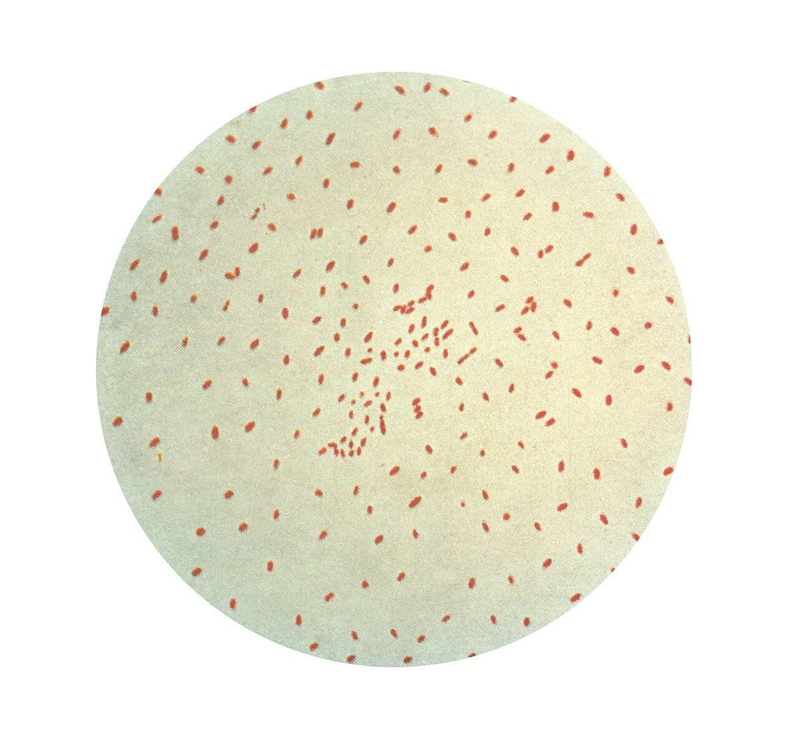

# DTP and whole-cell pertussis

**Prerequisites:** [Pertussis](../03-diseases/pertussis.md); [Febrile seizures](../06-adverse-events/02-febrile-seizures.md)

**Bordetella pertussis*, the bacterium that causes whooping cough; early vaccines contained whole killed bacteria. Credit: CDC Public Health Image Library. License: Public domain. Source: [File:Bordetella pertussis.jpg](https://commons.wikimedia.org/wiki/File:Bordetella_pertussis.jpg).*

## A reactogenic vaccine

The whole-cell pertussis vaccine, made from killed *Bordetella pertussis* bacteria and combined with diphtheria and tetanus toxoids as DTP, was introduced in the 1940s and sharply reduced whooping cough. It was also the most reactogenic routine vaccine: fever, crying, local swelling, and less commonly febrile seizures and hypotonic-hyporesponsive episodes (sudden floppiness). Whether it also caused permanent brain damage became one of the great vaccine controversies.

## The UK scare

In 1974 a paper from Great Ormond Street Hospital described 36 children with neurological illness after DTP ([Kulenkampff, Schwartzman & Wilson, *Archives of Disease in Childhood* 1974](https://doi.org/10.1136/adc.49.1.46)). Media coverage and campaigns by parents' groups followed. Coverage of pertussis vaccination in England fell from about 80% to about 30% by 1978, and large epidemics followed in 1977–79 and 1981–82, with tens of thousands of cases and dozens of deaths. Japan suspended vaccination in 1975 after two infant deaths and saw a resurgence; Sweden stopped whole-cell vaccination in 1979 because of concerns about safety and efficacy. A comparison of countries found that those where anti-vaccine movements disrupted pertussis vaccination had 10 to 100 times higher incidence than those that maintained it ([Gangarosa et al., *Lancet* 1998](https://doi.org/10.1016/S0140-6736(97)04334-1)).

The UK's National Childhood Encephalopathy Study, a case-control study published in 1981, estimated a small risk of serious acute neurological illness after DTP, about 1 in 110,000 doses. Its interpretation was disputed for decades, including in British court cases, where judges in 1988 (*Loveday v Renton*) found that it had not been proven on the balance of probabilities that the vaccine could cause permanent brain damage.

## The US: *DPT: Vaccine Roulette*

In 1982 a Washington television documentary, *DPT: Vaccine Roulette*, presented children said to have been brain-damaged by the vaccine. Parents formed Dissatisfied Parents Together, which became the National Vaccine Information Center, an organisation still prominent in vaccine-safety advocacy. Lawsuits multiplied, liability insurance became scarce, and several manufacturers left the market, threatening supply. Congress responded with the National Childhood Vaccine Injury Act of 1986 ([the 1980s DTP lawsuits](../08-litigation-and-compensation/01-the-1980s-dtp-lawsuits.md); [the 1986 Act](../08-litigation-and-compensation/02-the-national-childhood-vaccine-injury-act-1986.md)).

## What the evidence later showed

The Institute of Medicine's 1991 review found that the evidence indicated a causal link between DTP and anaphylaxis and prolonged inconsolable crying, was consistent with a causal link to acute encephalopathy and shock-like episodes, and did not indicate a link with infantile spasms or SIDS; evidence on chronic neurological damage was limited ([Institute of Medicine, *Adverse Effects of Pertussis and Rubella Vaccines* (1991)](https://doi.org/10.17226/1815)). Large studies found that DTP increased the risk of febrile seizures on the day of vaccination without long-term harm ([Barlow et al., *NEJM* 2001](https://doi.org/10.1056/NEJMoa003077)).

Genetics later cast new light on many cases. Children with Dravet syndrome, a severe genetic epilepsy caused by SCN1A mutations, often have their first seizure with fever, including vaccine fever. In a study of 14 patients diagnosed with "vaccine encephalopathy", 11 had SCN1A mutations ([Berkovic et al., *Lancet Neurology* 2006](https://doi.org/10.1016/S1474-4422(06)70446-X)), and vaccination brought forward but did not change the course of the disease ([McIntosh et al., *Lancet Neurology* 2010](https://doi.org/10.1016/S1474-4422(10)70107-1)). This does not exclude other rare harms, but it means that many of the most severe cases that drove the controversy were probably genetic.

## Acellular vaccines and their trade-off

Japan developed acellular pertussis vaccines (DTaP), containing a few purified proteins, in 1981. They cause far fewer reactions, and the US and other rich countries switched in the 1990s. But protection from acellular vaccines wanes faster, and in animal studies they prevented disease but not infection and transmission ([Klein et al., *NEJM* 2012](https://doi.org/10.1056/NEJMoa1200850); [Warfel, Zimmerman & Merkel, *PNAS* 2014](https://doi.org/10.1073/pnas.1314688110)). Pertussis has resurged in many countries using them, prompting adolescent boosters and vaccination in pregnancy. Most low- and middle-income countries still use whole-cell vaccines, which are cheaper and possibly more durable.

Researchers in Guinea-Bissau have also argued that DTP may have "non-specific effects" increasing overall mortality, particularly in girls ([Mogensen et al., *EBioMedicine* 2017](https://doi.org/10.1016/j.ebiom.2017.01.041)). A WHO-commissioned review found the evidence inconsistent and at high risk of bias, and WHO continues to recommend DTP ([Higgins et al., *BMJ* 2016 (WHO-commissioned review)](https://doi.org/10.1136/bmj.i5170)).

## Key ideas

- Whole-cell DTP was effective but reactogenic; fears of brain damage caused coverage collapses and epidemics in the UK, Japan and Sweden.
- Later evidence showed febrile seizures and other acute reactions, but many cases of "vaccine encephalopathy" were genetic epilepsy.
- Acellular vaccines are safer but less durable, contributing to pertussis resurgence.

## Where this leads

- Next: [HPV vaccine safety claims](09-hpv-vaccine-safety-claims.md).
