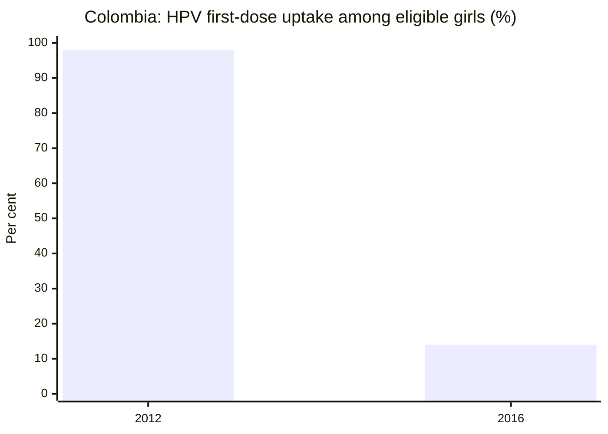

# HPV vaccine safety claims

**Prerequisites:** [[hpv-and-cervical-cancer|HPV and cervical cancer]]; [Syncope and shoulder injuries](../06-adverse-events/04-syncope-and-shoulder-injuries.md)

*Figure: HPV vaccine first-dose uptake in Colombia before and after the 2014 Carmen de Bolívar events, from Simas et al. 2019.*

## Why HPV vaccines attract controversy

Human papillomavirus vaccines, licensed from 2006, prevent infection with the virus types that cause most cervical cancers and many anal, throat and genital cancers. They are given to pre-teens and teenagers, an age when many chronic conditions such as chronic fatigue, postural orthostatic tachycardia syndrome (POTS) and functional disorders first appear, and when fainting after injection is common. They also prevent a sexually transmitted infection, which adds a moral dimension in some communities. Several countries have seen safety scares that sharply reduced uptake.

## Japan, 2013–2022

Japan began funding HPV vaccination in 2010 and coverage reached more than 70%. In June 2013, two months after adding it to the national programme, the health ministry suspended its "proactive recommendation" after media reports of chronic pain, movement disorders and other symptoms in vaccinated girls. The vaccine remained available, but coverage fell below 1%. A modelling study estimated that the crisis from 2013 to 2019 would cause about 5,000–5,700 extra cervical cancer deaths among women born in 1994–2007 if the missed cohorts were not caught up ([Simms et al., *Lancet Public Health* 2020 (HPV vaccine hesitancy in Japan)](https://doi.org/10.1016/S2468-2667(20)30010-4)). A survey of about 30,000 young women in Nagoya found no association between vaccination and 24 reported symptoms ([Suzuki & Hosono, *Papillomavirus Research* 2018 (Nagoya study)](https://doi.org/10.1016/j.pvr.2018.02.002)). Japan resumed the proactive recommendation in April 2022, with a catch-up programme for missed cohorts.

## Denmark, 2015

In March 2015, the Danish channel TV2 broadcast the documentary *De vaccinerede piger* ("The vaccinated girls"), featuring young women who believed the vaccine had caused POTS and other illnesses. A Danish syncope clinic reported a case series of 35 women with orthostatic intolerance after vaccination ([Brinth et al., *Vaccine* 2015](https://doi.org/10.1016/j.vaccine.2015.03.098)). Uptake fell to about half its baseline level, then recovered after a national information campaign from 2017, though an estimated 26,000 fewer girls started vaccination than would have otherwise ([Hansen, Schmidtblaicher & Brewer, *Vaccine* 2020](https://doi.org/10.1016/j.vaccine.2019.12.019)).

## Colombia, 2014

In 2014, a group of schoolgirls in the town of El Carmen de Bolívar developed fainting, shortness of breath and numbness after HPV vaccination. Videos spread on television and YouTube, and more than 600 cases were reported nationally. The national health institute investigated and found no organic link, concluding that it was mass psychogenic illness. First-dose uptake nevertheless fell from 98% in 2012 to 14% in 2016 ([Simas et al., *Human Vaccines & Immunotherapeutics* 2019 (Carmen de Bolívar)](https://doi.org/10.1080/21645515.2018.1511667)).

## What the regulators and studies found

In 2015, after Denmark's concerns, the European Medicines Agency reviewed complex regional pain syndrome (CRPS) and POTS. It compared reported cases with the numbers expected in young women anyway, about 150 per million per year for each syndrome, and concluded that the evidence did not support a causal link ([European Medicines Agency, "Review concludes evidence does not support that HPV vaccines cause CRPS or POTS" (November 2015)](https://www.ema.europa.eu/en/news/review-concludes-evidence-does-not-support-hpv-vaccines-cause-crps-or-pots)). A study of almost one million Swedish and Danish girls found no consistent association with 53 autoimmune, neurological and thrombotic conditions ([Arnheim-Dahlström et al., *BMJ* 2013](https://doi.org/10.1136/bmj.f5906)). The WHO's Global Advisory Committee on Vaccine Safety reached similar conclusions.

Supporters of the vaccine-injury view say that POTS and CRPS are hard to diagnose, that registry studies may miss them, and that patients were dismissed. The Danish syncope clinic, and some patient groups, continue to argue for a link.

## The Cochrane dispute

In 2018 the Cochrane Collaboration published a review of trials concluding that HPV vaccines protect against cervical pre-cancer, with no increased risk of serious adverse events ([Arbyn et al., Cochrane review of HPV vaccines, 2018](https://doi.org/10.1002/14651858.CD009069.pub3)). Researchers from the Nordic Cochrane Centre, Lars Jørgensen, Peter Gøtzsche and Tom Jefferson, criticised it in a separate journal, arguing that it missed trials, relied on industry-funded studies, used active "placebos" containing aluminium adjuvant, and did not fully assess serious harms ([Jørgensen, Gøtzsche & Jefferson, *BMJ Evidence-Based Medicine* 2018](https://doi.org/10.1136/bmjebm-2018-111012)). The review's editors rejected most of the criticisms. Gøtzsche had earlier complained to the EMA about its review, and he was expelled from Cochrane's governing board in 2018, in a dispute over his conduct that also involved wider disagreements. The episode is a rare example of a serious scientific critique from within the evidence-based medicine movement rather than from vaccine opponents. The underlying point about aluminium-containing comparators is discussed in [aluminium adjuvants](06-aluminium-adjuvants.md).

## The evidence of benefit

Population studies now show large falls in cervical cancer. In Sweden, girls vaccinated before 17 had an 88% lower risk of invasive cervical cancer ([Lei et al., *NEJM* 2020](https://doi.org/10.1056/NEJMoa1917338)); in England, cervical cancer rates in women offered vaccination at 12–13 were 87% lower ([Falcaro et al., *Lancet* 2021](https://doi.org/10.1016/S0140-6736(21)02178-4)); in Scotland, high-grade pre-cancer fell sharply ([Palmer et al., *BMJ* 2019](https://doi.org/10.1136/bmj.l1161)).

## Litigation

In the United States, product-liability suits against Merck alleging injuries from Gardasil have been brought by firms including Wisner Baum. Robert F. Kennedy Jr. had a contingency-fee interest in some of these cases and pledged to pass it to his son on becoming health secretary ([New York Times, "RFK Jr. says he won't keep financial stake in HPV vaccine lawsuits" (30 January 2025)](https://www.nytimes.com/2025/01/30/health/rfk-jr-hpv-vaccine-lawsuits-fees.html)). See [[litigation-outside-the-vicp|litigation outside the VICP]].

## Key ideas

- HPV vaccines are given at an age when many functional and autonomic conditions first appear, making coincidental associations likely.
- Safety scares in Japan, Denmark and Colombia sharply reduced uptake; modelling suggests thousands of extra deaths in Japan.
- Regulators found no causal link with CRPS or POTS; serious methodological critique came from the Nordic Cochrane Centre.

## Where this leads

- Next: [COVID-19 vaccines, mandates and mortality](10-covid-19-vaccines-mandates-and-mortality.md).
