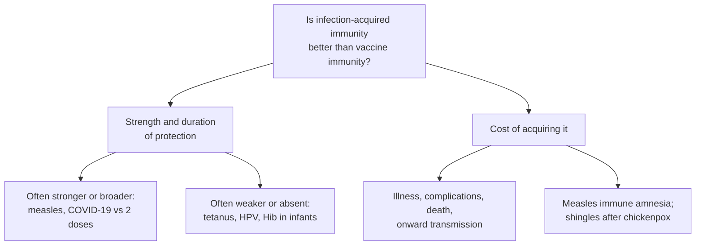

# Natural versus vaccine immunity

**Prerequisites:** [Immunological memory](../../07-immunological-memory.md); [Measles](../03-diseases/measles.md)

## The argument

A common argument against vaccination is that immunity gained by catching a disease is "natural", stronger and longer-lasting than vaccine immunity, so children are better off getting childhood infections. Like most vaccine debates, part of this is true and part is not, and the answer differs by disease.

## Where infection gives stronger immunity

For some diseases, infection does produce more durable protection. Antibodies after measles, mumps and rubella infection last for decades; one study estimated antibody half-lives of more than 200 years after infection with these viruses ([Amanna, Carlson & Slifka, *NEJM* 2007](https://doi.org/10.1056/NEJMoa066092)). Vaccine-induced antibodies to mumps wane faster, which helps explain mumps outbreaks among vaccinated young adults.

During the COVID-19 Delta wave, an Israeli study of 124,500 people found that never-infected people who had two doses of the Pfizer vaccine had about 13 times the risk of breakthrough infection of unvaccinated people who had previously been infected, when the first event happened in early 2021 ([Gazit et al., *Clinical Infectious Diseases* 2022](https://doi.org/10.1093/cid/ciac262)). People with both infection and vaccination ("hybrid immunity") had the best protection. Critics of COVID-19 mandates cited such findings to argue that prior infection should have counted as equivalent to vaccination, as it did in some European countries.

## Where vaccines give better or the only immunity

For other diseases, infection gives little or no lasting protection:

- **Tetanus.** The amount of toxin that causes disease is too small to induce immunity, so survivors are vaccinated. Vaccine-induced antibodies decline slowly, with a half-life of about 14 years ([Hammarlund et al., *Clinical Infectious Diseases* 2016](https://doi.org/10.1093/cid/ciw066)).
- **HPV.** Many people clear infection without producing high antibody levels, while vaccination produces much higher levels.
- **Hib and pneumococcus in infants.** Children under two respond poorly to the bacteria's sugar coat; conjugate vaccines overcome this.
- **Pertussis.** Both infection and vaccination give immunity that wanes over years.

## The price of natural immunity

The key difference is not the immunity but the cost of acquiring it. To gain natural immunity to measles, a child must have measles, with its risks of pneumonia, encephalitis and death. Measles also suppresses the immune system: a study of unvaccinated Dutch children found that infection wiped out between 11% and 73% of their existing antibodies to other pathogens, an effect called immune amnesia that was not seen after MMR vaccination ([Mina et al., *Science* 2019](https://doi.org/10.1126/science.aay6485)). Before vaccination, measles may have been responsible for a large share of childhood deaths from other infections ([Mina et al., *Science* 2015](https://doi.org/10.1126/science.aaa3662)).

Chickenpox infection leaves the virus dormant in nerves, where it can later cause shingles; the vaccine strain can also become latent but causes shingles less often. And natural infection spreads to others, including infants and immunocompromised people who cannot be vaccinated.

## Chickenpox and measles parties

Before chickenpox vaccine, some parents held "chickenpox parties" to infect children while young, when the disease is milder than in adults. Such parties have occasionally been reported in vaccine-sceptical communities since, including for measles. Public health bodies advise against them because complications cannot be predicted.

## Is "natural" a useful category?

Vaccines work by mimicking infection, using the same immune machinery. Calling one form of immunity "natural" can imply it is purer or safer, which is an appeal to nature rather than evidence. On the other hand, dismissing infection-acquired immunity when the evidence shows it is protective, as some COVID-19 policies did, can also undermine trust.

## Key ideas

- Infection gives stronger immunity for some diseases (measles, COVID-19 compared with two doses) and weaker or none for others (tetanus, HPV, Hib in infants).
- The cost of natural immunity is the disease itself, including complications such as measles immune amnesia.
- Policies that ignored prior infection were criticised even by vaccine supporters.

## Where this leads

- Next: [The historical mortality decline argument](12-historical-mortality-decline-argument.md).
