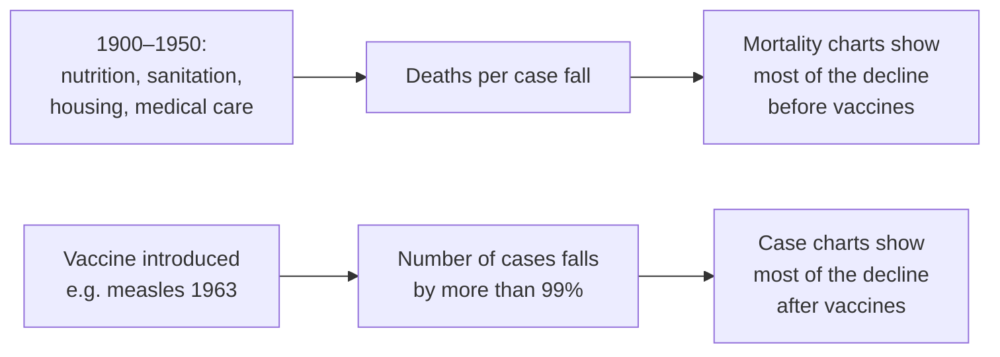

# The historical mortality decline argument

**Prerequisites:** [Measles](../03-diseases/measles.md); [the history section](../04-history/README.md)

## The argument

A popular argument holds that deaths from infectious diseases were falling long before vaccines were introduced, so vaccines deserve little credit. It is illustrated with charts showing death rates from measles, whooping cough or scarlet fever falling steeply from the 1900s, with the vaccine's introduction marked near the bottom. The book *Dissolving Illusions* (2013) by physician Suzanne Humphries and Roman Bystrianyk popularised the argument among vaccine sceptics.

## What is true about it

The charts are generally accurate as far as they go. In the industrialised world, deaths from many infectious diseases fell dramatically in the late 19th and early 20th centuries, before vaccines or antibiotics were available. The physician and demographer Thomas McKeown argued in *The Modern Rise of Population* (1976) that improved nutrition, rather than medicine, explained most of the fall in mortality. Historians have since argued that sanitation, clean water, housing, smaller families and better medical care also mattered. Scarlet fever, for which there is still no vaccine, declined without one.

## What the argument leaves out

**Deaths are not cases.** Better nutrition and medical care reduced the proportion of measles cases that ended in death, but nearly every child still caught measles. The US reported several hundred thousand measles cases a year until the 1963 vaccine, after which cases fell by more than 99%. Similar falls in cases followed vaccines against diphtheria, polio, rubella, mumps and pertussis. Analysis of more than a century of US disease reports estimated that vaccines prevented about 100 million cases of contagious disease since 1924 ([van Panhuis et al., *NEJM* 2013 (Project Tycho)](https://doi.org/10.1056/NEJMms1215400)).

**Disability matters, not only death.** Rubella killed few people, but caused congenital rubella syndrome in babies; polio paralysed many more people than it killed. Mortality charts hide these harms.

**Some diseases became worse with better hygiene.** Paralytic polio epidemics grew in the early 20th century precisely because cleaner living conditions delayed infection beyond infancy, when it was more likely to cause paralysis ([polio](../03-diseases/polio.md)).

**Resurgence when vaccination falls.** When pertussis vaccination collapsed in the UK, Japan and Sweden in the 1970s, despite modern nutrition and sanitation, pertussis returned ([DTP and whole-cell pertussis](08-dtp-and-whole-cell-pertussis.md)). Measles outbreaks in undervaccinated communities in North America in 2025–26 show the same thing.

**The log scale and starting point.** Choosing a linear scale and a starting point decades before vaccine introduction makes later falls look trivial. On a logarithmic scale, the vaccine-era falls in cases are often as large as all earlier progress.

## What both sides can agree on

Vaccines were not the main reason for the fall in overall mortality in rich countries before 1950; living conditions were. But after those improvements, vaccines prevented most remaining cases of the diseases they target, and they matter even more where nutrition and health care are poorer. The argument is a useful case study of how a true chart can support a false conclusion ([ecological studies](../../../../science/research-methods/reading-research/03-study-designs/03-ecological-studies.md)).

## Key ideas

- Mortality from many infections fell before vaccines, thanks to nutrition, sanitation and better care.
- Cases, disability and resurgence after vaccination stops show vaccines' separate effect.
- Graph choices such as scale, starting point and deaths versus cases shape the impression.

## Where this leads

- Next: [SIDS and vaccines](13-sids-and-vaccines.md).
