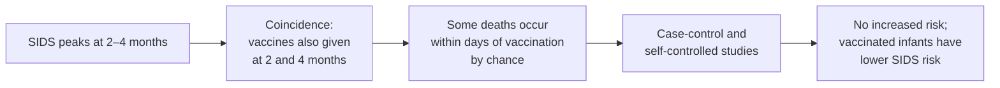

# SIDS and vaccines

**Prerequisites:** [Causality assessment](../06-adverse-events/13-causality-assessment.md)

## The concern

Sudden infant death syndrome (SIDS) is the unexplained death of an apparently healthy baby, usually during sleep. Its peak age, two to four months, coincides with the first infant vaccinations. Inevitably, some babies die within days of vaccination by chance, and for parents and some doctors the timing suggests a cause. In the late 1970s and 1980s, several SIDS deaths after DTP vaccination in the US and elsewhere fuelled the whole-cell pertussis controversy ([DTP](08-dtp-and-whole-cell-pertussis.md)).

## Expected coincidences

Before vaccine introduction, statisticians can estimate how many SIDS deaths will occur by chance within a week of vaccination. In a country with many SIDS deaths a year and nearly universal vaccination, dozens of such deaths are expected even if vaccines have no effect. Reports to passive surveillance systems such as VAERS cannot distinguish coincidence from causation ([passive surveillance](../../../../science/research-methods/reading-research/03-study-designs/13-passive-surveillance-and-pharmacovigilance.md)).

## The evidence

- The Institute of Medicine reviewed the evidence in 2003 and concluded that it favoured rejection of a causal relationship between DTP vaccine and SIDS, and between multiple vaccines given together and SIDS ([Institute of Medicine, *Vaccinations and Sudden Unexpected Death in Infancy* (2003)](https://doi.org/10.17226/10649)).
- A German case-control study of 307 SIDS cases and 971 controls found that babies who died were vaccinated less often and later, and found no increased risk in the 14 days after vaccination, including with new six-in-one vaccines ([Vennemann et al., *Vaccine* 2007](https://doi.org/10.1016/j.vaccine.2006.07.027)).
- A meta-analysis of nine case-control studies found that vaccinated babies had about half the risk of SIDS (summary odds ratio 0.54 in the adjusted studies). The authors noted that this may be partly causal but that the healthy vaccinee effect could explain some of it ([Vennemann et al., *Vaccine* 2007 (meta-analysis)](https://doi.org/10.1016/j.vaccine.2007.02.077)).

## What did reduce SIDS

The biggest change came from sleep position. Campaigns to put babies to sleep on their backs, such as "Back to Sleep" in the US from 1994, were followed by falls of around half in SIDS rates. Other risk factors include smoking during pregnancy or around the baby, soft bedding, overheating and some forms of bed-sharing. Over the same decades, the number of infant vaccines increased while SIDS rates fell, which is consistent with vaccines not being a major cause, though as an ecological pattern it proves little either way.

## Infant mortality and number of doses

A 2011 paper by Neil Miller and Gary Goldman reported that among rich countries, those giving more vaccine doses in infancy had higher infant mortality ([Miller & Goldman, *Human & Experimental Toxicology* 2011](https://doi.org/10.1177/0960327111407644)). The analysis was ecological and did not account for differences in how countries record infant deaths; a later reanalysis using all countries found no such association ([Nysetvold et al., "Infant vaccination does not predict increased infant mortality rate: correcting past misinformation", medRxiv preprint 2021](https://doi.org/10.1101/2021.09.03.21263082)). See [comparing schedules](../05-schedules/06-comparing-schedules.md).

## Diagnostic shifts

SIDS is a diagnosis of exclusion, and many deaths once called SIDS are now classed as accidental suffocation or "sudden unexpected infant death". These shifts complicate trends over time. Some critics argue that sudden deaths after vaccination are under-investigated; supporters reply that the controlled studies above directly compared vaccinated and unvaccinated infants.

## Key ideas

- SIDS peaks at the age of infant vaccination, so chance associations are expected.
- Controlled studies find no increased risk; vaccinated infants have lower SIDS risk, possibly partly from healthy vaccinee bias.
- Back-sleeping campaigns, not vaccination changes, explain most of the fall in SIDS.

## Where this leads

- Next: [Conflicts of interest and funding](14-conflicts-of-interest-and-funding.md).
