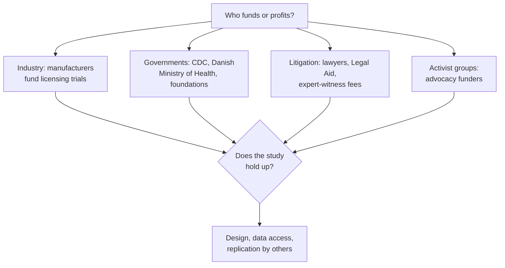

# Conflicts of interest and funding

**Prerequisites:** [MMR and autism](01-mmr-and-autism.md); the reading-research section on [funding and conflicts](../../../../science/research-methods/reading-research/08-funding-and-conflicts/README.md)

## Why this lesson exists

Both sides of vaccine debates accuse the other of being bought. Defenders of vaccines point to lawyers and activists who profit from injury claims; critics point to manufacturers, regulators who later work for industry, and scientists with patents. Both kinds of conflict are real. This lesson sets out the main documented examples on each side, then asks what a reader should do with them. The general principles are covered in the reading-research course, especially [what a conflict of interest is](../../../../science/research-methods/reading-research/08-funding-and-conflicts/02-what-a-conflict-of-interest-is.md) and [weighing conflicts without ad hominem](../../../../science/research-methods/reading-research/08-funding-and-conflicts/05-weighing-conflicts-without-ad-hominem.md).

## Industry funding

Manufacturers pay for the trials that lead to licensing, because regulators require them and governments rarely fund them. A Cochrane methodology review found that industry-sponsored drug and device studies more often report favourable results and conclusions than independently funded ones, and that this was not explained by standard risk-of-bias measures ([Lundh et al., Cochrane methodology review, 2017](https://doi.org/10.1002/14651858.MR000033.pub3)). For vaccines specifically, a systematic review of influenza-vaccine studies found that government-funded studies were less likely to reach conclusions favouring the vaccines, and that industry-funded studies were published in higher-impact journals and cited more, regardless of quality ([Jefferson et al., *BMJ* 2009](https://doi.org/10.1136/bmj.b354)). Its lead author, Tom Jefferson, himself disclosed past GlaxoSmithKline shares and consultancy fees, a reminder that disclosure is common across the spectrum.

Most of the large safety studies cited in this course were not industry-funded. The Danish MMR study was funded by the Novo Nordisk Foundation and the Danish Ministry of Health, which state that they had no role in design or analysis ([Hviid et al., *Annals of Internal Medicine* 2019](https://doi.org/10.7326/M18-2101)). Critics point out that the State Serum Institute, where many Danish researchers worked, also produced and sold vaccines until it sold that business in 2016–17, and that government health agencies have an institutional interest in their own programmes ([Danish schedules](../05-schedules/05-the-danish-and-nordic-schedules.md)). Studies using the Vaccine Safety Datalink are run by the CDC, which also promotes vaccination; this is a non-financial conflict of the kind discussed in [non-financial conflicts](../../../../science/research-methods/reading-research/08-funding-and-conflicts/06-non-financial-conflicts.md).

## Scientists with commercial interests

**Paul Offit**, a prominent vaccine defender, co-invented the rotavirus vaccine RotaTeq. In 2008 the Children's Hospital of Philadelphia sold its royalty interest for $182 million ([BioSpace, "Royalty Pharma AG acquires royalty interest in RotaTeq for $182 million" (2008)](https://www.biospace.com/royalty-pharma-ag-acquires-royalty-interest-in-rotateq-r-for-182-million)); Offit told *Wired* his share was "several million dollars" ([Amy Wallace, *Wired*, "An epidemic of fear" (October 2009)](https://www.wired.com/2009/10/ff-waronscience/)). Critics say this taints his advocacy; Offit and supporters reply that it is disclosed and that his arguments rest on studies by others. He has argued that funding should matter less than "the strength and the internal consistency of the study, robustness and reproducibility of the data" ([*The Guardian*, "Professor who claims vaccines linked to autism funded through university portal" (1 June 2019)](https://www.theguardian.com/society/2019/jun/01/professor-who-links-vaccines-to-autism-funded-through-university-portal)).

**Andrew Wakefield**, author of the 1998 MMR paper, was paid by lawyers preparing litigation against MMR manufacturers, with funds from the UK Legal Aid Board, eventually totalling £435,643 plus expenses, and in 1997 filed a patent application for a single measles vaccine and related products ([Deer, *BMJ* 2011, "How the vaccine crisis was meant to make money"](https://doi.org/10.1136/bmj.c5258)). Neither was disclosed in the paper. The conflicts did not prove the findings wrong; it was the later evidence of data manipulation, and failure to replicate, that did ([Deer, *BMJ* 2011, "How the case against the MMR vaccine was fixed"](https://doi.org/10.1136/bmj.c5347); [Godlee, Smith & Marcovitch, *BMJ* 2011 editorial](https://doi.org/10.1136/bmj.c7452); [Wakefield case study](../../../../science/research-methods/reading-research/10-case-studies/07-wakefield-1998.md)).

## Critics' funding and interests

- **Litigation.** Robert F. Kennedy Jr., a long-time vaccine critic and later US health secretary, kept a contingency-fee interest in lawsuits against Merck over Gardasil, and before taking office pledged to pass that interest to his son ([New York Times, "RFK Jr. says he won't keep financial stake in HPV vaccine lawsuits" (30 January 2025)](https://www.nytimes.com/2025/01/30/health/rfk-jr-hpv-vaccine-lawsuits-fees.html)). Lawyers in vaccine-injury cases, and experts on both sides, are paid for their work; in the US vaccine court, petitioners' reasonable legal costs are paid even when they lose ([[vaccine-injury-compensation-program|the VICP]]).
- **Advocacy funders.** Christopher Exley's aluminium research at Keele University, including the brain-tissue study, was part-funded by the Children's Medical Safety Research Institute, a US organisation that challenges vaccine safety, and he also received public donations ([*The Guardian*, "Professor who claims vaccines linked to autism funded through university portal" (1 June 2019)](https://www.theguardian.com/society/2019/jun/01/professor-who-links-vaccines-to-autism-funded-through-university-portal); [Mold et al., *Journal of Trace Elements in Medicine and Biology* 2018](https://doi.org/10.1016/j.jtemb.2017.11.012)).
- **Personal stakes.** Brian Hooker, whose 2014 reanalysis of CDC data claimed an MMR–autism link in African American boys, has described his son as vaccine-injured. The paper was retracted because of undeclared competing interests that compromised peer review, and concerns about its methods ([Retraction note, *Translational Neurodegeneration* 2014](https://doi.org/10.1186/2047-9158-3-22); [CDC whistleblower claims](04-cdc-whistleblower-claims.md)).

These are described in general terms in [activist and litigation-funded research](../../../../science/research-methods/reading-research/08-funding-and-conflicts/07-activist-and-litigation-funded-research.md).

## Regulators and advisers

Critics highlight the "revolving door" between regulators and industry, such as former CDC director Julie Gerberding becoming head of Merck's vaccine division in 2010, and the fact that FDA user fees from companies fund part of drug and vaccine review. Members of US advisory committees must declare conflicts and may be excluded from votes. In June 2025 the new health secretary removed all 17 members of the CDC's vaccine advisory committee, citing conflicts of interest, and appointed replacements including several prominent critics of vaccine policy. FactCheck.org found that the few examples he gave were misconstrued or decades old, that members already had to file and update financial disclosures, and that three of the new members had filed statements in court against vaccine manufacturers, two of them paid to do so ([FactCheck.org, "RFK Jr.'s flawed justifications for 'clean sweep' of CDC vaccine advisory panel" (June 2025)](https://www.factcheck.org/2025/06/rfk-jr-s-flawed-justifications-for-clean-sweep-of-cdc-vaccine-advisory-panel/); [the US schedule](../05-schedules/02-the-us-schedule.md)).

## Does it matter?

Conflicts of interest matter because they predict bias on average, as Lundh's review shows, and because they may influence choices that readers cannot see, such as which outcomes to report. But a conflict is not evidence that a particular finding is false. Practical questions are more useful:

1. **Was the design fixed in advance?** Registered protocols and pre-specified outcomes limit room for bias.
2. **Who controlled the data and analysis?** Funders with no role in analysis are less concerning.
3. **Has it been replicated by people with different interests?** MMR studies from Denmark, Finland, the UK and the US, funded differently, agree; Wakefield's findings were never replicated.
4. **Is the conflict being used to avoid the argument?** Dismissing a study only because of who funded it is an ad hominem argument; this applies equally to industry-funded trials and to activist-funded critiques.

Reading-research case studies show how to apply this in practice ([how funding shapes results](../../../../science/research-methods/reading-research/08-funding-and-conflicts/03-how-funding-shapes-results.md); [disclosure and its limits](../../../../science/research-methods/reading-research/08-funding-and-conflicts/04-disclosure-and-its-limits.md)).

## Key ideas

- Industry funding is associated with favourable results on average; disclosure is necessary but not sufficient.
- Documented conflicts exist on both sides: patents and royalties, litigation fees, activist funding, institutional interests.
- Judge a study by its design, data control and replication, using the conflict as a reason for scrutiny rather than dismissal.

## Where this leads

- Next: [Religious and philosophical exemptions](15-religious-and-philosophical-exemptions.md).
