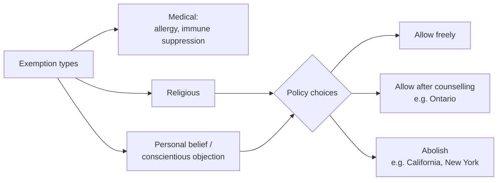

# Religious and philosophical exemptions

**Prerequisites:** [Contraindications and precautions](../05-schedules/09-contraindications-and-precautions.md)

## What exemptions are

Where vaccines are required, usually for school or day-care entry, laws normally allow exemptions. Medical exemptions cover genuine contraindications such as severe allergy or immune suppression. Non-medical exemptions, on religious or personal-belief ("philosophical" or "conscientious") grounds, are more contested. They balance parental freedom and freedom of religion against the protection of other children, including those who cannot be vaccinated.

## Religious teaching on vaccines

Most major religious traditions do not oppose vaccination, and many religious leaders actively promote it. Specific questions arise:

- **Fetal cell lines.** Some vaccines, such as rubella and varicella, are grown in cell lines derived from fetuses aborted in the 1960s. The Catholic Church's Pontifical Academy for Life said in 2005 that parents could use such vaccines when no alternative exists, and the Vatican's doctrinal office said the same about COVID-19 vaccines in 2020, while urging development of alternatives.
- **Animal products.** Some vaccines contain porcine gelatine. Many Islamic and Jewish authorities consider its use permissible in medicine, especially by injection, though some communities object and halal-certified alternatives are sought.
- **Faith healing and providence.** Some Christian groups, such as Christian Science and some orthodox Protestant communities, have traditionally preferred prayer or trust in providence over medical prevention.

Communities with low coverage have repeatedly had outbreaks. The orthodox Protestant "Bible Belt" in the Netherlands had large measles outbreaks in 1999–2000 and 2013–14; an outbreak among the Amish in Ohio in 2014 caused 383 cases; and in 2018–19 measles spread in Orthodox Jewish communities in New York, where rabbinic authorities generally supported vaccination but misinformation circulated.

## The United States

All US states allow medical exemptions; most also allow religious ones, and some allow personal-belief exemptions. Exemptions have grown: 3.6% of kindergarteners had one in the 2024–25 school year, a record ([AP News, "US kindergarten vaccination rates drop as exemptions hit record high" (July 2025)](https://apnews.com/article/vaccination-rates-cdc-kindergarten-0d261546a130dc256735d7b1ff8c6a5f)). Studies have found that easier exemption procedures are associated with higher exemption rates and outbreaks ([Salmon et al., *Lancet* 2013](https://doi.org/10.1016/S0140-6736(12)62189-8)).

After the 2014–15 Disneyland measles outbreak, California removed personal-belief exemptions with law SB 277 in 2015. Coverage rose, but medical exemptions also increased, especially in areas that previously had many personal-belief exemptions, as some doctors wrote exemptions on doubtful grounds ([Delamater et al., *JAMA* 2017](https://doi.org/10.1001/jama.2017.9242)); the state later tightened oversight. New York removed religious exemptions in 2019 after its outbreak, Maine in 2019 (upheld by referendum in 2020) and Connecticut in 2021. Elsewhere the trend has been the other way, with some states expanding exemptions since the COVID-19 pandemic.

Courts have generally held that states may require vaccination without religious exemptions, building on *Jacobson v. Massachusetts* (1905) ([*Jacobson v. Massachusetts*, 197 U.S. 11 (1905)](https://www.law.cornell.edu/supremecourt/text/197/11); [mandate cases](../08-litigation-and-compensation/09-mandate-cases-jacobson-to-covid.md)), but recent Supreme Court religious-freedom decisions have prompted new challenges.

## Canada and elsewhere

In Canada, only Ontario and New Brunswick require proof of vaccination for school. Ontario allows exemptions for reasons of conscience or religious belief, but since 2017 parents must attend an education session first. Other countries take different approaches: Australia's "No Jab, No Pay" policy from 2016 removed conscientious-objector exemptions for family benefit payments; Italy (2017) and France (2018) made more vaccines compulsory for school or day care; Germany has required measles vaccination for children in day care and school since 2020. Many countries, including the UK, Denmark and Sweden, have no mandates at all and rely on voluntary vaccination with high uptake ([comparing schedules](../05-schedules/06-comparing-schedules.md)).

## The ethical debate

Supporters of exemptions argue that freedom of conscience and religion should be respected, that coercion breeds distrust, and that high coverage can be reached without it. Opponents argue that exemptions let some families rely on others' immunity, that clusters of exempt children cause outbreaks, and that children's interests in being protected should outweigh parents' beliefs. Some ethicists favour making exemptions available but harder to obtain, for example by requiring counselling ([[mandates-and-ethics|mandates and ethics]]).

## Key ideas

- Most religions accept vaccination; specific concerns involve fetal cell lines, gelatine and faith healing.
- Exemption rates and outbreaks are linked; US kindergarten exemptions reached a record 3.6% in 2024–25.
- Jurisdictions range from no mandates (UK, Nordic countries) to mandates without non-medical exemptions (California, New York).

## Where this leads

- Next: [Dengvaxia in the Philippines](16-dengvaxia-in-the-philippines.md).
