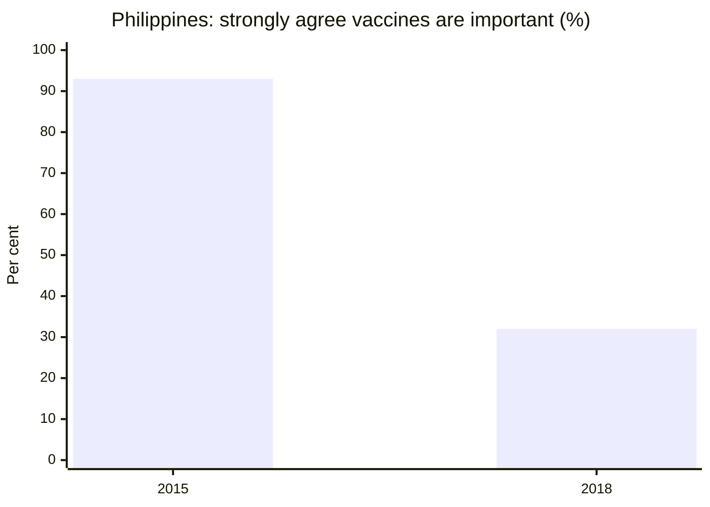

# Dengvaxia in the Philippines

**Prerequisites:** [Dengue](../03-diseases/dengue.md); [how vaccines work](../01-how-vaccines-work/01-how-vaccines-work.md)

*Figure: Confidence in vaccines in the Philippines before and after the Dengvaxia controversy, from Larson et al. 2019.*

## A vaccine with a hidden risk

Dengue is a mosquito-borne virus with four types. A first infection is often mild, but a second infection with a different type carries a higher risk of severe dengue, because antibodies from the first can enhance infection with the second. Sanofi Pasteur's Dengvaxia, licensed from 2015, was the first dengue vaccine. Trials showed it reduced dengue overall in children over nine, but long-term follow-up and a later analysis showed that in people who had never had dengue it acted like a first infection: vaccinated seronegative children had a higher risk of hospitalisation and severe dengue when later infected ([Sridhar et al., *NEJM* 2018](https://doi.org/10.1056/NEJMoa1800820)).

## The programme and the scandal

In April 2016 the Philippines began the world's first public dengue vaccination programme, vaccinating more than 830,000 schoolchildren. In November 2017 Sanofi announced the new analysis showing the risk in seronegative recipients, and the government halted the programme in December ([*Scientific American*, "How the world's first dengue vaccination drive ended in disaster"](https://www.scientificamerican.com/article/how-the-worlds-first-dengue-vaccination-drive-ended-in-disaster/)). WHO then recommended that the vaccine be given only to people with evidence of previous dengue infection.

Public reaction was furious. Officials who had approved the purchase were investigated and charged; a government lawyers' office carried out autopsies on children who died after vaccination and attributed deaths to the vaccine, claims disputed by independent experts and the health department's own panels. Scientists involved in the trials were vilified. The episode was entangled with politics, as the programme had been launched under a previous administration in the run-up to an election.

## The collapse in confidence

Surveys found that the share of Filipinos strongly agreeing that vaccines are important fell from 93% in 2015 to 32% in 2018, with similar falls for safety and effectiveness ([Larson et al., *Human Vaccines & Immunotherapeutics* 2018 (Philippines confidence)](https://doi.org/10.1080/21645515.2018.1522468)). Routine childhood vaccination fell, and in 2019 the Philippines had a large measles outbreak with hundreds of deaths, mostly among unvaccinated children.

## How the risk was missed, and found

Dengvaxia's trials in Asia and Latin America measured efficacy over several years, but most participants had already had dengue, and the vaccine's effect in seronegative children was hard to estimate without blood samples taken before vaccination. An excess of hospitalisations in vaccinated young children in the third year of follow-up was an early warning sign. Sanofi then developed a new antibody test that could tell, from blood taken after vaccination, which participants had been infected before, and this allowed the seronegative analysis published in 2018 ([Sridhar et al., *NEJM* 2018](https://doi.org/10.1056/NEJMoa1800820)). The case is often taught as an example of why long-term follow-up and pre-specified subgroup analyses matter, a theme of [study designs](../../../../science/research-methods/reading-research/03-study-designs/README.md) in the reading-research course.

## Lessons and lingering questions

The Dengvaxia story is unusual because the concerns were partly justified. The vaccine did have a real risk for a subgroup, which emerged after licensure; some scientists had warned about this theoretical risk before the programme began. Critics asked why a mass programme was launched quickly without screening, and whether the company disclosed risks promptly. On the other hand, the vaccine prevented severe dengue in those already infected, the actual number of extra severe cases was small, and the reaction harmed confidence in unrelated, well-established vaccines.

Newer dengue vaccines such as Takeda's Qdenga have since been approved in many countries, and screening tests before vaccination have been developed for Dengvaxia.

## Key ideas

- Dengvaxia increased the risk of severe dengue in people never previously infected, a risk confirmed after licensure.
- The Philippines halted its school programme in 2017; confidence in all vaccines fell from 93% to 32%.
- A real but limited safety problem, handled through scandal, spilled over into a measles epidemic.

## Where this leads

- Next: [Trovan, Kano and the polio boycott](17-trovan-kano-and-the-polio-boycott.md).
