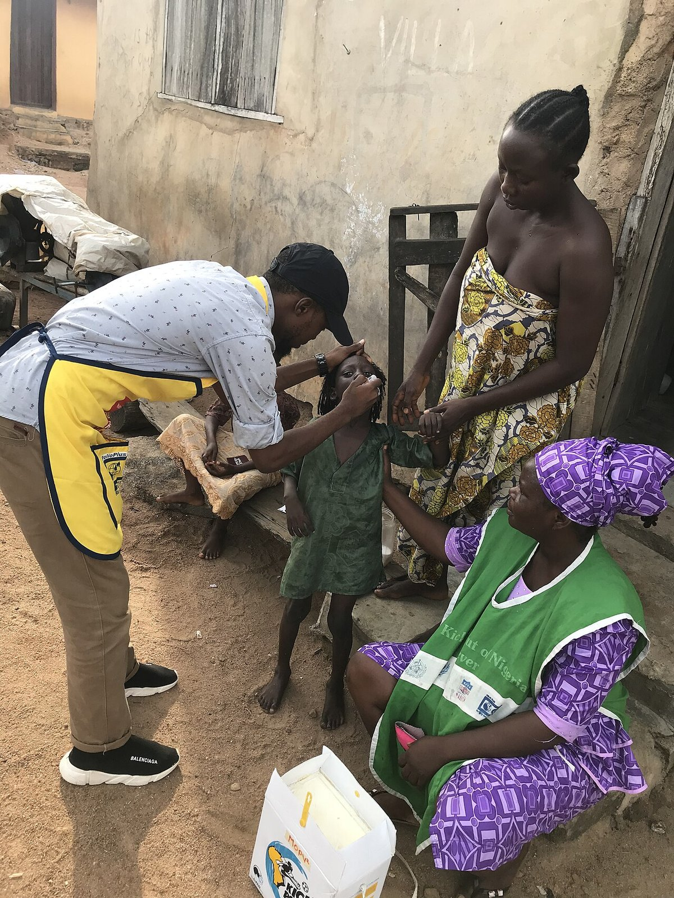

# Trovan, Kano and the polio boycott

**Prerequisites:** [Polio](../03-diseases/polio.md); [vaccine-derived polio](../06-adverse-events/10-vaccine-derived-polio.md)

*Oral polio vaccination in Nigeria. Credit: Asap_Kamal. License: [CC BY-SA 4.0](https://creativecommons.org/licenses/by-sa/4.0). Source: [File:Polio Vaccination in Nigeria.jpg](https://commons.wikimedia.org/wiki/File:Polio_Vaccination_in_Nigeria.jpg).*

## The Trovan trial, 1996

In 1996, during a large meningitis epidemic in Kano, northern Nigeria, Pfizer ran a trial of its experimental antibiotic trovafloxacin (Trovan) in about 200 children, comparing it with ceftriaxone, an established treatment. Eleven children in the trial died and others were left disabled. Families and the Kano state government later alleged that parents had not given informed consent, that the trial lacked proper ethics approval, and that the comparison drug was given at a reduced dose. Pfizer denied wrongdoing and said that the trial saved lives.

In *Abdullahi v. Pfizer* (2009), a US federal appeals court held that the families could sue under the Alien Tort Statute, because the prohibition on non-consensual medical experimentation is a norm of customary international law ([*Abdullahi v. Pfizer, Inc.*, 562 F.3d 163 (2d Cir. 2009)](https://www.courtlistener.com/opinion/2531/abdullahi-v-pfizer-inc/)). Pfizer settled with Kano state in 2009 for $75 million ([Reuters, "Pfizer, Nigeria sign $75 mln Trovan settlement" (2009)](https://www.reuters.com/article/business/finance/pfizer-nigeria-sign-75-mln-trovan-settlement-idUSJOE56U02P/)) and later settled the US case.

Trovan was an antibiotic, not a vaccine, but the episode deepened distrust of Western medicine in northern Nigeria.

## The polio vaccine boycott, 2003–04

In 2003, as the Global Polio Eradication Initiative pushed mass oral polio vaccination campaigns, some religious and political leaders in northern Nigeria claimed that the vaccine was contaminated with HIV or with agents to sterilise Muslim girls. Contextual factors included the Trovan trial, anger about US foreign policy after the 2001 attacks and the invasion of Iraq, distrust of the federal government, and resentment that free polio vaccines were brought door to door while basic health care was lacking ([Jegede, *PLoS Medicine* 2007](https://doi.org/10.1371/journal.pmed.0040073)). Kano, Zamfara and Kaduna states suspended vaccination; Kano was the last to resume, in July 2004, after about 11 months, once supplies were sourced from a manufacturer in Indonesia, a Muslim-majority country, and tested.

The consequences were severe. Polio surged in Nigeria, and Nigerian type 1 poliovirus spread to about a dozen previously polio-free countries in Africa and later beyond, including Saudi Arabia and Indonesia ([CDC, *MMWR* 2005, "Progress toward interruption of wild poliovirus transmission, January 2004–March 2005"](https://www.cdc.gov/mmwr/preview/mmwrhtml/mm5416a4.htm)). The international effort to contain it cost hundreds of millions of dollars.

## How trust was rebuilt

Polio eradicators shifted towards working with traditional and religious leaders, recruiting local women as vaccinators, integrating polio vaccination with other health services, and responding to community concerns rather than dismissing them. Attacks on polio workers in northern Nigeria in 2013 showed that risks remained. Nigeria recorded its last case of wild polio in 2016, and the WHO African region was certified free of wild polio in 2020, although vaccine-derived polio remains a problem ([vaccine-derived polio](../06-adverse-events/10-vaccine-derived-polio.md)).

## Why the story matters

The boycott is often presented as a case of rumour defeating science. Scholars such as Jegede argue that it is better understood as a crisis of trust rooted in real grievances, including the Trovan trial, in which outsiders had indeed violated the community's trust. Fears were factually wrong, but the distrust had causes that public health had to address.

## Key ideas

- Pfizer's 1996 Trovan trial in Kano led to a landmark US ruling on non-consensual experimentation and a $75 million settlement.
- Northern Nigerian states boycotted polio vaccination in 2003–04 over false sterilisation rumours; polio spread to many countries.
- Engagement with local leaders, rather than dismissal of concerns, helped rebuild trust and eliminate wild polio.

## Where this leads

- Next: [The CIA's fake vaccination campaign in Pakistan](18-cia-fake-vaccination-in-pakistan.md).
