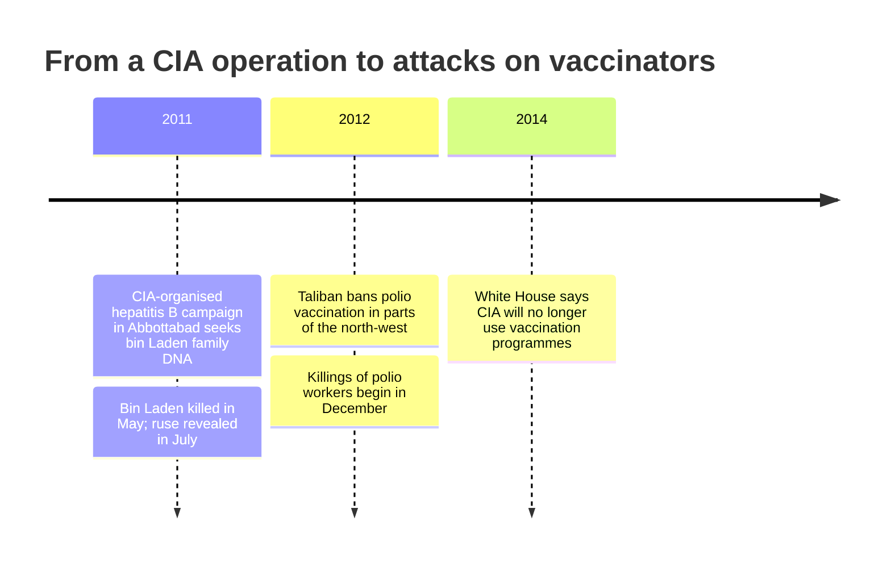

# The CIA's fake vaccination campaign in Pakistan

**Prerequisites:** [Trovan, Kano and the polio boycott](17-trovan-kano-and-the-polio-boycott.md)

## The operation

Before the raid that killed Osama bin Laden in May 2011, the US Central Intelligence Agency arranged for a Pakistani doctor, Shakil Afridi, to run a hepatitis B vaccination campaign in Abbottabad, apparently to obtain DNA from children in the compound to confirm the family's presence. The ruse was reported in July 2011. Afridi was arrested and later imprisoned in Pakistan. It is not clear that the operation obtained any DNA.

## The aftermath

Pakistan was one of the last countries with wild polio. Militants already suspicious of vaccination campaigns as Western plots now had a concrete example. In 2012 Taliban commanders in North and South Waziristan banned polio vaccination while US drone strikes continued, and from December 2012 dozens of polio vaccinators and the police guarding them were killed in attacks across Pakistan.

An economic study comparing districts found that after the ruse was revealed and Taliban propaganda spread, vaccination rates fell by 23–39% in the districts with the highest support for Islamist parties compared with those with the lowest. The authors attributed the fall mainly to reduced demand from parents rather than reduced supply ([Martinez-Bravo & Stegmann, *Journal of the European Economic Association* 2022](https://doi.org/10.1093/jeea/jvab018)). Other factors, such as conflict and displacement, also affected polio vaccination in the region.

## The White House pledge

In January 2013 the deans of 12 US public-health schools wrote to President Obama protesting the use of a vaccination campaign as cover. In May 2014 the White House counterterrorism adviser, Lisa Monaco, replied that the CIA director had ordered in August 2013 that the agency would make no operational use of vaccination programmes or workers, and would not use genetic material obtained through such programmes ([Johns Hopkins Bloomberg School of Public Health, "White House responds to public health deans" (May 2014)](https://publichealth.jhu.edu/2014/white-house-responds-to-public-health-deans-the-central-intelligence-agency-makes-no-use-of-operational-vaccination-programs)).

## Responses in Pakistan

Pakistani authorities, religious scholars and the polio programme responded by recruiting local vaccinators, seeking fatwas from respected clerics in support of polio vaccination, and offering police protection to vaccination teams. Some campaigns paused after attacks. The government also pursued Afridi, whose case became a source of friction between the United States and Pakistan.

## Polio in Pakistan since

Pakistan and Afghanistan remain the only countries where wild poliovirus has never been interrupted. Cases fell to a handful in the early 2020s, then rose again, and attacks on vaccinators continued. The CIA operation was not the only cause of resistance, but it is widely cited as having made it worse.

## Why it matters for trust

The episode shows that suspicion of vaccine programmes can be grounded in real deception. It became a standard example in debates about the "humanitarian space" that protects health workers, and a reason why public-health leaders argue that vaccination must never be used for intelligence or military purposes. It is also a reminder that trust in vaccines depends on trust in the institutions that deliver them ([trust and misinformation](19-trust-and-misinformation.md)).

## Key ideas

- The CIA used a fake hepatitis B campaign in 2011 in its hunt for bin Laden.
- Taliban bans and killings of vaccinators followed; vaccination fell most where Islamist support was strongest.
- In 2014 the White House said the CIA would no longer use vaccination programmes as cover.

## Where this leads

- Next: [Trust and misinformation](19-trust-and-misinformation.md).
