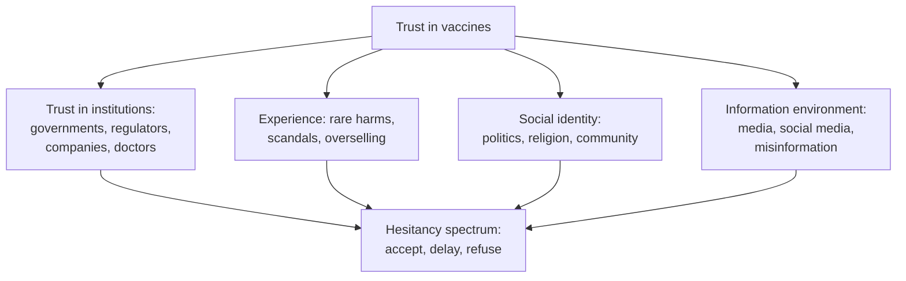

# Trust and misinformation

**Prerequisites:** the earlier lessons in this section

## From "anti-vaxxers" to the hesitancy spectrum

Researchers now speak of vaccine hesitancy rather than simply anti-vaccine sentiment. Most hesitant people are not opposed to all vaccines; they delay some, refuse others, or accept with doubts. A small, committed minority opposes vaccination outright. The World Health Organization listed vaccine hesitancy among ten threats to global health in 2019. Treating all hesitant parents as "anti-vaxxers" is now widely seen as counterproductive.

## Measuring confidence

The Vaccine Confidence Project, led by anthropologist Heidi Larson, surveyed 67 countries in 2016 and found that attitudes were positive overall but that Europe had seven of the ten least confident countries; in France, 41% of respondents disagreed that vaccines are safe ([Larson et al., *EBioMedicine* 2016](https://doi.org/10.1016/j.ebiom.2016.08.042)). UNICEF reported in 2023 that the perceived importance of childhood vaccines fell in 52 of 55 countries studied during the COVID-19 pandemic ([UNICEF press release on *The State of the World's Children 2023* (April 2023)](https://www.unicef.org/press-releases/sowc_2023_immunization)). Larson's book *Stuck* (2020) argues that hesitancy is less about facts than about trust, identity and feeling heard.

## Trust is earned and lost

The episodes in this section show that distrust often has real roots:

- Rare harms acknowledged late, such as narcolepsy after Pandemrix and severe dengue after Dengvaxia ([Pandemrix](../06-adverse-events/07-narcolepsy-and-pandemrix.md); [Dengvaxia](16-dengvaxia-in-the-philippines.md)).
- Deception or exploitation, such as the CIA's fake vaccination campaign and the Trovan trial ([CIA in Pakistan](18-cia-fake-vaccination-in-pakistan.md); [Trovan](17-trovan-kano-and-the-polio-boycott.md)).
- Overconfident messaging, such as early COVID-19 claims about transmission ([COVID-19](10-covid-19-vaccines-mandates-and-mortality.md)).
- Conflicts of interest, on both sides ([conflicts of interest](14-conflicts-of-interest-and-funding.md)).

Equally, false claims, most famously the MMR–autism hypothesis, have damaged trust and led to outbreaks long after being refuted ([MMR and autism](01-mmr-and-autism.md)).

## Misinformation

In a randomised experiment in 2020, exposure to recent online COVID-19 vaccine misinformation reduced the share of people who said they would definitely accept a vaccine by about 6 percentage points in both the UK and US, compared with factual information; scientific-sounding misinformation had the strongest effect ([Loomba et al., *Nature Human Behaviour* 2021](https://doi.org/10.1038/s41562-021-01056-1)). The Center for Countering Digital Hate reported in 2021 that 12 accounts, the "Disinformation Dozen", produced up to 65% of the anti-vaccine content shared on Facebook and Twitter in its sample ([Center for Countering Digital Hate, *The Disinformation Dozen* (2021)](https://www.counterharm.com/research/the-disinformation-dozen)). Facebook disputed the methods, saying the accounts were responsible for a much smaller share of all vaccine-related views.

Defining misinformation is itself contested. Some claims labelled misinformation early in the pandemic, such as the possibility of a laboratory origin of the virus, or that vaccines would not stop transmission, were later treated as open questions or confirmed. Critics argue that labelling and removing content damaged trust and suppressed legitimate debate.

## Platforms, governments and free speech

During the pandemic, social-media companies removed or labelled vaccine misinformation, sometimes after pressure from governments. In the US, state attorneys general and others sued, alleging that federal officials coerced platforms into censoring speech. In *Murthy v. Missouri* (2024) the Supreme Court ruled that the plaintiffs lacked standing, without deciding whether the government had crossed a constitutional line ([*Murthy v. Missouri*, 603 U.S. 43 (2024)](https://www.supremecourt.gov/opinions/23pdf/23-411_3dq3.pdf)). Several platforms later relaxed their policies.

## What works

Evidence on countering misinformation is mixed but growing:

- **Prebunking.** Short videos explaining manipulation techniques improved people's ability to recognise them, including in a field experiment on YouTube ([Roozenbeek et al., *Science Advances* 2022](https://doi.org/10.1126/sciadv.abo6254)).
- **Trusted messengers.** Family doctors, nurses and community and religious leaders are more persuasive than distant authorities, as the polio programmes in Nigeria and Pakistan found.
- **Presumptive, respectful conversation.** Clinicians who assume vaccination while listening to concerns achieve higher uptake than those who open with debate.
- **Transparency.** Admitting uncertainty and acknowledging real harms, with compensation, may build longer-term trust, though this is harder to test.

Simply repeating facts or ridiculing opponents often fails and can entrench views.

## A balanced view

An unbiased reading of vaccine controversies requires holding two ideas at once: the overwhelming evidence that routine vaccines prevent far more harm than they cause, and the documented record of institutional failures that give some people reasons for doubt. The reading-research course offers tools for judging individual claims ([reading research](../../../../science/research-methods/reading-research/README.md)).

## Key ideas

- Hesitancy is a spectrum shaped by trust, identity, experience and information.
- Misinformation measurably reduces intent to vaccinate, but defining and policing it is contested.
- Trusted messengers, prebunking and transparency show more promise than ridicule or fact repetition alone.

## Where this leads

- Next section: [[d:immunology/vaccines/08-litigation-and-compensation|Litigation and compensation]].
