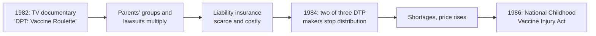

# The 1980s DTP lawsuits

**Prerequisites:** [DTP and whole-cell pertussis](../07-controversies/08-dtp-and-whole-cell-pertussis.md)

## Before the crisis

Vaccine injury lawsuits in the United States predate the DTP crisis. In *Reyes v. Wyeth* (1974), a federal appeals court held a manufacturer liable when a child developed polio after oral polio vaccine, because the risk had not been communicated to the family. Cases like this established that manufacturers could be liable for failing to warn, even when the vaccine was given in a public programme. After the 1976 swine flu programme, Congress had made the federal government the defendant for claims of Guillain-Barré syndrome and other injuries, a precedent for later federal involvement ([the 1976 swine flu affair](../04-history/09-the-1976-swine-flu-affair.md)).

## The surge

The British pertussis scare of the 1970s reached the United States with the 1982 television documentary *DPT: Vaccine Roulette*. It featured children with severe disabilities whose parents believed the vaccine was responsible. Parents founded Dissatisfied Parents Together, and lawyers began filing suits against manufacturers. Product-liability suits over DTP rose from 17 in 1982 to more than 200 a year by the mid-1980s, claiming damages far larger than the vaccine market itself ([Institute of Medicine, *Financing Vaccines in the 21st Century* (2004), Box 2-2 on DTaP](https://www.ncbi.nlm.nih.gov/books/NBK221822/box/bbb00007/)).

Some juries awarded large sums. The suits alleged that the whole-cell vaccine caused brain damage, seizure disorders and deaths, and that manufacturers should have used a less reactogenic vaccine. As described in the previous section, the scientific evidence for permanent brain damage was weak, but courts had to decide individual cases with uncertain science, and juries were sympathetic to injured children ([DTP](../07-controversies/08-dtp-and-whole-cell-pertussis.md)).

## The market collapses

Insurers withdrew or raised premiums sharply. In 1984 Wyeth stopped distributing DTP and Connaught temporarily did the same, leaving Lederle as the main supplier; the CDC recommended deferring some booster doses because of the shortage ([CDC, *MMWR* 1984, "Diphtheria-tetanus-pertussis vaccine shortage – United States"](https://www.cdc.gov/mmwr/preview/mmwrhtml/00000452.htm)). The private-sector price of a dose rose to more than $11 by 1986, much of it reflecting liability costs, compared with well under a dollar a few years earlier ([Institute of Medicine, *Financing Vaccines in the 21st Century* (2004), Box 2-2 on DTaP](https://www.ncbi.nlm.nih.gov/books/NBK221822/box/bbb00007/)). Fewer companies were willing to make other vaccines, too; an Institute of Medicine committee warned in 1985 that liability was a major threat to vaccine supply and innovation ([Institute of Medicine, *Vaccine Supply and Innovation* (1985), chapter "Vaccine availability"](https://www.ncbi.nlm.nih.gov/books/NBK216807/)).

## Two sides of the crisis

For public health officials and manufacturers, the lawsuits threatened the supply of a vaccine that prevented a deadly disease, on the basis of weak science. For parents of injured children, the tort system was the only way to get compensation or acknowledgement, and they argued that the threat of liability was what pushed manufacturers to develop safer vaccines. Both arguments shaped the compromise that followed.

The litigation did contribute to development of the acellular pertussis vaccine in the United States, though Japanese researchers had already produced one ([DTP](../07-controversies/08-dtp-and-whole-cell-pertussis.md)). Parents' groups also pushed for safety reporting and information for parents, which became part of the 1986 law.

## The search for a solution

By the mid-1980s, Congress heard testimony from manufacturers threatening to leave the market entirely and from parents seeking a fair way to be compensated. Proposals ranged from full manufacturer immunity to a no-fault compensation fund. Parents' groups, the American Academy of Pediatrics and manufacturers eventually agreed on a compromise: a federal no-fault compensation programme funded by a tax on vaccines, with preserved but limited access to the courts. This became the National Childhood Vaccine Injury Act of 1986 ([the 1986 Act](02-the-national-childhood-vaccine-injury-act-1986.md)).

## Key ideas

- Fears about whole-cell DTP led to a surge in lawsuits in the early 1980s.
- Liability costs drove manufacturers from the market, causing shortages and steep price rises.
- The crisis led to a compromise between parents, doctors and industry: the 1986 Act.

## Where this leads

- Next: [The National Childhood Vaccine Injury Act of 1986](02-the-national-childhood-vaccine-injury-act-1986.md).
