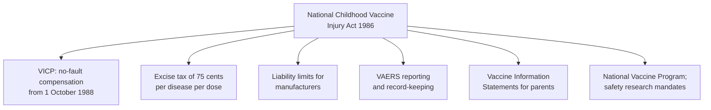

# The National Childhood Vaccine Injury Act of 1986

**Prerequisites:** [The 1980s DTP lawsuits](01-the-1980s-dtp-lawsuits.md)

## The law

President Ronald Reagan signed the National Childhood Vaccine Injury Act on 14 November 1986, as part of a larger health bill, while expressing reservations about the compensation scheme. Its compensation provisions took effect on 1 October 1988 ([HRSA, "About the National Vaccine Injury Compensation Program"](https://www.hrsa.gov/vaccine-compensation/about)).

## What it did

- **Created the National Vaccine Injury Compensation Program (VICP).** People claiming injury from a covered vaccine must first file a petition with the US Court of Federal Claims, where special masters decide cases. Compensation is no-fault: claimants do not have to show that the manufacturer was negligent ([the VICP](03-vaccine-injury-compensation-program.md)).
- **Funded it with an excise tax.** A tax of 75 cents per dose for each disease a vaccine prevents goes into a trust fund ([HRSA, "About the National Vaccine Injury Compensation Program"](https://www.hrsa.gov/vaccine-compensation/about)). An MMR dose, which protects against three diseases, is taxed $2.25.
- **Limited manufacturers' liability.** After going through the VICP, claimants may reject the result and sue the manufacturer, but the law limits such suits: manufacturers are not liable for side effects that were "unavoidable" despite proper preparation and warnings, and are presumed to have warned properly if they followed FDA requirements.
- **Required safety monitoring.** Health providers must record vaccinations and report certain adverse events; this led to the creation of the Vaccine Adverse Event Reporting System in 1990 ([VAERS](../02-development-and-regulation/08-reading-vaers-correctly.md)).
- **Required information for patients.** Providers must give Vaccine Information Statements describing benefits and risks before each dose.
- **Set up a Vaccine Injury Table** of injuries presumed to be caused by vaccines within set time windows ([the Vaccine Injury Table](04-the-vaccine-injury-table.md)).
- **Called for research.** It established the National Vaccine Program and directed the Institute of Medicine to review the evidence on pertussis and rubella vaccine harms, which produced the 1991 report ([Institute of Medicine, *Adverse Effects of Pertussis and Rubella Vaccines* (1991)](https://doi.org/10.17226/1815)).

Compensation for pain and suffering is capped at $250,000, as is the payment for a death, but there is no cap on compensation for medical and care costs or lost earnings ([42 U.S.C. § 300aa-15 (compensation under the VICP)](https://uscode.house.gov/us/usc/119-124/t42/s300aa-15/)).

## The Supreme Court on design defects

The Act's liability limits were tested in *Bruesewitz v. Wyeth* (2011). Parents of a child who developed seizures after DTP argued that the manufacturer should have used a safer design. The Supreme Court ruled 6–2 that the Act pre-empts all design-defect claims against vaccine manufacturers, so the design of a licensed vaccine cannot be challenged in state courts; Justices Sotomayor and Ginsburg dissented ([*Bruesewitz v. Wyeth LLC*, 562 U.S. 223 (2011)](https://supreme.justia.com/cases/federal/us/562/223/)).

## Was the compromise fair?

**Supporters** say it achieved its goals. Manufacturers returned to the market, vaccine supply stabilised, and thousands of people have been compensated faster and more cheaply than through lawsuits, without having to prove negligence. The Act also built in safety monitoring.

**Critics**, including some of the parents' groups who supported it in 1986, argue that:

- It removed manufacturers' main incentive to improve safety by shielding them from design-defect claims.
- The VICP became more adversarial than intended, with the government contesting many claims.
- Changes to the injury table in 1995 made compensation harder for DTP injuries.
- Compensation caps have not been raised since 1986 for inflation.
- HHS was required to report to Congress on vaccine safety research; critics argue that it has not done so fully.

Some critics, including health secretary Robert F. Kennedy Jr., have called for the liability protections to be repealed or the program overhauled.

## Key ideas

- The 1986 Act created a no-fault federal compensation programme funded by a vaccine tax, and limited manufacturer liability.
- It also created VAERS, Vaccine Information Statements and the injury table.
- *Bruesewitz v. Wyeth* (2011) confirmed that design-defect suits are pre-empted.

## Where this leads

- Next: [The Vaccine Injury Compensation Program](03-vaccine-injury-compensation-program.md).
