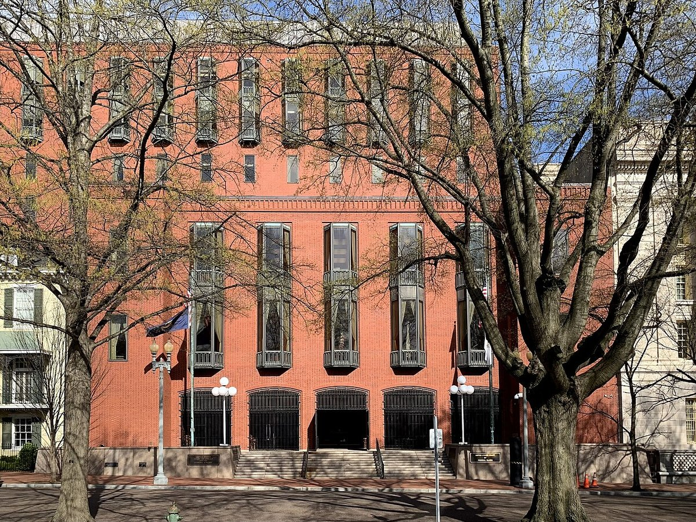
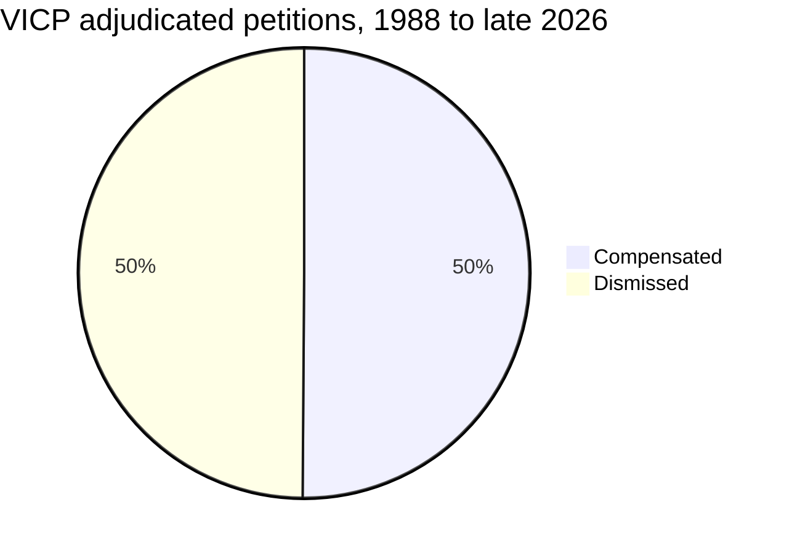

# The Vaccine Injury Compensation Program

**Prerequisites:** [The 1986 Act](02-the-national-childhood-vaccine-injury-act-1986.md)

*The Howard T. Markey National Courts Building in Washington, DC, home of the US Court of Federal Claims, where vaccine petitions are heard. Credit: APK. License: [CC BY-SA 4.0](https://creativecommons.org/licenses/by-sa/4.0). Source: [File:Howard T. Markey National Courts Building.jpg](https://commons.wikimedia.org/wiki/File:Howard_T._Markey_National_Courts_Building.jpg).*

## How a claim works

A person who believes they were injured by a covered vaccine, or the family of someone who died, files a petition with the US Court of Federal Claims. The Secretary of Health and Human Services is the respondent, represented by Justice Department lawyers, and medical staff at the Health Resources and Services Administration (HRSA) review the claim. Cases are decided by special masters, judicial officers who specialise in vaccine cases, informally known as the "vaccine court". Petitions must be filed within three years of the first symptom, or two years of a death.

Claimants can win in three ways:

1. **Table injury.** If the injury is on the Vaccine Injury Table and occurred within the listed time window, causation is presumed unless the government shows another cause ([the injury table](04-the-vaccine-injury-table.md)).
2. **Off-table injury.** Otherwise, the claimant must prove causation by a preponderance of the evidence. Under *Althen* (2005), this requires a medical theory linking the vaccine and the injury, a logical sequence of cause and effect showing the vaccine caused it, and an appropriate time interval ([*Althen v. Secretary of HHS*, 418 F.3d 1274 (Fed. Cir. 2005)](https://www.cafc.uscourts.gov/opinions-orders/04-5146.pdf)).
3. **Settlement or concession.** HHS may concede a case, or the parties may negotiate a settlement.

Covered vaccines are those recommended by the CDC for routine use in children or pregnant women and subject to the excise tax; adults who receive them, notably influenza vaccine, are covered too. COVID-19 vaccines are not covered; they fall under a different program ([the PREP Act and CICP](06-prep-act-and-cicp.md)).

## By the numbers

*Figure: Outcomes of adjudicated VICP petitions, from HRSA data compiled by Vaccine Data Navigator ([Vaccine Data Navigator, "Vaccine injury compensation statistics (VICP and CICP)", compiled from HRSA reports (accessed November 2026)](https://vaccinedatanavigator.org/vaccine-injury-compensation-statistics.html)).*

By late 2026, about 30,000 petitions had been filed since 1988. Roughly half of those adjudicated were compensated, and total outlays since 1989 were about $5.7 billion, including about $5.0 billion in awards and about $660 million in lawyers' fees and costs ([Vaccine Data Navigator, "Vaccine injury compensation statistics (VICP and CICP)", compiled from HRSA reports (accessed November 2026)](https://vaccinedatanavigator.org/vaccine-injury-compensation-statistics.html); [HRSA, "Vaccine Injury Compensation Data" (monthly VICP data report)](https://www.hrsa.gov/vaccine-compensation/data)). Most petitions now name influenza vaccine, given to many adults every year, and the most common claims are shoulder injuries and Guillain-Barré syndrome. More than 5,000 autism petitions were dismissed after the omnibus proceeding, mostly in 2011–13 ([the omnibus autism proceeding](05-the-omnibus-autism-proceeding.md)).

HRSA stresses that compensation does not necessarily mean the vaccine caused the injury: about 60% of compensation comes from negotiated settlements in which HHS has not concluded that the vaccine was the cause ([HRSA, "Vaccine Injury Compensation Data" (monthly VICP data report)](https://www.hrsa.gov/vaccine-compensation/data)). Compensated petitions amount to roughly one or two per million doses of covered vaccines distributed, depending on how they are counted ([Vaccine Data Navigator, "Vaccine injury compensation statistics (VICP and CICP)", compiled from HRSA reports (accessed November 2026)](https://vaccinedatanavigator.org/vaccine-injury-compensation-statistics.html)).

## Lawyers' fees

Unusually, claimants' reasonable lawyers' fees and costs are paid by the program even when they lose, as long as the claim was brought in good faith with a reasonable basis, and lawyers may not charge any other fee ([HRSA, "Vaccine Injury Compensation Data" (monthly VICP data report)](https://www.hrsa.gov/vaccine-compensation/data)). This was meant to ensure that injured people could find representation. Critics on one side say it encourages weak claims; critics on the other say fee disputes and delays deter lawyers from taking difficult cases.

## Criticisms from both sides

**From claimants and their advocates:**

- Cases can take years, much longer than Congress intended; the government contests many claims with its own experts.
- The special masters are not bound by rules of evidence, but critics say they have become sceptical of novel theories.
- The $250,000 caps on pain and suffering and on death benefits have not been raised since 1986.
- The three-year deadline excludes people who only later link an injury to a vaccine.

**From public health and legal scholars:**

- Settlements without findings of causation, and table presumptions, may compensate injuries that vaccines did not cause, which some critics then cite as evidence of harm.
- Expanding the table, as with shoulder injuries in 2017, increased costs and caseload.
- Adults receiving influenza vaccine now dominate a program designed for children.

## How it compares

A 2020 review identified 25 jurisdictions with no-fault vaccine injury compensation schemes ([Mungwira et al., *PLOS ONE* 2020](https://doi.org/10.1371/journal.pone.0233334)). Most are administrative rather than court-based, and many pay less. The UK pays a single lump sum for severe disability, and Canada and Quebec have their own programs ([Canada's programs](07-canadas-compensation-programs.md); [litigation outside the VICP](08-litigation-outside-the-vicp.md)).

## Key ideas

- The VICP is a no-fault system run through the Court of Federal Claims, with presumptions for table injuries.
- About $5.7 billion has been paid out since 1989; roughly half of adjudicated petitions are compensated, mostly by settlement.
- It is criticised as slow and adversarial by claimants, and as over-inclusive by some public health scholars.

## Where this leads

- Next: [The Vaccine Injury Table](04-the-vaccine-injury-table.md).
