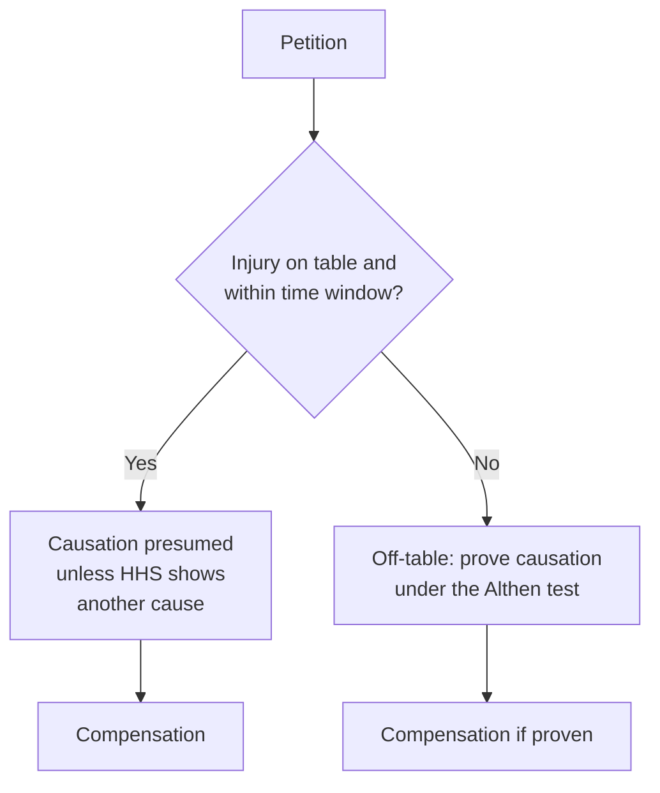

# The Vaccine Injury Table

**Prerequisites:** [The VICP](03-vaccine-injury-compensation-program.md); [Causality assessment](../06-adverse-events/13-causality-assessment.md)

## What the table is

The Vaccine Injury Table lists, for each covered vaccine, injuries and the time windows in which their onset after vaccination is presumed to be vaccine-caused. A claimant who shows a table injury within its window wins unless the government proves a different cause. The table is a regulation, set out in federal rules, which HHS can change after public comment and advice from the Advisory Commission on Childhood Vaccines ([42 CFR § 100.3, Vaccine Injury Table](https://www.law.cornell.edu/cfr/text/42/100.3)).

## Examples

The current table includes entries such as:

| Vaccine | Injury | Onset window |
|---|---|---|
| Any covered vaccine | Anaphylaxis | Within 4 hours |
| Most injected vaccines | Shoulder injury related to vaccine administration (SIRVA) | Within 48 hours |
| Most injected vaccines | Vasovagal syncope | Within 1 hour |
| Measles-containing vaccines | Thrombocytopenic purpura | 7–30 days |
| Measles-containing vaccines | Encephalopathy | 5–15 days |
| Pertussis-containing vaccines | Encephalopathy | Within 72 hours |
| Seasonal influenza vaccine | Guillain-Barré syndrome | 3–42 days |
| Oral polio vaccine | Paralytic polio | Within 30 days (6 months if immunodeficient) |

*Table: Selected entries, simplified from 42 CFR § 100.3 ([42 CFR § 100.3, Vaccine Injury Table](https://www.law.cornell.edu/cfr/text/42/100.3)). The regulation includes detailed definitions for each condition.*

## How the table has changed

The original 1986 table, written into the law, was generous because the science was uncertain. It included residual seizure disorder and hypotonic-hyporesponsive episodes after DTP, and a broad definition of encephalopathy.

In 1995, after the 1991 and 1994 Institute of Medicine reviews, HHS removed residual seizure disorder and hypotonic-hyporesponsive episodes from the DTP entries, and tightened the definition of encephalopathy to require a significant acute change in consciousness lasting at least 24 hours followed by chronic encephalopathy lasting at least six months ([*Federal Register* 60(26), 8 February 1995: revisions to the Vaccine Injury Table](https://www.govinfo.gov/content/pkg/FR-1995-02-08/pdf/95-2945.pdf)). Supporters said the changes followed the science; parents' groups said they made DTP injuries almost impossible to compensate, and petitions on the table fell sharply.

In 2017 HHS added shoulder injuries (SIRVA) and syncope to the table for injected vaccines, and Guillain-Barré syndrome for seasonal flu vaccine, following the 2011 Institute of Medicine review ([Institute of Medicine, *Adverse Effects of Vaccines: Evidence and Causality* (2011)](https://doi.org/10.17226/13164)). A 2021 rule to remove SIRVA was published and then withdrawn ([syncope and shoulder injuries](../06-adverse-events/04-syncope-and-shoulder-injuries.md)).

## Why a table at all?

The table was designed to make compensation quick and non-adversarial for common, well-defined injuries, avoiding argument over causation. In practice, fewer and fewer claims are table claims: most petitions are now off-table or settled. The 2011 IOM review, commissioned by HRSA, aimed to bring the table in line with evidence, finding convincing evidence for 14 vaccine–injury relationships ([Institute of Medicine, *Adverse Effects of Vaccines: Evidence and Causality* (2011)](https://doi.org/10.17226/13164)).

## Debates about the table

- **Evidence versus generosity.** Should the table include only injuries with convincing evidence, or also those where evidence is inadequate either way, giving claimants the benefit of the doubt? The original Act favoured generosity; later revisions favoured evidence.
- **Time windows.** Narrow windows exclude late-onset cases; wide windows compensate coincidences.
- **Autism.** Autism has never been a table injury. Some vaccine critics, and the 2025 HHS leadership's broader interest in autism and vaccine injury, have raised the question of changing that; any change would require formal rule-making and would be contested ([the omnibus autism proceeding](05-the-omnibus-autism-proceeding.md)).

## Key ideas

- The table lists presumed vaccine injuries and time windows, shifting the burden of proof to the government.
- The 1995 revision removed some DTP injuries and tightened definitions; 2017 added SIRVA and syncope.
- Most claims are now off-table or settled.

## Where this leads

- Next: [The omnibus autism proceeding](05-the-omnibus-autism-proceeding.md).
