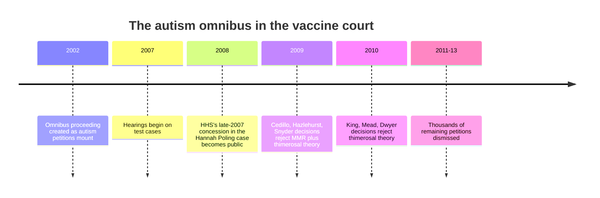

# The omnibus autism proceeding

**Prerequisites:** [MMR and autism](../07-controversies/01-mmr-and-autism.md); [Thimerosal and autism](../07-controversies/02-thimerosal-and-autism.md); [The VICP](03-vaccine-injury-compensation-program.md)

## Why an omnibus proceeding?

By the early 2000s, thousands of families had filed VICP petitions claiming that vaccines caused their children's autism. In 2002 the Court of Federal Claims' Office of Special Masters created the Omnibus Autism Proceeding to handle the general question of causation once, using test cases, rather than repeating the same expert evidence thousands of times. More than 5,400 claims were eventually included ([US Court of Federal Claims, "Autism decisions and background information"](https://www.uscfc.uscourts.gov/autism-decisions-and-background-information)).

## The theories and the test cases

The petitioners' steering committee put forward theories of causation, each tested in three cases:

1. **MMR vaccine combined with thimerosal-containing vaccines.** Test cases: *Cedillo*, *Hazlehurst* and *Snyder*. In February 2009 three special masters each rejected the theory in detailed decisions, finding the petitioners' evidence unpersuasive. The decisions in *Cedillo* and *Hazlehurst* were upheld on appeal ([Office of Special Masters, autism omnibus update (29 September 2010)](https://www.uscfc.uscourts.gov/sites/cfc/files/omnibus_autism_20100929_0.pdf)).
2. **Thimerosal-containing vaccines alone.** Test cases: *King*, *Mead* and *Dwyer*. In March 2010 the special masters rejected this theory too ([Office of Special Masters, autism omnibus update (29 September 2010)](https://www.uscfc.uscourts.gov/sites/cfc/files/omnibus_autism_20100929_0.pdf)).

A third theory, MMR alone, was dropped as the petitioners decided it was covered by the first. The special masters heard testimony from experts on both sides, including a laboratory that had reported measles virus in children's guts, whose methods were shown to be unreliable.

After the test cases, petitioners in the remaining cases were given the option of proceeding with other theories; most cases were dismissed in 2011–13, which is visible as a spike in dismissals in VICP statistics ([Vaccine Data Navigator, "Vaccine injury compensation statistics (VICP and CICP)", compiled from HRSA reports (accessed November 2026)](https://vaccinedatanavigator.org/vaccine-injury-compensation-statistics.html)).

## The Hannah Poling case

In 2007 HHS conceded the case of Hannah Poling, a girl with an underlying mitochondrial disorder who developed encephalopathy with features of autism after receiving several vaccines at once. The government's concession was that the vaccines had significantly aggravated her underlying disorder, resulting in encephalopathy; it did not say vaccines cause autism. The concession became public in 2008 and was widely reported as an admission that vaccines can cause autism, which officials denied ([Offit, *NEJM* 2008, "Vaccines and autism revisited: the Hannah Poling case"](https://doi.org/10.1056/NEJMp0802904)). Critics of vaccine policy continue to cite it, along with a few other compensated cases involving encephalopathy or brain inflammation in children later diagnosed with autism.

## Reactions

**Supporters of the decisions** say that the special masters applied a lower standard of proof than science, the balance of probabilities, and still found no causal link, after hearing the best case petitioners could make. The decisions aligned with epidemiological studies ([MMR and autism](../07-controversies/01-mmr-and-autism.md)).

**Critics** argue that the omnibus format put all families' claims on a few test cases, that some children may have had individual susceptibilities not captured by general theories, and that the Poling concession shows vaccines can contribute to autism-like outcomes in a vulnerable subgroup. Some also argue that the government's expert witnesses had their own ties to vaccine programmes ([conflicts of interest](../07-controversies/14-conflicts-of-interest-and-funding.md)).

## The 2025–26 context

In 2025 HHS leadership announced new work on autism causes and suggested revisiting vaccine-injury policy ([HHS autism claims](../07-controversies/05-hhs-autism-claims-2025.md)). Any change to the injury table to add autism would require rule-making and would likely be contested, given the evidence base reviewed in the controversies section.

## Key ideas

- Over 5,400 autism claims were handled through six test cases on two theories.
- Special masters rejected both the MMR-plus-thimerosal and thimerosal-only theories in 2009–10.
- The Poling concession involved an underlying mitochondrial disorder and is still debated.

## Where this leads

- Next: [The PREP Act and CICP](06-prep-act-and-cicp.md).
