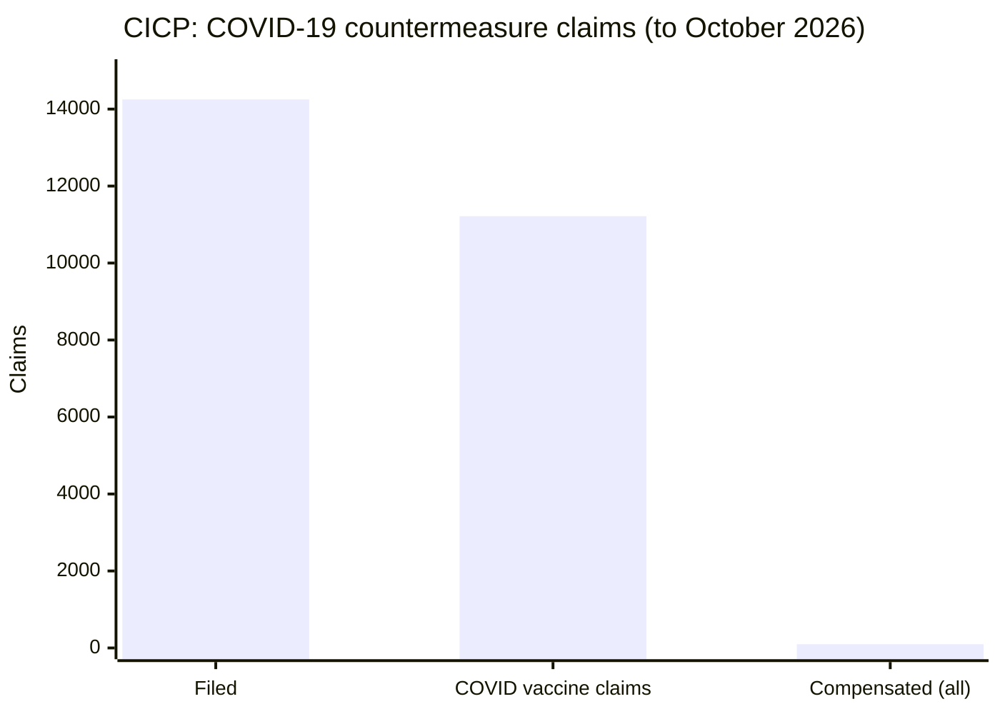

# The PREP Act and the CICP

**Prerequisites:** [The VICP](03-vaccine-injury-compensation-program.md)

*Figure: Countermeasures Injury Compensation Program claims, from HRSA tables compiled by Vaccine Data Navigator ([Vaccine Data Navigator, "Vaccine injury compensation statistics (VICP and CICP)", compiled from HRSA reports (accessed November 2026)](https://vaccinedatanavigator.org/vaccine-injury-compensation-statistics.html)).*

## A second, weaker system

The Public Readiness and Emergency Preparedness (PREP) Act of 2005 lets the health secretary issue declarations giving broad legal immunity to manufacturers, distributors and those who administer "covered countermeasures" against public-health emergencies. Immunity can be lifted only for "willful misconduct", which must be proven to a high standard in a special federal court in Washington, DC. A PREP Act declaration for COVID-19 was issued in March 2020 and covered COVID-19 vaccines, tests and treatments.

Instead of the VICP, injuries from covered countermeasures go to the Countermeasures Injury Compensation Program (CICP), run administratively by HRSA ([HRSA, "Countermeasures Injury Compensation Program (CICP) data"](https://www.hrsa.gov/cicp/cicp-data)).

## How the CICP differs from the VICP

| Feature | VICP | CICP |
|---|---|---|
| Decided by | Special masters in a court | HRSA officials, with internal review |
| Filing deadline | 3 years from first symptom | 1 year from vaccination |
| Lawyers' fees | Paid by the program | Not paid |
| Pain and suffering | Up to $250,000 | Not covered |
| Appeal to court | Yes | No |
| Standard of proof | Preponderance; table presumptions | "Compelling, reliable, valid" scientific evidence |

*Table: Main differences between the two US compensation programs.*

The CICP was designed for rare emergencies such as the 2009 H1N1 pandemic, with a handful of claims a year. COVID-19 vaccination of hundreds of millions of people overwhelmed it.

## The record

By October 2026, 14,250 COVID-19 countermeasure claims had been filed, 11,218 of them about COVID-19 vaccines. Only 96 claims across all countermeasures had been compensated, 66 of them for COVID-19 vaccines, with total payments of about $14 million. Thousands were denied for missing medical records, for not meeting the standard of proof, or for missing the one-year deadline ([Vaccine Data Navigator, "Vaccine injury compensation statistics (VICP and CICP)", compiled from HRSA reports (accessed November 2026)](https://vaccinedatanavigator.org/vaccine-injury-compensation-statistics.html)). Compensated injuries include myocarditis and anaphylaxis.

## Criticism

The CICP has been criticised across the spectrum. Vaccine-injury advocates and many legislators describe it as a "black hole": slow, opaque, without lawyers or court review, and with very low payments. Some vaccine supporters agree that a credible compensation system is important for public trust, and that the gap between the VICP and CICP undermines it. Bills in Congress have proposed moving COVID-19 vaccines into the VICP, which would require Congress to add an excise tax and the CDC to recommend them for routine use in children or pregnant women. The 2025 changes to COVID-19 vaccine recommendations complicated this further ([the US schedule](../05-schedules/02-the-us-schedule.md)).

## Why immunity at all?

Supporters of the PREP Act argue that companies will not rapidly develop and supply products for emergencies if they face unlimited lawsuits over rare side effects that could not be detected in fast trials, and that the same logic underlies the 1986 Act. During COVID-19, almost every country granted manufacturers indemnities or immunity in purchase contracts. For 92 lower-income countries supplied through COVAX, WHO set up the first global no-fault compensation programme, so that people in countries without their own schemes could claim ([COVAX No-Fault Compensation Programme for AMC eligible economies (official site)](https://covaxclaims.com/)).

Critics argue that immunity combined with a weak compensation system leaves injured people without a remedy, removes market pressure for safety, and fuels the perception that governments are protecting companies rather than citizens. They point out that the willful misconduct exception is so narrow that it has rarely been tested.

## PREP Act immunity in court

Courts have generally upheld PREP Act immunity. For example, a federal court in Texas dismissed the state's lawsuit accusing Pfizer of misrepresenting its vaccine's effectiveness in December 2024, holding that the PREP Act gave Pfizer immunity and pre-empted the state's claims; the state appealed ([*Texas v. Pfizer Inc.*, No. 5:23-cv-00312-C (N.D. Tex. 30 December 2024), order granting dismissal](https://www.courthousenews.com/wp-content/uploads/2026/09/texas-v-pfizer-order-granting-motion-to-dismiss.pdf)). See [COVID-19 litigation](10-covid-19-litigation.md).

## Key ideas

- The PREP Act gives near-total immunity for emergency countermeasures; injuries go to the CICP.
- The CICP has a one-year deadline, no lawyers' fees, no pain-and-suffering awards and no court appeal.
- Of more than 14,000 COVID-19 claims, fewer than 100 have been compensated.

## Where this leads

- Next: [Canada's compensation programs](07-canadas-compensation-programs.md).
