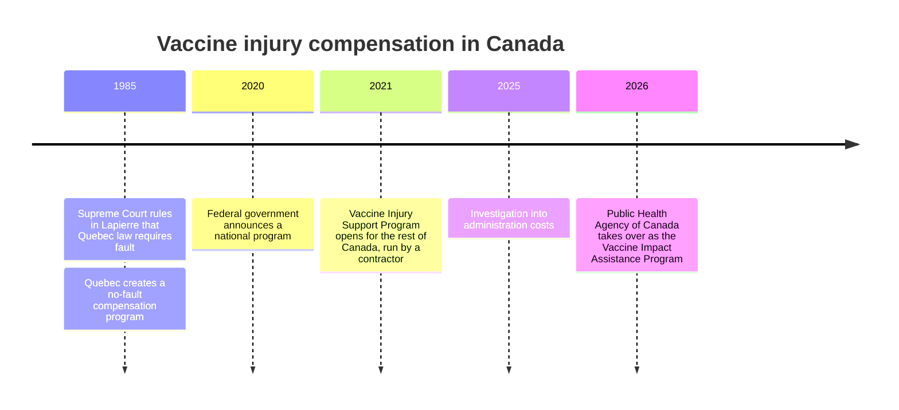

# Canada's compensation programs

**Prerequisites:** [The VICP](03-vaccine-injury-compensation-program.md)

## Quebec: the Lapierre case

In September 1972 Nathalie Lapierre, a five-year-old girl in Quebec, developed encephalitis after a measles vaccination given in a provincial campaign, and was left severely disabled. Her family sued the provincial government. In 1985 the Supreme Court of Canada accepted that the vaccine had caused her illness, but dismissed the claim because Quebec civil law required fault, and none had been shown ([*Lapierre v. Attorney General of Quebec*, [1985] 1 SCR 241](https://decisions.scc-csc.ca/scc-csc/scc-csc/en/40/1/document.do)). The case prompted Quebec to create a no-fault Vaccine Injury Compensation Program the same year ([Gouvernement du Québec, "Vaccine Injury Compensation Program"](https://www.quebec.ca/en/health/advice-and-prevention/vaccination/vaccine-injury-compensation-program)). For decades it was the only such program in Canada; it has compensated a small number of claims each year.

## The rest of Canada before 2021

Outside Quebec, people injured by vaccines had to sue in court and prove negligence, which was rarely possible. Canada was the only G7 country without a national no-fault program. Experts had recommended one for years.

## The Vaccine Injury Support Program

In December 2020, as COVID-19 vaccines arrived, the federal government announced a national no-fault program covering all Health Canada authorised vaccines given in Canada outside Quebec. The Vaccine Injury Support Program (VISP) opened in June 2021, administered by a contractor, Oxaro, under federal funding. Claims were reviewed by an independent medical review board, and support could include income replacement, care costs, death benefits and a lump sum for permanent injury.

From June 2021 to November 2025, VISP received 3,557 claims. The medical review board approved 252 claims and 11 appeals, and about $21.5 million was paid to claimants ([Public Health Agency of Canada, Vaccine Injury Support Program statistics (June 2021 to November 2025)](https://www.canada.ca/en/public-health/services/immunization-vaccines/vaccine-impact-assistance-program/statistics-data.html)).

## Controversy and reform

In 2025 a Global News investigation reported that most of the program's spending had gone to administration rather than to injured people, and described long delays for claimants. The government announced that the Public Health Agency of Canada would take over the program directly ([Global News, "PHAC to take over vaccine injury program after Global News investigation" (2025)](https://globalnews.ca/news/11407587/visp-program-phac-government/)). It relaunched as the Vaccine Impact Assistance Program on 1 April 2026, with existing claims transferred ([Public Health Agency of Canada, Vaccine Injury Support Program statistics (June 2021 to November 2025)](https://www.canada.ca/en/public-health/services/immunization-vaccines/vaccine-impact-assistance-program/statistics-data.html)).

## Lessons from the Canadian experience

The Canadian story shows that the design of a compensation program matters as much as its existence. Approval rates were low, partly because claims required medical records showing a probable causal link and a serious, permanent injury, and many claimants waited years. Critics from vaccine-injury groups described the program as inaccessible; public health experts who had campaigned for it argued that a trusted program was essential to support confidence in vaccination, and called for faster, more transparent decisions. The move to direct government administration was intended to address cost and delay; whether it does so remains to be seen.

## Comparing the systems

| Feature | US VICP | Canada (VISP, now VIAP) | Quebec |
|---|---|---|---|
| Since | 1988 | 2021 | 1985 |
| Decision | Court (special masters) | Medical review board | Ministry with medical committee |
| Funding | Vaccine excise tax | Federal budget | Provincial budget |
| COVID-19 vaccines | Not covered | Covered | Covered |

*Table: Simplified comparison of North American no-fault programs.*

Unlike the US, Canada did not tie compensation to liability protection for manufacturers, but Canadian advance-purchase contracts for COVID-19 vaccines included indemnities from the government, as in most countries.

## Key ideas

- The 1985 Lapierre case led Quebec to create Canada's first no-fault program.
- A national program for the rest of Canada began only in 2021.
- High administration costs led the federal government to take it in-house in 2026.

## Where this leads

- Next: [Litigation outside the VICP](08-litigation-outside-the-vicp.md).
