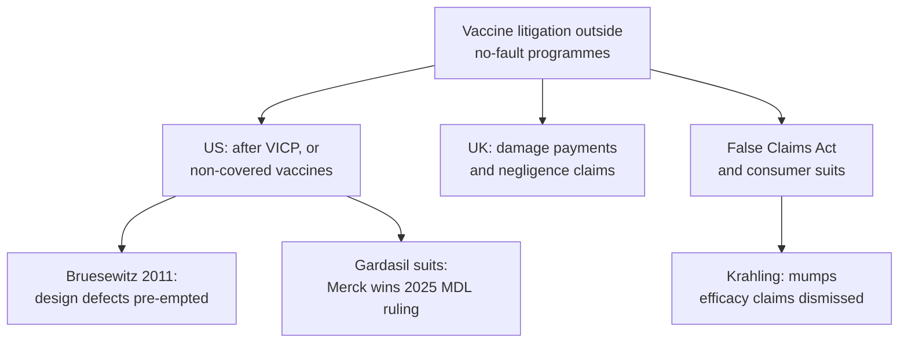

# Litigation outside the VICP

**Prerequisites:** [The 1986 Act](02-the-national-childhood-vaccine-injury-act-1986.md)

## Suing after the VICP

The 1986 Act does not ban lawsuits against manufacturers outright. A claimant must first go through the VICP, and may then reject the judgment and sue, but the Act blocks claims that a vaccine's design was defective, after *Bruesewitz v. Wyeth* (2011), and gives manufacturers a strong defence on warnings ([*Bruesewitz v. Wyeth LLC*, 562 U.S. 223 (2011)](https://supreme.justia.com/cases/federal/us/562/223/)). Remaining routes include claims of manufacturing defects (a particular batch was contaminated) or that the manufacturer failed to tell the FDA something it should have.

## The Gardasil litigation

The largest recent example concerns Merck's HPV vaccine Gardasil. Claimants, represented by firms including Wisner Baum, went through or opted out of the VICP and then sued, alleging that Gardasil caused postural orthostatic tachycardia syndrome (POTS), primary ovarian insufficiency and other conditions, and that Merck failed to warn. Federal cases were consolidated in a multidistrict litigation in North Carolina. In March 2025 the judge granted Merck summary judgment on failure-to-warn claims, ruling that they were pre-empted because there was insufficient evidence that the FDA would have approved the warnings the claimants sought ([*In re Gardasil Products Liability Litigation*, No. 3:22-md-03036 (W.D.N.C. 11 March 2025), order on summary judgment](https://www.govinfo.gov/content/pkg/USCOURTS-ncwd-3_22-md-03036/pdf/USCOURTS-ncwd-3_22-md-03036-25.pdf); [Reuters, "Merck prevails in US safety litigation over Gardasil HPV vaccine" (11 March 2025)](https://www.reuters.com/business/healthcare-pharmaceuticals/merck-prevails-gardasil-safety-litigation-2025-03-11/)). A state-court trial in Los Angeles was also interrupted in 2025. Health secretary Robert F. Kennedy Jr. had a contingency-fee interest in these cases that he pledged to transfer to his son ([New York Times, "RFK Jr. says he won't keep financial stake in HPV vaccine lawsuits" (30 January 2025)](https://www.nytimes.com/2025/01/30/health/rfk-jr-hpv-vaccine-lawsuits-fees.html)).

## False Claims Act and consumer claims

Other suits target what manufacturers told the government. In a long-running False Claims Act case, two former Merck virologists alleged that the company had misrepresented the efficacy of its mumps vaccine; in 2024 an appeals court upheld judgment for Merck ([*United States ex rel. Krahling v. Merck & Co.*, No. 23-2553 (3d Cir. 6 August 2024)](https://www2.ca3.uscourts.gov/opinarch/232553np.pdf)). In 2023–24 the attorneys general of Texas and Kansas sued Pfizer, alleging that it misrepresented its COVID-19 vaccine's efficacy and safety; the Texas suit was dismissed in December 2024 on PREP Act grounds and appealed, and the Kansas case was on appeal in 2026 ([*Texas v. Pfizer Inc.*, No. 5:23-cv-00312-C (N.D. Tex. 30 December 2024), order granting dismissal](https://www.courthousenews.com/wp-content/uploads/2026/09/texas-v-pfizer-order-granting-motion-to-dismiss.pdf); [*State of Kansas v. Pfizer*, No. 25-3085 (10th Cir.), docket](https://www.courtlistener.com/docket/70287684/state-of-kansas-v-pfizer/); [COVID-19 litigation](10-covid-19-litigation.md)).

## The United Kingdom

The UK's Vaccine Damage Payment Scheme, created in 1979 in response to the pertussis scare, pays a single tax-free lump sum of £120,000 to people assessed as at least 60% disabled by a vaccine ([GOV.UK, "Vaccine Damage Payment: eligibility"](https://www.gov.uk/vaccine-damage-payment/eligibility)). It is not compensation in the legal sense, and claimants can still sue. Since COVID-19 vaccination, claims have soared: by mid-2026, 24,260 claims had been made since November 2021, most about the AstraZeneca vaccine, but only 264 had succeeded; running costs were more than double the amount paid out ([BBC News, "Running costs of vaccine damage scheme more than double amount paid to victims" (11 September 2026)](https://www.bbc.co.uk/news/articles/cj06762qegmo)). The UK COVID-19 inquiry recommended reforming the scheme, including payments scaled to the degree of injury.

Separately, people injured by the AstraZeneca vaccine brought a group action under consumer-protection law. In court documents in 2024, AstraZeneca accepted that its vaccine "can, in very rare cases, cause TTS", while contesting individual claims ([Leigh Day, "AstraZeneca formally admits that its COVID-19 vaccine can cause rare side effect" (2024)](https://www.leighday.co.uk/news/press-releases/2024-news/astrazeneca-formally-admits-that-its-covid-19-vaccine-can-cause-rare-side-effect/)). Earlier, people who developed narcolepsy after Pandemrix received damages from the UK government, which had indemnified the manufacturer ([Pandemrix](../06-adverse-events/07-narcolepsy-and-pandemrix.md)).

## Other countries

Courts in some countries have been more willing to accept vaccine causation than scientific bodies. In 2017 the Court of Justice of the European Union ruled that national courts could find a vaccine caused a disease on the basis of "serious, specific and consistent" evidence even without scientific consensus, in a French case about hepatitis B vaccine and multiple sclerosis ([Court of Justice of the EU, *N. W and Others v Sanofi Pasteur MSD*, Case C-621/15 (21 June 2017)](https://curia.europa.eu/juris/liste.jsf?num=C-621/15)). Italian courts in 2012 awarded compensation for a child's autism after MMR, a decision overturned by the Bologna appeal court in 2015, which found no causal link ([Dorit Reiss, "Italian court overturns decision that compensates for autism", *Law and Vaccines* blog (2 March 2015)](https://sites.uclawsf.edu/lawandvaccines/2015/03/02/italian-court-overturns-decision-that-compensates-for-autism/)). Such rulings are cited by critics as evidence of harm and by scientists as examples of courts departing from the evidence ([causality assessment](../06-adverse-events/13-causality-assessment.md)).

## Key ideas

- In the US, suits are possible only after the VICP, and design-defect claims are pre-empted.
- Merck won a key 2025 ruling in the Gardasil litigation; state suits against Pfizer were mostly blocked by the PREP Act.
- The UK pays a flat £120,000 for severe disability; claims and costs have soared since COVID-19.

## Where this leads

- Next: [Mandate cases from Jacobson to COVID](09-mandate-cases-jacobson-to-covid.md).
