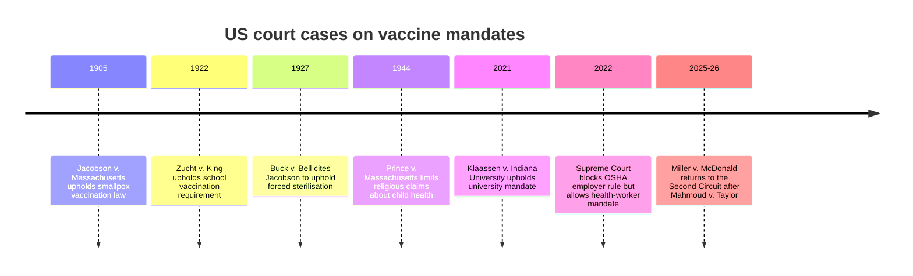

# Mandate cases from Jacobson to COVID

**Prerequisites:** [Compulsory vaccination and the anti-vaccination leagues](../04-history/03-compulsory-vaccination-and-the-anti-vaccination-leagues.md)

## Jacobson v. Massachusetts (1905)

During a smallpox outbreak in 1902, Cambridge, Massachusetts, ordered adults to be vaccinated under a state law. Henning Jacobson, a Lutheran pastor who said he and his son had suffered bad reactions to earlier vaccination, refused and was fined $5. The Supreme Court upheld the law 7–2. It held that states have a "police power" to protect public health and safety, and that individual liberty is subject to reasonable restraints for the common good. It also said that a law could be struck down if it was arbitrary or oppressive, and suggested that a person for whom vaccination would be cruel because of their health should not be forced ([*Jacobson v. Massachusetts*, 197 U.S. 11 (1905)](https://www.law.cornell.edu/supremecourt/text/197/11)). Jacobson was not forcibly vaccinated; the penalty was a fine.

## School requirements: Zucht v. King (1922)

In *Zucht v. King*, the Court upheld a San Antonio rule excluding unvaccinated children from school, saying that *Jacobson* had settled that a city could make vaccination a condition of school attendance ([*Zucht v. King*, 260 U.S. 174 (1922)](https://www.law.cornell.edu/supremecourt/text/260/174)). School-entry requirements became the main form of US vaccine mandate.

## A dark use of Jacobson: Buck v. Bell (1927)

In *Buck v. Bell*, the Court upheld Virginia's forced sterilisation of Carrie Buck, a young woman labelled "feeble-minded". Justice Oliver Wendell Holmes wrote that "the principle that sustains compulsory vaccination is broad enough to cover cutting the Fallopian tubes", citing *Jacobson* ([*Buck v. Bell*, 274 U.S. 200 (1927)](https://www.law.cornell.edu/supremecourt/text/274/200)). The case, never formally overruled, is now widely condemned, and critics of mandates cite it as a warning about how public-health reasoning can be abused. Defenders of *Jacobson* reply that the two cases are very different: one prevents contagion, the other was based on discredited eugenics.

## Religion and child health: Prince v. Massachusetts (1944)

Although about child labour, not vaccines, *Prince* is often quoted in vaccine cases: "The right to practice religion freely does not include liberty to expose the community or the child to communicable disease or the latter to ill health or death" ([*Prince v. Massachusetts*, 321 U.S. 158 (1944)](https://www.law.cornell.edu/supremecourt/text/321/158)). Lower courts have relied on it to hold that states need not offer religious exemptions to school vaccine requirements ([exemptions](../07-controversies/15-religious-and-philosophical-exemptions.md)).

## COVID-19 cases

The pandemic produced many challenges:

- **Universities.** In *Klaassen v. Indiana University* (2021), a federal appeals court upheld a university mandate that allowed exemptions, and Justice Amy Coney Barrett declined to block it.
- **Employers.** In January 2022, the Supreme Court blocked a rule from the Occupational Safety and Health Administration requiring large employers to mandate vaccination or testing, holding 6–3 that the agency lacked authority for such a broad public-health measure ([*National Federation of Independent Business v. OSHA*, 595 U.S. 109 (2022)](https://www.supremecourt.gov/opinions/21pdf/21a244_hgci.pdf)). The same day, it allowed by 5–4 a mandate for health-care workers in facilities funded by Medicare and Medicaid ([*Biden v. Missouri*, 595 U.S. 87 (2022)](https://www.supremecourt.gov/opinions/21pdf/21a240_d18e.pdf)). Neither case questioned states' power under *Jacobson*; both turned on federal agencies' authority.
- **Religious accommodation.** Thousands of employees sued after being fired for refusing vaccination. In *Groff v. DeJoy* (2023), not a vaccine case, the Supreme Court made it harder for employers to refuse religious accommodation, requiring them to show substantial costs ([*Groff v. DeJoy*, 600 U.S. 447 (2023)](https://www.supremecourt.gov/opinions/22pdf/22-174_k536.pdf)). Some juries have since awarded large damages to fired employees ([COVID-19 litigation](10-covid-19-litigation.md)).

## The current frontier

The Supreme Court's recent religious-freedom decisions have revived challenges to school requirements without religious exemptions. In *Miller v. McDonald*, Amish schools in New York challenged the state's 2019 repeal of religious exemptions. In December 2025 the Supreme Court vacated the appeals court's ruling for the state and sent it back for reconsideration in light of *Mahmoud v. Taylor*, a 2025 decision on parents' religious rights in schools ([Supreme Court order in *Miller v. McDonald*, No. 25-133 (8 December 2025), vacating and remanding in light of *Mahmoud v. Taylor*](https://www.supremecourt.gov/orders/courtorders/120825zor_i4ek.pdf)). The Second Circuit again upheld the law in 2026, and declined to rehear the case with all its judges in November 2026, over dissents arguing that strict scrutiny should apply ([*Miller v. McDonald*, No. 24-681 (2d Cir. 17 November 2026), order denying rehearing en banc](https://law.justia.com/cases/federal/appellate-courts/ca2/24-681/24-681-2026-11-17.html)). Further Supreme Court review is possible.

In Canada, courts have generally declined to strike down COVID-19 vaccine mandates under the Charter, often finding challenges moot once mandates ended.

## Key ideas

- *Jacobson* (1905) established states' power to require vaccination, with limits; *Zucht* extended it to schools.
- *Buck v. Bell* shows how the same reasoning was misused, a point raised by mandate critics.
- COVID-19 cases turned mostly on federal agency authority and religious accommodation, and religious-exemption challenges are now at the frontier.

## Where this leads

- Next: [COVID-19 litigation](10-covid-19-litigation.md).
