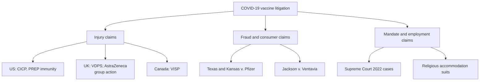

# COVID-19 litigation

**Prerequisites:** [The PREP Act and CICP](06-prep-act-and-cicp.md); [COVID-19 vaccines, mandates and mortality](../07-controversies/10-covid-19-vaccines-mandates-and-mortality.md)

## Injury claims

In the US, the PREP Act gives manufacturers and vaccinators near-total immunity, and injured people must go to the Countermeasures Injury Compensation Program, which had compensated 66 COVID-19 vaccine claims out of more than 11,000 by October 2026 ([Vaccine Data Navigator, "Vaccine injury compensation statistics (VICP and CICP)", compiled from HRSA reports (accessed November 2026)](https://vaccinedatanavigator.org/vaccine-injury-compensation-statistics.html); [CICP](06-prep-act-and-cicp.md)). In the UK, the Vaccine Damage Payment Scheme had paid 264 claims of more than 24,000 by mid-2026 ([BBC News, "Running costs of vaccine damage scheme more than double amount paid to victims" (11 September 2026)](https://www.bbc.co.uk/news/articles/cj06762qegmo)), and a group of claimants sued AstraZeneca under consumer-protection law; the company accepted in court that its vaccine can, very rarely, cause TTS ([Leigh Day, "AstraZeneca formally admits that its COVID-19 vaccine can cause rare side effect" (2024)](https://www.leighday.co.uk/news/press-releases/2024-news/astrazeneca-formally-admits-that-its-covid-19-vaccine-can-cause-rare-side-effect/)). In Canada, the national no-fault program approved a few hundred claims ([Canada's programs](07-canadas-compensation-programs.md)). In Germany and other European countries, some people have sued BioNTech and other manufacturers under product-liability law, with most early claims dismissed.

## Fraud and consumer-protection claims

- **Texas v. Pfizer.** In 2023 the Texas attorney general sued Pfizer, alleging that it misled the public by describing its vaccine as 95% effective, a relative risk reduction, and by claiming it would stop transmission. A federal court dismissed the case in December 2024, finding that Pfizer was immune under the PREP Act and that federal law pre-empted the claims; Texas appealed ([*Texas v. Pfizer Inc.*, No. 5:23-cv-00312-C (N.D. Tex. 30 December 2024), order granting dismissal](https://www.courthousenews.com/wp-content/uploads/2026/09/texas-v-pfizer-order-granting-motion-to-dismiss.pdf)).
- **Kansas v. Pfizer.** Kansas filed a similar suit in 2024, alleging concealment of risks such as myocarditis and pregnancy complications; it was before a federal appeals court in 2026 ([*State of Kansas v. Pfizer*, No. 25-3085 (10th Cir.), docket](https://www.courtlistener.com/docket/70287684/state-of-kansas-v-pfizer/)).
- **Jackson v. Ventavia.** Brook Jackson, the trial-site whistleblower featured in *The BMJ* ([Thacker, *BMJ* 2021](https://doi.org/10.1136/bmj.n2635)), sued Pfizer and Ventavia under the False Claims Act. The US government, which had the right to take over the case, instead sought its dismissal, and in November 2026 an appeals court upheld the dismissal ([*Jackson v. Ventavia Research Group*, No. 24-40564 (5th Cir. 2026)](https://www.ca5.uscourts.gov/opinions/pub/24/24-40564-CV0.pdf)).

Supporters of these suits argue that they are the only way to test companies' claims in court, given immunity from injury suits. Critics say they repackage disputed claims about vaccine efficacy and that efficacy figures were reported in the published trials and reviewed by regulators.

## Mandate and employment claims

The Supreme Court's January 2022 decisions blocked the federal employer rule but allowed the health-worker mandate ([mandate cases](09-mandate-cases-jacobson-to-covid.md)). Since then, thousands of employees fired for refusing vaccination have sued, mostly for religious discrimination. In 2024 a federal jury in Detroit awarded about $12.7 million, mostly punitive damages, to a former Blue Cross Blue Shield of Michigan employee whose religious exemption had been denied ([AP News, "Michigan jury awards millions to a woman fired after refusing to get a COVID-19 vaccine" (2024)](https://apnews.com/article/michigan-covid-19-vaccine-woman-fired-a9105ddef0302bb81ee9684bc1146dd7)). Courts have upheld other dismissals, particularly of front-line health workers, where employers showed real risks to patients. The US military, which discharged several thousand service members for refusing vaccination, ended its mandate in 2023 after Congress required it.

## What the litigation shows

COVID-19 litigation reflects the gap between the scale of vaccination and the narrowness of compensation in the US: with injury suits blocked, critics have turned to fraud, consumer and employment law. Supporters of PREP Act immunity argue that it allowed rapid development and supply. Many commentators, including both vaccine advocates and vaccine-injury groups, have called for the CICP to be reformed ([CICP](06-prep-act-and-cicp.md)).

## Key ideas

- PREP Act immunity has blocked most US injury and consumer suits against manufacturers.
- State and whistleblower fraud suits against Pfizer have so far failed or remain on appeal.
- Employment suits over mandates have produced some large awards after *Groff v. DeJoy*.

## Where this leads

- Next section: [Public health and ethics](../09-public-health-and-ethics/README.md).
