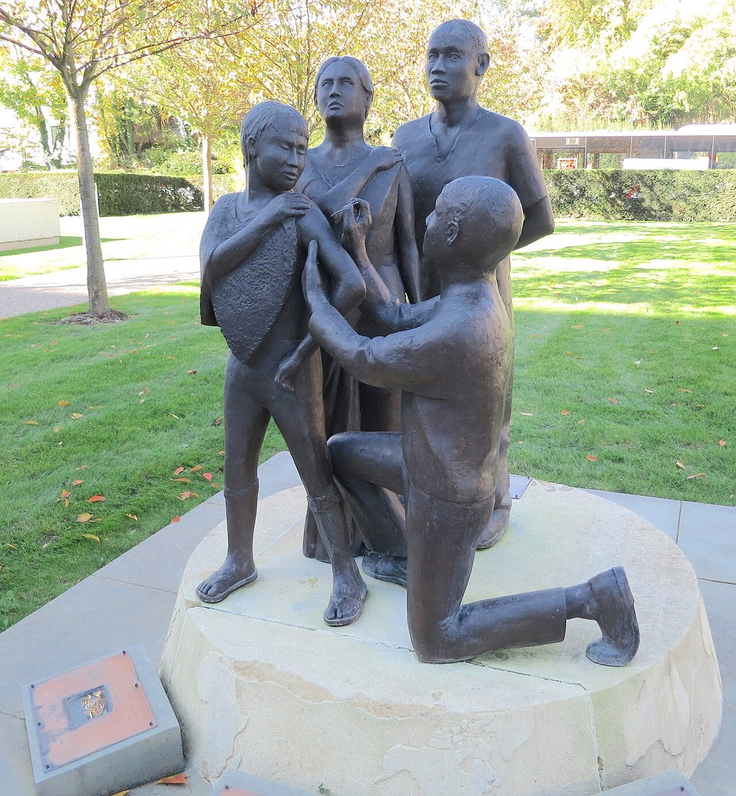

# Eradication and elimination

**Prerequisites:** [Herd immunity](../../../epidemiology/04-herd-immunity.md); [Smallpox eradication](../04-history/07-smallpox-eradication.md)

*Statue commemorating smallpox vaccination outside the World Health Organization headquarters in Geneva. Credit: Thorkild Tylleskar. License: [CC BY-SA 3.0](https://creativecommons.org/licenses/by-sa/3.0). Source: [File:Smallpox vaccination, statue outside the WHO HQ entrance, Geneva.JPG](https://commons.wikimedia.org/wiki/File:Smallpox_vaccination,_statue_outside_the_WHO_HQ_entrance,_Geneva.JPG).*

## Definitions

Public-health planners distinguish several levels of success against an infectious disease ([Dowdle, *Bulletin of the WHO* 1998, "The principles of disease elimination and eradication"](https://www.ncbi.nlm.nih.gov/pmc/articles/PMC2305684/)):

- **Control:** reducing cases and deaths to a locally acceptable level; continued measures are needed.
- **Elimination of disease:** reducing cases to zero in a defined area, for example neonatal tetanus, which cannot be eradicated because the bacterium lives in soil.
- **Elimination of transmission:** no continuous spread in a region for at least 12 months, though imported cases still occur. Measles and rubella elimination are measured this way.
- **Eradication:** permanent reduction of worldwide incidence to zero, so that control measures are no longer needed.
- **Extinction:** the pathogen no longer exists in nature or the laboratory. Smallpox is eradicated, but not extinct, since stocks remain in two laboratories.

## What makes a disease eradicable?

Only diseases with certain features can realistically be eradicated:

1. No animal or environmental reservoir; humans are the only host.
2. An effective intervention, such as a vaccine that gives lasting immunity.
3. Accurate diagnosis, so that cases and outbreaks can be found.
4. Infection that is apparent, rather than silent, so chains can be traced.
5. Political will and money sustained over decades.

Smallpox met these conditions. Polio is harder because most infections are silent, and vaccine-derived strains can circulate ([vaccine-derived polio](../06-adverse-events/10-vaccine-derived-polio.md)). Measles is technically eradicable but so contagious that coverage near 95% must be maintained everywhere.

## Successes

- **Smallpox** was certified eradicated in 1980, after a global campaign led by WHO from 1967 that used surveillance and ring vaccination ([WHO smallpox health topic](https://www.who.int/health-topics/smallpox); [smallpox eradication](../04-history/07-smallpox-eradication.md)).
- **Rinderpest**, a cattle disease, was declared eradicated in 2011, the second disease eliminated by humans and the first animal disease ([World Organisation for Animal Health, rinderpest disease page](https://www.woah.org/en/disease/rinderpest/)).
- **Wild polio types 2 and 3** were declared eradicated in 2015 and 2019 ([GPEI, "Two out of three wild poliovirus strains eradicated" (24 October 2019)](https://polioeradication.org/news-post/two-out-of-three-wild-poliovirus-strains-eradicated/)). Wild type 1 remains endemic only in Pakistan and Afghanistan ([polio eradication](../04-history/08-polio-eradication.md)).

## Elimination gained and lost

The Americas eliminated endemic measles transmission by 2016, the first WHO region to do so. Elimination proved fragile: the UK lost its status in 2019, three years after achieving it; Canada lost it in November 2025, after an outbreak beginning in October 2024; and the United States lost it in November 2026, after continuous transmission from January 2025 including the West Texas outbreak ([PAHO, "PAHO calls for regional action as the Americas lose measles elimination status" (10 November 2025)](https://www.paho.org/en/news/10-11-2025-paho-calls-regional-action-americas-lose-measles-elimination-status); [CDC joint statement, "Loss of U.S. Measles Elimination Status" (17 November 2026)](https://www.cdc.gov/media/releases/2026/loss-of-usmeasles-elimination-status.html)). See [outbreaks and coverage](02-outbreaks-and-coverage.md).

## Debates

**Is eradication worth its cost?** Supporters say eradication is the ultimate public-health bargain: once achieved, vaccination and treatment costs disappear forever, as with smallpox. Critics, including some public-health economists, argue that the last stages of polio eradication have cost billions of dollars that could have strengthened routine health systems, and that campaigns run by outsiders have fuelled distrust ([Kano](../07-controversies/17-trovan-kano-and-the-polio-boycott.md); [Pakistan](../07-controversies/18-cia-fake-vaccination-in-pakistan.md)). Others reply that eradication campaigns built surveillance and cold-chain systems that serve other programmes.

**Coercion.** Smallpox eradication sometimes involved forcible vaccination, for example during the final campaign in parts of South Asia, which some historians argue was effective but ethically troubling.

**The endgame for polio.** Once wild polio is gone, the oral vaccine must be withdrawn to stop vaccine-derived polio, requiring a coordinated switch to inactivated vaccine and continued surveillance for years.

## Key ideas

- Eradication requires a human-only pathogen, effective vaccine, good diagnosis and long-term commitment.
- Smallpox and rinderpest are eradicated; two of three wild polio types are gone.
- Measles elimination has been lost in the UK, Canada and the US, showing how fragile it is.

## Where this leads

- Next: [Outbreaks and coverage](02-outbreaks-and-coverage.md).
