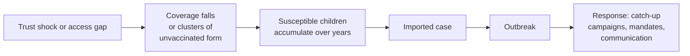

# Outbreaks and coverage

**Prerequisites:** [Herd immunity](../../../epidemiology/04-herd-immunity.md); [Measles](../03-diseases/measles.md)

## Why national averages mislead

Herd immunity depends on the proportion of immune people among those who actually mix. A country with 92% coverage nationally can have schools or communities where coverage is 60%, which is enough for measles to spread. Clusters form around shared beliefs (religious communities, alternative schools), shared barriers (remote areas, migrant communities), or both. Most large outbreaks in rich countries have started in such clusters ([Salmon et al., *Lancet* 2013](https://doi.org/10.1016/S0140-6736(12)62189-8); [exemptions](../07-controversies/15-religious-and-philosophical-exemptions.md)).

The threshold depends on the disease. With a basic reproduction number of 12–18, measles needs around 95% immunity to prevent spread; diseases with lower reproduction numbers need less ([herd immunity](../../../epidemiology/04-herd-immunity.md)).

## Case studies

**Samoa, 2019.** In July 2018 two infants died in Samoa after nurses mistakenly prepared MMR vaccine with an expired muscle relaxant instead of water. The government suspended vaccination, and fear spread. MMR coverage fell to about 31%. In 2019 a measles epidemic infected more than 5,700 people and killed 83, mostly young children ([BBC News, "How a wrong injection helped cause Samoa's measles epidemic" (2019)](https://www.bbc.com/news/world-asia-50625680)). Robert F. Kennedy Jr. visited Samoa in 2019, before the outbreak; Samoa's prime minister later criticised his vaccine views, while Kennedy denied any role in the outbreak ([*The Guardian*, "Samoa's prime minister criticises RFK Jr's vaccine views after deadly measles outbreak" (31 January 2025)](https://www.theguardian.com/world/2025/jan/31/samoas-prime-minister-criticises-rfk-jrs-vaccine-views-after-deadly-measles-outbreak)).

**Canada, 2024–26.** An outbreak that began in New Brunswick in October 2024 spread mainly in under-vaccinated communities in Ontario and Alberta. Canada recorded 5,462 cases in 2025 and two deaths, both of babies infected before birth, and lost measles elimination status in November 2025 ([Public Health Agency of Canada, Measles and Rubella Weekly Monitoring Report](https://health-infobase.canada.ca/measles-rubella/); [PAHO, "PAHO calls for regional action as the Americas lose measles elimination status" (10 November 2025)](https://www.paho.org/en/news/10-11-2025-paho-calls-regional-action-americas-lose-measles-elimination-status)).

**United States, 2025–26.** An outbreak in a Mennonite community in West Texas from January 2025 caused 762 cases and two child deaths before it was declared over in August 2025 ([Texas DSHS, "Texas announces end of West Texas measles outbreak" (18 August 2025)](https://www.dshs.texas.gov/news-alerts/texas-announces-end-west-texas-measles-outbreak)). Linked transmission continued, and the US lost elimination status in November 2026 ([CDC joint statement, "Loss of U.S. Measles Elimination Status" (17 November 2026)](https://www.cdc.gov/media/releases/2026/loss-of-usmeasles-elimination-status.html)). Exemptions among kindergarteners reached a record 3.6% in 2024–25 ([AP News, "US kindergarten vaccination rates drop as exemptions hit record high" (July 2025)](https://apnews.com/article/vaccination-rates-cdc-kindergarten-0d261546a130dc256735d7b1ff8c6a5f)).

**Philippines, 2019.** After the Dengvaxia controversy, routine vaccination fell, and a large measles outbreak followed ([Dengvaxia](../07-controversies/16-dengvaxia-in-the-philippines.md)).

## Access, not only hesitancy

Globally, the biggest gap in coverage is access, not refusal. In 2024, 85% of infants received three doses of DTP vaccine, but 14.3 million received none, mostly in fragile and conflict-affected countries ([WHO, "Global childhood vaccination coverage holds steady, yet over 14 million infants remain unvaccinated" (15 July 2025)](https://www.who.int/news/item/15-07-2025-global-childhood-vaccination-coverage-holds-steady-yet-over-14-million-infants-remain-unvaccinated-who-unicef); [global programmes](03-global-immunisation-programmes.md)). The COVID-19 pandemic disrupted routine vaccination in many countries, and coverage has not fully recovered.

## How outbreaks are controlled

- **Rapid case finding and isolation**, with exclusion of unvaccinated contacts from school.
- **Post-exposure vaccination** within 72 hours, or immune globulin for vulnerable contacts.
- **Catch-up campaigns** and early second doses in affected areas.
- **Community engagement** through trusted local leaders, which has worked better than lecturing ([trust and misinformation](../07-controversies/19-trust-and-misinformation.md)).

Outbreak responses can also be contentious. In 2019 New York City ordered vaccination in parts of Brooklyn and Rockland County briefly banned unvaccinated children from public places; courts upheld some measures and struck down others.

## Different readings of the same data

Public-health officials see outbreaks as the predictable result of falling coverage, and point out that most cases occur in unvaccinated people. Vaccine sceptics often emphasise cases among vaccinated people, the low death rate of measles in rich countries, and the risks of coercive responses. Both sides agree that local clusters matter more than national averages.

## Key ideas

- Outbreaks start in clusters of under-vaccinated people, even when national coverage is high.
- Samoa, Canada and the US show how trust shocks and exemptions translate into deaths and lost elimination.
- Globally, access remains the largest gap, with 14.3 million zero-dose children in 2024.

## Where this leads

- Next: [Global immunisation programmes](03-global-immunisation-programmes.md).
