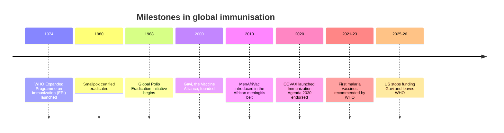

# Global immunisation programmes

**Prerequisites:** [Outbreaks and coverage](02-outbreaks-and-coverage.md)

## The Expanded Programme on Immunization

In 1974, building on the smallpox campaign, WHO launched the Expanded Programme on Immunization (EPI) to bring vaccines against six diseases (tuberculosis, diphtheria, tetanus, pertussis, polio and measles) to children everywhere. At the time, fewer than 5% of children in low-income countries were vaccinated. With UNICEF, the EPI built cold chains, trained health workers and set up national programmes. Hepatitis B, Hib, pneumococcal, rotavirus, HPV and other vaccines were added later. WHO publishes recommended schedules for all countries ([WHO, "WHO recommendations for routine immunization: summary tables"](https://www.who.int/teams/immunization-vaccines-and-biologicals/policies/who-recommendations-for-routine-immunization---summary-tables)).

## Gavi and the vaccine market

By the late 1990s, coverage had stalled and new vaccines were too expensive for poor countries. Gavi, the Vaccine Alliance, was founded in 2000 with a founding pledge from the Bill & Melinda Gates Foundation, bringing together WHO, UNICEF, the World Bank, donor governments and manufacturers. It pays for vaccines in low-income countries, which contribute a rising share as they grow richer, and uses its purchasing power to lower prices ([Gavi, the Vaccine Alliance, "About our alliance"](https://www.gavi.org/our-alliance/about)). Gavi reports that it has helped vaccinate more than a billion children.

Mechanisms such as advance market commitments, in which donors guarantee a market for a vaccine meeting set criteria, have been used to speed development of vaccines for poor countries, for example pneumococcal vaccines.

## Notable successes

- **MenAfriVac**, a meningitis A vaccine developed for Africa and priced at under a dollar a dose, was introduced in 2010. In nine countries, confirmed meningitis A fell by more than 99% in fully vaccinated populations ([Trotter et al., *Lancet Infect Dis* 2017](https://doi.org/10.1016/s1473-3099(17)30301-8)).
- **Malaria vaccines.** WHO recommended the first malaria vaccine, RTS,S, for children in 2021, and a second, R21, in 2023 ([WHO, "WHO recommends groundbreaking malaria vaccine for children at risk" (6 October 2021)](https://www.who.int/news/item/06-10-2021-who-recommends-groundbreaking-malaria-vaccine-for-children-at-risk); [WHO, "WHO recommends R21/Matrix-M vaccine for malaria prevention" (2 October 2023)](https://www.who.int/news/item/02-10-2023-who-recommends-r21-matrix-m-vaccine-for-malaria-prevention-in-updated-advice-on-immunization); [malaria](../03-diseases/malaria.md)).
- **Measles.** WHO estimates that measles vaccination averted nearly 59 million deaths between 2000 and 2024 ([measles](../03-diseases/measles.md)).

## Persistent gaps

In 2024, 85% of infants worldwide received three doses of DTP vaccine, but 14.3 million received none ([WHO, "Global childhood vaccination coverage holds steady, yet over 14 million infants remain unvaccinated" (15 July 2025)](https://www.who.int/news/item/15-07-2025-global-childhood-vaccination-coverage-holds-steady-yet-over-14-million-infants-remain-unvaccinated-who-unicef)). Immunization Agenda 2030, endorsed by WHO member states in 2020, aims to halve the number of such "zero-dose" children and to reach everyone, everywhere, by 2030 ([Immunization Agenda 2030 (WHO and partners)](https://www.immunizationagenda2030.org/)).

COVAX, launched in 2020 to share COVID-19 vaccines fairly, delivered close to two billion doses but was widely criticised as too slow, because rich countries bought most early supplies directly from manufacturers.

## Critiques

Global programmes attract criticism from several directions:

- **Vertical versus horizontal.** Disease-specific campaigns, such as polio eradication, can divert staff and money from basic health care. Supporters argue they also build infrastructure.
- **Donor influence.** The Gates Foundation's large role in setting priorities has been criticised by some public-health scholars as undemocratic, and it is a frequent target of conspiracy theories, which are not supported by evidence.
- **Pricing and intellectual property.** Advocates for access argue that manufacturers' patents and pricing limited supply during COVID-19; manufacturers argue that intellectual property funds innovation.
- **Trust.** Programmes delivered by outsiders can face resistance rooted in past abuses ([Kano](../07-controversies/17-trovan-kano-and-the-polio-boycott.md); [Pakistan](../07-controversies/18-cia-fake-vaccination-in-pakistan.md)).

## The funding shock of 2025–26

In June 2025 US health secretary Robert F. Kennedy Jr. announced that the United States, previously one of Gavi's largest donors, would stop funding it, citing vaccine-safety concerns ([Reuters, "US to stop financial support of global vaccine alliance Gavi, health secretary says" (25 June 2025)](https://www.reuters.com/business/healthcare-pharmaceuticals/us-stop-financial-support-global-vaccine-alliance-gavi-says-health-secretary-2025-06-25/)). In January 2026 the US completed its withdrawal from WHO ([AP News, "US completes withdrawal from World Health Organization" (January 2026)](https://apnews.com/article/world-health-organization-trump-b6e0be566c7db9aece0334e987d516f1)). Supporters of the moves said the organisations needed reform and accountability; global health agencies warned of reduced coverage and outbreaks. The long-term effects on immunisation programmes are not yet known.

## Key ideas

- The EPI (1974) and Gavi (2000) brought routine vaccines to most of the world's children.
- Successes include MenAfriVac and malaria vaccines; 14.3 million children still received no DTP in 2024.
- Global programmes face critiques over priorities, donor influence and pricing, and a major US funding withdrawal in 2025–26.

## Where this leads

- Next: [Mandates and ethics](04-mandates-and-ethics.md).
