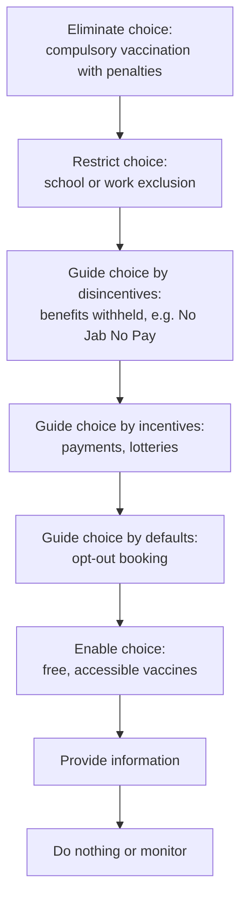

# Mandates and ethics

**Prerequisites:** [Mandate cases](../08-litigation-and-compensation/09-mandate-cases-jacobson-to-covid.md); [Exemptions](../07-controversies/15-religious-and-philosophical-exemptions.md)

*Figure: An intervention ladder, adapted from the Nuffield Council on Bioethics, with vaccine examples. Higher rungs need stronger justification ([Nuffield Council on Bioethics, *Public Health: Ethical Issues* (2007)](https://www.nuffieldbioethics.org/publication/public-health-ethical-issues/)).*

## The ethical question

Vaccines protect the vaccinated person and, through herd immunity, others. That creates a tension between individual liberty, including parents' rights to decide for their children, and the community's interest in preventing disease. Ethics asks not only whether vaccination is good, but what means of encouraging it are justified.

## Arguments for mandates

- **Harm principle.** John Stuart Mill argued that the only legitimate reason to restrict liberty is to prevent harm to others. Unvaccinated people can transmit disease to infants, immunocompromised people and others who cannot be protected.
- **Fairness and free-riding.** People who rely on others' immunity while avoiding small risks themselves benefit unfairly from a collective good.
- **Children's interests.** Children cannot consent, and their right to be protected from serious disease may override parents' beliefs ([*Prince v. Massachusetts*, 321 U.S. 158 (1944)](https://www.law.cornell.edu/supremecourt/text/321/158)).
- **Effectiveness.** Mandates with limited exemptions are associated with higher coverage and fewer outbreaks ([Salmon et al., *Lancet* 2013](https://doi.org/10.1016/S0140-6736(12)62189-8)).

## Arguments against mandates

- **Bodily autonomy and consent.** Medical interventions normally require free and informed consent; coercion undermines it.
- **Rare but real harms.** Because vaccines can occasionally cause serious injury ([weighing risks](../06-adverse-events/14-weighing-risks-against-benefits.md)), requiring people to accept that risk demands strong justification and fair compensation ([litigation and compensation](../08-litigation-and-compensation/README.md)).
- **Trust and backlash.** Coercion can harden opposition and damage trust; countries like the UK, Denmark and Sweden achieve high coverage without mandates.
- **Proportionality.** For diseases that mainly harm the person infected, such as tetanus, or for vaccines that do not stop transmission, the harm-to-others argument is weaker. This was central to debates about COVID-19 mandates once vaccines proved less effective against infection ([COVID-19 mandates](../07-controversies/10-covid-19-vaccines-mandates-and-mortality.md)).

## Principles for deciding

Public-health ethicists commonly propose tests that a mandate should pass:

1. **Necessity:** there is a serious threat and voluntary measures have proved insufficient.
2. **Effectiveness:** the vaccine prevents transmission, not only disease.
3. **Proportionality:** the burdens are reasonable relative to the benefits.
4. **Least restrictive means:** lower rungs of the ladder have been tried.
5. **Reciprocity:** those who bear risks are supported, for example with no-fault compensation and free access.
6. **Transparency and fairness:** decisions are made openly, and exemptions are applied consistently.

Different ethicists weigh these differently, and the same framework can support opposite conclusions depending on how the evidence on transmission and harm is read. Some, such as the philosopher Mark Navin, argue that refusing parents should face costs but not be forced; others argue that non-medical exemptions should be abolished outright for highly contagious childhood diseases.

## Comparative practice

Countries vary widely. The US relies on school-entry requirements set by states; Australia withholds family benefits; France and Italy require vaccination for school or day care; the UK and Nordic countries have no mandates. Coverage is high in some countries with each approach, suggesting that trust and access matter at least as much as compulsion ([comparing schedules](../05-schedules/06-comparing-schedules.md)).

## Key ideas

- Mandates pit individual liberty against protection of others, especially children and the vulnerable.
- Justification is strongest for highly contagious diseases with vaccines that stop transmission, and weaker when vaccines mainly protect the individual.
- Ethical frameworks stress necessity, proportionality, least restrictive means and reciprocity, including compensation.

## Where this leads

- Next: [People in vaccine history](../10-people/README.md).
- Terms used throughout the course are defined in the [medicine glossary](../../../glossary/README.md).
