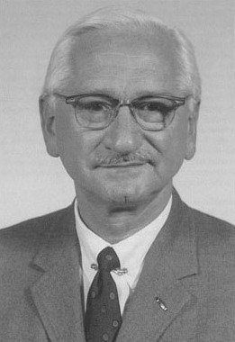

# Albert Sabin (1906–1993)

**Prerequisites:** none; see the linked history lessons for context.

*Albert Sabin, developer of the oral polio vaccine. Credit: Original uploader was Bobak at the English Wikipedia. License: Public domain. Source: [File:Albert Sabin.jpg](https://commons.wikimedia.org/wiki/File:Albert_Sabin.jpg).*

## Who he was

Albert Sabin was a Polish-born American virologist at the University of Cincinnati who developed the oral polio vaccine (OPV). He had earlier shown that poliovirus multiplies in the gut, not only the nervous system, which suggested that an oral vaccine could block transmission.

## The oral polio vaccine

Sabin selected weakened strains of all three poliovirus types that multiplied in the gut without causing paralysis. Because Salk's inactivated vaccine already dominated in the US, Sabin tested his vaccine abroad. With Soviet scientists including Mikhail Chumakov, mass trials in the Soviet Union in 1959 and 1960 vaccinated millions of children, at the height of the Cold War. The vaccine was licensed in the US in 1961–62, and "Sabin Sundays" vaccinated millions of Americans on sugar cubes ([Salk, Sabin and the Cutter incident](../04-history/06-salk-sabin-and-the-cutter-incident.md)).

OPV had important advantages: it was cheap, given by mouth, induced gut immunity that stopped transmission, and spread to contacts, immunising them indirectly. It became the main tool of the Global Polio Eradication Initiative.

## The downside

Because OPV contains live virus, it can very rarely revert and cause paralysis, about once per 2.7 million doses, known as vaccine-associated paralytic polio ([GPEI, "Oral polio vaccine (OPV)"](https://polioeradication.org/about-polio/the-vaccines/opv/)). In under-vaccinated communities, vaccine strains can circulate and regain the ability to cause outbreaks of vaccine-derived polio, which now cause more paralysis than wild virus ([vaccine-derived polio](../06-adverse-events/10-vaccine-derived-polio.md)). For these reasons the US switched to inactivated vaccine only in 2000, and the eradication programme is phasing out OPV and introduced a more stable novel OPV2.

## Rivalry and character

Sabin and Salk were bitter rivals. Sabin argued that killed vaccines would not give lasting immunity or stop transmission; Salk argued that live vaccines carried unnecessary risk. Both had a point: the modern strategy uses both. Like Salk, Sabin did not patent his vaccine.

## Later work

In later life Sabin promoted mass vaccination days, in which an entire country's children receive oral vaccine within a short period, an approach Brazil adopted in 1980 and that became a pillar of polio eradication in Latin America and elsewhere. The Americas recorded their last case of wild polio in 1991. Sabin also argued for vaccination as a public good that should be cheap and universally available, a view reflected in the low price of OPV for decades.

## Key ideas

- Sabin's oral polio vaccine was tested in mass Soviet trials and licensed in the US in 1961–62.
- OPV is cheap and blocks transmission, but can rarely cause paralysis and vaccine-derived outbreaks.
- The polio endgame depends on replacing OPV with inactivated vaccine.

## Where this leads

- [Maurice Hilleman](maurice-hilleman.md), the most prolific vaccine developer of the 20th century.
